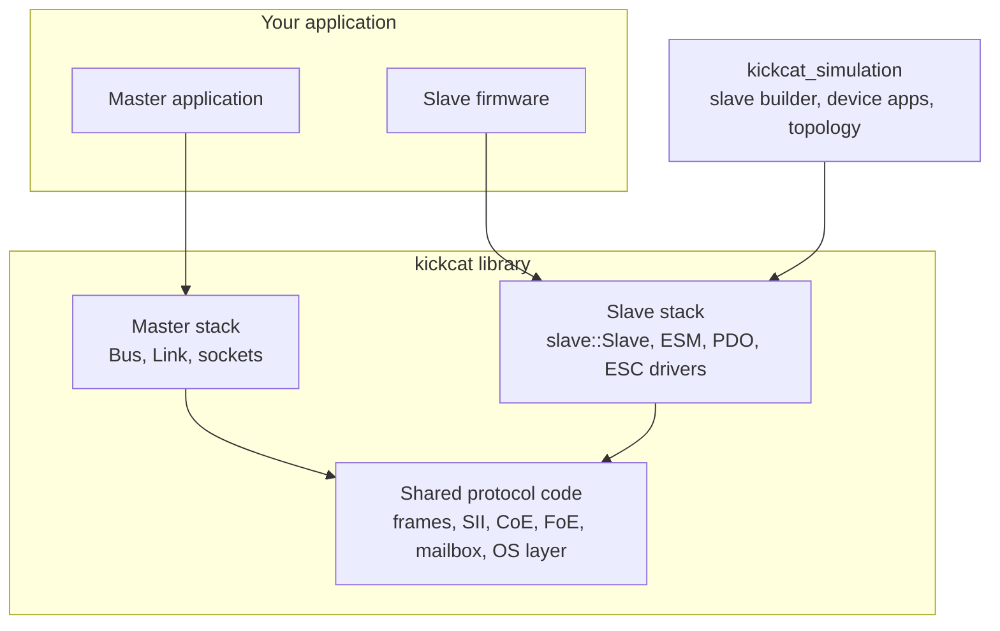

# A map of the code

> Where does each part of KickCAT live, and how do the parts fit together?
>
> You will learn:
>
> - how one library holds the master, the slave and the code they share
> - why there are two classes named `Slave`, and which one you want
> - where each directory of the repository fits
> - how one short example uses the whole stack, from top to bottom

## One library, two stacks

KickCAT is a **master** stack and a **slave** stack in one codebase. Both speak
the same protocol, so most of the protocol code is written once and shared:
frame and datagram definitions, the EEPROM (SII) parser, the CoE object
dictionary, the mailbox messages and the OS layer.

The build produces one library, `kickcat`. It always contains the shared code
and the slave stack. It also contains the master stack, except in a KickOS
build, which only needs the slave. A host build adds a second library,
`kickcat_simulation`. It holds what the simulator needs on top of the slave
stack: building a slave from a JSON file, device behaviours such as a motor, and
topology files.



The master application uses the master stack and the slave firmware uses the
slave stack. Both rest on the same shared protocol code. The simulation library
builds on the slave stack.

## Two classes named Slave

The name `Slave` appears twice, and the two classes have nothing in common
except the protocol.

| Class | Side | What it is |
|---|---|---|
| `kickcat::Slave` | Master | The master's record of one remote slave: its addresses, the content of its EEPROM, its mailbox queue, and where its inputs and outputs sit in the process image. It is a plain structure owned by the `Bus`. |
| `kickcat::slave::Slave` | Slave | The slave stack itself, running on the device: it drives the EtherCAT state machine, the process data and the mailbox of one EtherCAT Slave Controller (ESC). |

When you write a master application, you read `kickcat::Slave` entries from
`bus.slaves()`. When you write slave firmware, you create one
`kickcat::slave::Slave` and call its `routine()` in your main loop.

## Namespaces

| Namespace | Content |
|---|---|
| `kickcat` | The master stack (`Bus`, `Link`, `Slave`), sockets, frames, the OS layer, and the slave hardware abstractions (`AbstractESC`, `PDO`) |
| `kickcat::slave`, `kickcat::ESM` | The slave stack and its state machine |
| `kickcat::mailbox::request` | Mailbox messages as the master sends them |
| `kickcat::mailbox::response` | Mailbox messages as a slave answers them |
| `kickcat::CoE`, `kickcat::FoE` | CANopen over EtherCAT and File over EtherCAT: protocol definitions, the object dictionary, file storage |
| `kickcat::CoE::CiA::DS402` | The CiA 402 drive profile, with a ready-made `Drive` helper on the master |
| `kickcat::ESI`, `kickcat::ENI` | Parsers for the device description (ESI) and network description (ENI) XML files |
| `kickcat::sim` | The simulation library |

## The repository

| Directory | Content |
|---|---|
| `lib/include/kickcat/` | Public headers of the shared code |
| `lib/src/` | Shared code: frames, SII parser, CoE, FoE, ESI and ENI parsers, OS backends |
| `lib/master/` | Master stack, with its own `include/` |
| `lib/slave/` | Slave stack, ESC drivers and SPI drivers, with their own `include/` |
| `lib/simulation/` | The `kickcat_simulation` library |
| `lib/py_bindings/`, `py_bindings/` | Python bindings of the master |
| `examples/master/` | Master applications, one per device or use case |
| `examples/slave/` | Slave firmware, sorted by ESC, board and OS |
| `simulation/` | The `network_simulator` program and ready-made slave configurations |
| `tools/` | Command-line tools and the GUIs (KickUI, EEPROM editor) |
| `unit/` | Unit tests (GoogleTest) and their mocks |
| `test/integration/` | Integration benches: booting a whole ESI catalog, hardware tests |
| `scripts/`, `conan/`, `cmake/` | Build wrappers, dependency profiles, CMake helpers |

Every header that the package installs is public API, including its protected
members.

## One example, top to bottom

The `simulated_bus` example puts a real master and a real slave in one process.
It is about one hundred lines long, and it touches every layer. The later
chapters use it as their running example, with the device description of the
Freedom K64F board: three output bytes that drive an RGB LED, and twelve input
bytes from an accelerometer and a magnetometer.

Run it from the repository root once the build is done:

```bash
./build/examples/master/simulated_bus/simulated_bus \
    -f examples/slave/lan9252/freedom-k64f/nuttx/freedom-k64f.xml -t Board
```

The program has five steps.

1. **Read the device description.** The ESI parser loads the `Board` device from
   the XML file. It produces the content of the slave's EEPROM and its CoE object
   dictionary. [Chapter 9](guide/from-xml-to-bytes.md) follows this step.
2. **Build the slave.** An `EmulatedESC` plays the role of the slave controller
   chip and receives the EEPROM image. A `PDO` object and a `slave::Slave` sit on
   top of it, exactly as they would in firmware. A mailbox serves CoE from the
   object dictionary. The application gives the input and output buffers.
   [Chapter 6](guide/slave.md) explains these classes.
3. **Wire the master to the slave.** A `LoopbackSocket` replaces the network
   card. Each frame the master writes goes through the emulated slave, and the
   slave runs one `routine()` per frame. A `Link` wraps the socket, and a `Bus`
   wraps the link. [Chapter 4](guide/transport.md) covers the link and the
   sockets, and [Chapter 8](guide/simulation.md) the emulator.
4. **Bring the bus to OP.** `bus.init()` finds the slave and brings it to
   PRE-OP. `bus.createMapping()` lays out the process image. The application then
   asks for SAFE-OP, writes its first outputs, and asks for OP while it keeps the
   process data moving. [Chapter 3](guide/master.md) walks this sequence.
5. **Exchange process data.** Each cycle reads the inputs and writes the
   outputs.

```mermaid
sequenceDiagram
    participant App as Application
    participant Bus
    participant Link
    participant Sock as LoopbackSocket
    participant ESC as EmulatedESC
    participant Sl as slave::Slave
    App->>Bus: init(), createMapping(iomap)
    App->>Bus: requestState(SAFE_OP), waitForState(SAFE_OP)
    loop each cycle
        App->>Bus: processDataRead(), processDataWrite()
        Bus->>Link: datagrams
        Link->>Sock: write(frame)
        Sock->>ESC: process each datagram
        Sock->>Sl: routine()
        Sock-->>Link: read(frame)
        Link-->>Bus: callbacks
    end
    App->>Bus: requestState(OPERATIONAL), waitForState(OPERATIONAL, cyclic)
```

The application only talks to the `Bus`. The frame goes down through the link
and the socket, through the emulated controller, and back up as callbacks.

On real hardware, two things change. The socket is a raw Ethernet socket on a
network card, and the slave side runs on its own board, with a `Lan9252` or
`XMC4800` driver in place of the `EmulatedESC`. The master code and the slave
code stay the same.

## Where to go next

- The principles behind this layout: [Chapter 1](guide/principles.md).
- The master, from discovery to OP: [Chapter 3](guide/master.md).
- The slave stack: [Chapter 6](guide/slave.md).
- The list of all chapters: [the guide's index](guide/README.md).
