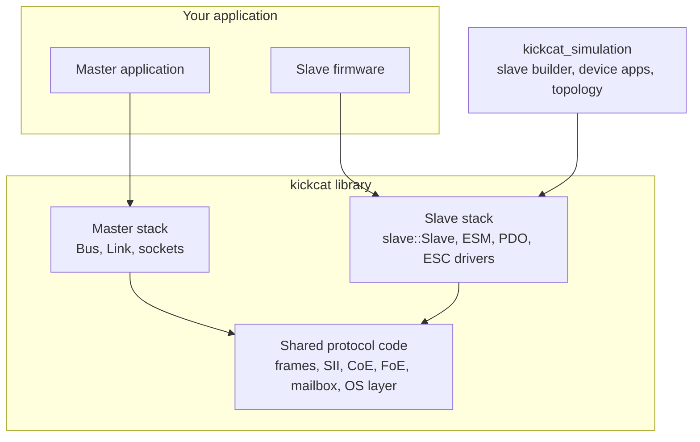

# A map of the code

> Where are the master and slave implementations of EtherCAT?
>
> You will learn:
>
> - which parts of the library the master and slave share
> - how the two classes named `Slave` differ
> - where to find each part of the stack
> - how to run the example and follow its main calls

## One library, two stacks

The master and slave are part of one codebase. They share frame and datagram
definitions, mailbox messages for protocols such as FoE, and
the OS layer. They also share
the CoE object dictionary and the parser for the SII data in EEPROM.

The slave stack includes the ESM, PDO handling, and ESC drivers. The `kickcat` library
contains shared code and the slave stack. It also includes the master stack on all
targets except KickOS. Host builds also produce `kickcat_simulation`, which creates
slaves from JSON files, models devices such as motors, and reads network topology
files.

## Two classes named Slave

The two `Slave` classes have different roles.

| Class | Side | What it is |
|---|---|---|
| `kickcat::Slave` | Master | A structure owned by the `Bus`. It holds one remote slave's addresses, EEPROM contents, mailbox queue, and process image offsets. |
| `kickcat::slave::Slave` | Slave | Runs on the device. It manages the ESM, process data, and mailbox for one ESC. |

When you write a master application, you read `kickcat::Slave` entries from
`bus.slaves()`. When you write slave firmware, you create one
`kickcat::slave::Slave` and call its `routine()` in your main loop.

## Namespaces

| Namespace | Content |
|---|---|
| `kickcat` | The master stack (`Bus`, `Link`, `Slave`), sockets, frames, the OS layer, and the slave hardware abstractions (`AbstractESC`, `PDO`) |
| `kickcat::slave`, `kickcat::ESM` | The slave stack and its state machine |
| `kickcat::mailbox::request` | Mailbox requests sent by the master |
| `kickcat::mailbox::response` | Mailbox responses sent by a slave |
| `kickcat::CoE`, `kickcat::FoE` | CoE and FoE protocol definitions, the object dictionary, and file storage |
| `kickcat::CoE::CiA::DS402` | The CiA 402 drive profile, with a `Drive` helper on the master |
| `kickcat::ESI`, `kickcat::ENI` | Parsers for ESI and ENI files in XML |
| `kickcat::sim` | The simulation library |

## The repository

| Directory | Content |
|---|---|
| `lib/include/kickcat/` | Public headers of the shared code |
| `lib/src/` | Shared code: frames, SII parser, CoE, FoE, ESI and ENI parsers, OS backends |
| `lib/master/` | Master stack, with its own `include/` |
| `lib/slave/` | Slave stack, ESC drivers and SPI drivers, with their own `include/` |
| `lib/simulation/` | The `kickcat_simulation` library |
| `lib/py_bindings/`, `py_bindings/` | Python bindings of the master |
| `examples/master/` | Master applications, one per device or use case |
| `examples/slave/` | Slave firmware, sorted by ESC, board and OS |
| `simulation/` | The `network_simulator` program and ready-made slave configurations |
| `tools/` | Command-line tools and graphical tools (KickUI, EEPROM editor) |
| `unit/` | Unit tests (GoogleTest) and their mocks |
| `test/integration/` | Integration tests for ESI catalog startup and hardware |
| `scripts/`, `conan/`, `cmake/` | Build wrappers, dependency profiles, CMake helpers |

All installed headers are part of the public API. This includes protected members.

## One example, top to bottom

[Your first bus](../../get-started/first-bus.md) follows the `simulated_bus` example through
both stacks: the ESI parser, emulated slave, loopback transport, and master.

## Where to go next

- The principles behind this layout: [Overview and principles](principles.md).
- The master, from discovery to OP: [The master](master.md).
- The slave stack: [The slave stack](slave.md).
- The list of all chapters: [the guide's index](../index.md).
