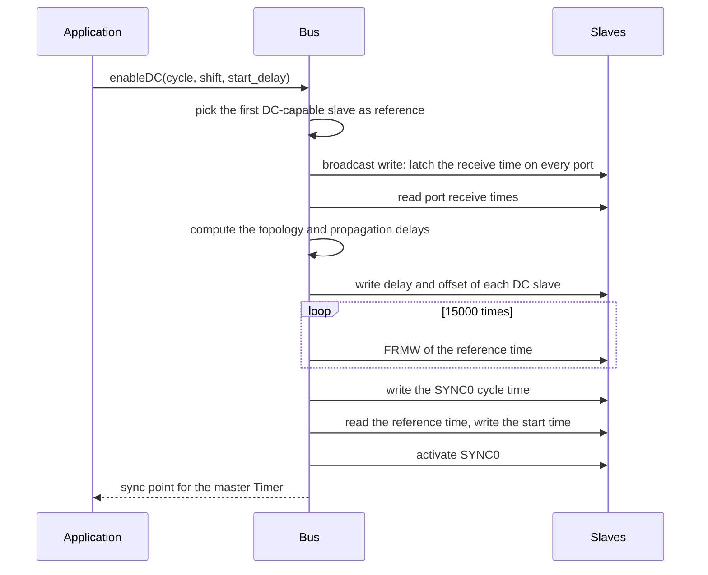
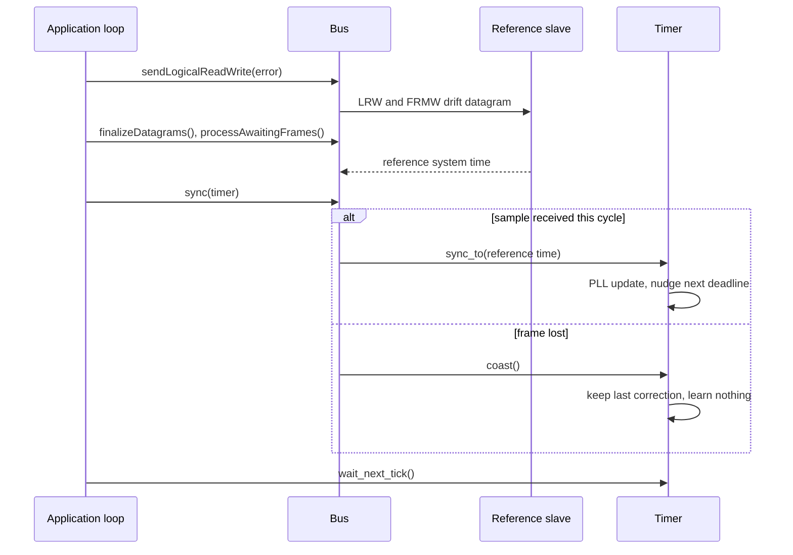

# Distributed clocks

> How does KickCAT synchronize the slaves and master cycle in EtherCAT?
>
> You will learn:
>
> - how `Bus::enableDC()` configures DC
> - how an FRMW datagram distributes time
> - why the master adjusts its own cycle
> - how a software PLL adjusts the master's timing
> - how to check synchronization

Master DC support is experimental. The maintainers have tested it in the emulator
and on hardware. It still needs longer tests on physical buses. See the [feature
matrix](../../user-guide/features.md).

## The problem: two kinds of clock error

Each DC slave has a local clock (see [Topology, redundancy and clocks](../ethercat/topology-and-clocks.md)). One
supplies the **reference clock** and the others follow it. Synchronized slaves can
generate a SYNC0 signal at the same time to sample inputs and apply outputs.

Synchronization must account for the following differences.

- **Offset and delay.** Each clock starts at its own time. A frame also takes time
  to reach each slave. At startup, the master measures the clock offsets and
  propagation delays.
- **Drift.** Each clock uses its own quartz crystal. Small differences in frequency
  cause drift of a few parts per million (ppm). This needs correction throughout
  operation.

The host clock that schedules the master cycle also drifts. If its rate differs from
the SYNC0 rate, frames arrive at a different point in each cycle. A frame may
eventually arrive while a slave is sampling its data.

## Setting up the clocks: enableDC

`Bus::enableDC(cycle_time, shift, start_delay)` configures DC for the bus. The
application calls it after `init()` and before requesting SAFE-OP.

**1. Select the reference.** The bus uses the first slave in bus order whose
ESC supports DC. If none supports DC, `enableDC()`
throws.

**2. Measure port times.** The master reads its clock and broadcasts a write to the
receive time register. Each slave records the frame's arrival time at each port. The
master reads the four port times from each slave.

**3. Calculate delays and offsets.** The master uses the port status to find each
slave's parent and entry port. For each DC slave, it finds the DC parent and
calculates the delay from the reference. The calculation uses half the difference
between the parent's round-trip time and the round-trip time in the child's branch.
It accounts for branches and slaves without DC. The master writes the delay and
clock offset to each slave. The offset aligns the local clock with the master's
time, measured from January 1, 2000.

**4. Compensate for drift at startup.** The master configures the slave clock
filters and sends 15,000 drift compensation frames. Each distributes the reference
time so the slave control loops can adjust to the reference frequency before cyclic
operation.

**5. Start SYNC0.** The master writes the cycle time and reads the reference time.
It sets the start time to the next cycle boundary plus `shift` and `start_delay`.
`shift` sets the pulse time within the cycle. `start_delay` gives the frame time to
reach all slaves. The master then enables SYNC0.

**6. Return the synchronization time.** `enableDC()` returns the start of the DC
cycle in the master's monotonic clock time. The application passes it to
`Timer::start()` to align the master cycle with SYNC0.

## Keeping the slaves together: the drift datagram

With DC enabled, `sendLogicalWrite()` and `sendLogicalReadWrite()` add an FRMW
datagram for the reference system time. The
reference writes its current time into the datagram. Every following slave receives
that time and adjusts its local clock. This exchange synchronizes the slaves
independently of the master's clock.

The master fills the datagram with its own time before sending it. If a break in the
ring prevents a slave from receiving the reference time, it receives the master's
time instead of zero.

## Keeping the master in step

The reply contains one reference time sample per cycle. A master can synchronize in
either of two ways.

- **Adjust the reference clock.** The master writes its time to the reference. A
  busy host can introduce tens of microseconds of jitter when it wakes and reads its
  clock in software. This jitter can affect all slaves and cause a SYNC0 control
  loop to lose synchronization.
- **Adjust the master cycle.** The reference clock keeps its own frequency. The
  master adjusts its wake-up time to maintain the same phase in each DC cycle.

KickCAT adjusts the master cycle. Host timing jitter therefore affects only the master.

The master uses a `Timer` for its cycle. Each `Timer` has a software PLL
(`SoftPll`). Once per cycle, the application calls `Bus::sync(timer)`. If the
drift datagram came back, `sync()` passes its reference time to the timer. The PLL
compares the master's wake-up phase with the target phase and adjusts the next
deadline. The configured timer period stays the same. The cycle below uses an LRW
datagram for process data.

The PLL uses a filtered proportional-integral controller. The proportional term
corrects phase error. The integral term estimates the frequency difference between
the host and reference clocks in ppm.

- **Missing sample.** `sync()` uses each sample once. If the next frame is lost, the
  timer repeats its previous correction without updating the estimate.
- **Late cycle.** The PLL ignores the sample if the cycle missed its deadline.
- **Correction limit.** The next deadline can move by at most a few tens of
  microseconds per cycle.
- **Lock status.** `Timer::locked()` returns true after the filtered error stays
  small for several cycles. The application can wait for lock before enabling
  drives.

The gains and limits are in `SoftPll::Config`. The defaults are the values
validated on hardware.

## Putting it together

Use the following call order.

1. `init()`, then `enableDC()`, which returns a sync point.
2. Map the process data and bring the bus to SAFE-OP, then OP, as in
   [The master](master.md).
3. Create a `Timer` with the DC cycle time and start it at the sync point.
4. In each cycle: exchange process data, call `bus.sync(timer)`, then
   `timer.wait_next_tick()`.

`Bus::isDCSynchronized(threshold)` reads the system time difference register of each
DC slave except the reference. The register holds the error between the slave clock
and the time it receives. The call returns true when all errors are below the
threshold. It returns false if an error exceeds it or a slave fails to reply. The
check sends a separate frame. Use it during startup or monitoring.

## Summary

| Question | Answer |
|---|---|
| Which slave is the reference? | The first slave in bus order with DC. |
| When is `enableDC()` called? | After `init()`, before SAFE-OP. |
| How do the slaves follow the reference? | An FRMW datagram added to each cyclic write. |
| Does the master write its time into the reference? | No. The reference runs free. |
| How does the master stay in step? | `Bus::sync()` feeds the reference time to the `Timer`'s soft PLL. |
| What happens when a drift frame is lost? | The timer repeats its last correction. |
| How do I know the bus is synchronized? | `isDCSynchronized()` for the slaves, `Timer::locked()` for the master. |

## In the code

- `lib/master/src/dc.cc`: `enableDC()`, the delay computation, the drift
  datagram, `sync()` and `isDCSynchronized()`.
- `lib/master/include/kickcat/Bus.h`: the DC calls of the bus.
- `lib/include/kickcat/OS/Timer.h`: the cyclic timer and its `sync_to()` and
  `coast()`.
- `lib/include/kickcat/OS/SoftPll.h`: the soft PLL and its settings.
- Read `examples/master/marvin/marvin.cc` for a bus with DC, a timer started
  at the sync point, and the PLL state printed while it runs. The emulator also
  models DC clocks with drift, so `simulated_bus --dc` runs the setup without
  hardware.

## Where to go next

- How DC works on the protocol side: [Topology, redundancy and clocks](../ethercat/topology-and-clocks.md).
- The cyclic loop around `sync()`: [The master](master.md).
- How the emulator models a drifting clock: [Simulation internals](emulation.md).
- How to tune Linux for a stable cycle: [the performance guide](../../user-guide/realtime.md).
