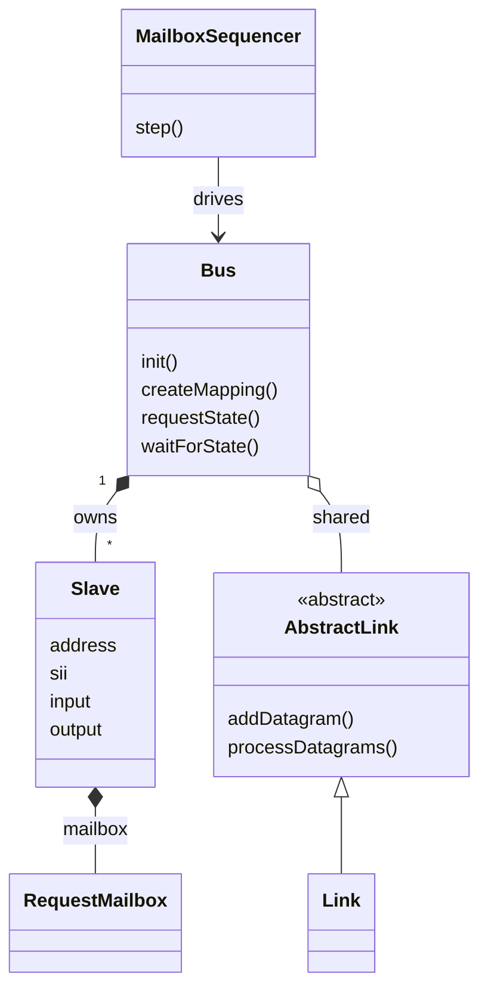
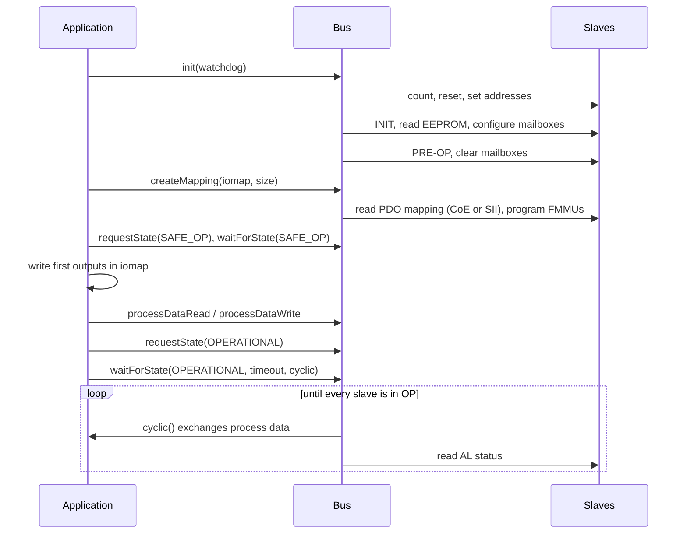
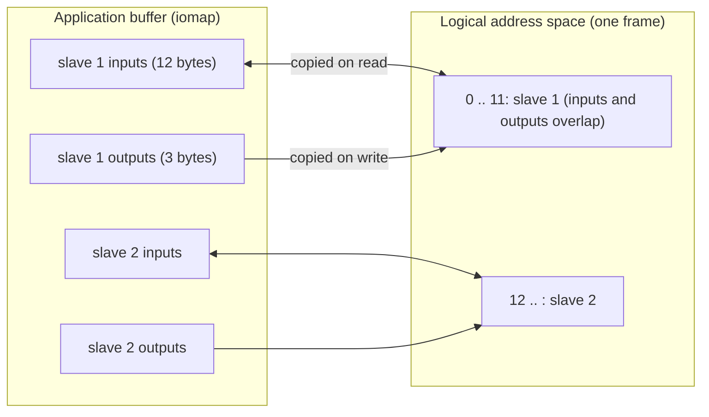

# The master: from discovery to OP

> How does the KickCAT master start and run a bus using EtherCAT?
>
> You will learn:
>
> - which objects the application and bus own
> - which calls bring a slave to OP
> - how the process image and frame layouts differ
> - how to exchange process data and mailbox messages in the cyclic loop
> - how the application receives errors

## The problem: one program drives a whole bus

Every millisecond, the example master reads 12 sensor bytes from the Freedom K64F
board and writes 3 bytes to its LEDs. It also reads
parameters as needed and checks for errors.

At startup, the master finds the slaves and assigns station addresses. It reads
each slave's EEPROM and configures its mailbox. It reads the PDO mapping, then
configures the FMMUs and SyncManagers. It requests state changes as described in
[The EtherCAT state machine](../../get-started/ethercat-primer.md#the-state-machine). During operation, it must exchange process data
at a fixed rate without waiting for mailbox replies.

The library design determines who schedules the cycle.

- A framework can run its own thread and call the application each cycle. This
  reduces setup code but limits control over scheduling, thread priority, and other
  work in the cycle.
- A library can provide separate calls for each step. The application then writes
  the loop and controls the timing.

KickCAT uses the second design. Your `main` runs the loop and decides when to send
frames. See [Overview and principles](principles.md).

## The objects of a master

Three types provide the main master functions.

- **`Bus`** owns the slave list, runs startup, builds process data frames, and
  provides the cyclic calls.
- **`Slave`** (`kickcat::Slave`) stores one remote slave's station address, parsed
  SII data, ESC description, and last AL status. It also stores error counters,
  the request mailbox, and the process data mapping. `Bus` fills in this record.
  The separate `kickcat::slave::Slave` class runs on the slave (see [The slave stack](slave.md)).
- **`AbstractLink`** provides the datagram interface. `Link` implements it, and
  `Bus` uses it for all network access. See [Transport](transport.md).



`Bus` owns the slave records. Each record owns a request mailbox
(`mailbox::request::Mailbox`, see [Mailboxes in KickCAT](mailboxes.md)).

The application creates the link and passes it to `Bus`. It keeps a reference for
link settings such as the read timeout.

## Bring-up: from power-on to OPERATIONAL

The application starts the bus in three steps.

**`Bus::init()` brings the bus to PRE-OP.** It counts the slaves using the WKC
of a broadcast read. It resets their registers, assigns station addresses, and
reads their ESC and data link descriptions. It requests INIT, reads each EEPROM,
configures the mailbox SyncManagers, and requests PRE-OP. It then empties the
mailboxes and installs handlers for unsolicited messages such as CoE emergencies.
After `init()`, `bus.slaves()` lists each slave and its parsed SII.

**`Bus::createMapping()` sets up process data.** It gets the input and output sizes
for each slave, assigns logical addresses and buffer offsets, builds the cyclic
frames, and programs the FMMUs. Each slave stays in its current state.

**The application requests SAFE-OP, then OP.** For each state, it calls
`requestState()` and `waitForState()`. A slave with outputs must receive valid
outputs before entering OP. The application writes outputs before requesting OP
and keeps exchanging process data while it waits.



`waitForState()` calls the application back so it can continue exchanging process data.

`requestState()` and `waitForState()` can address the whole bus or one slave. For
example, a tool can put one slave into the bootstrap state for a firmware update.
See [Mailboxes in KickCAT](mailboxes.md).

Configure individual slaves between `init()` and `createMapping()`. In PRE-OP, the
application can use SDOs to set drive parameters or change a
PDO mapping. Mailbox calls such as `readSDO()` are available
from PRE-OP onward.

## Finding the process data mapping

`createMapping()` needs each slave's input and output sizes and the corresponding
SyncManagers. It checks the following sources in order.

1. **Static mapping.** If the application sets `is_static_mapping` on a slave,
   with the byte sizes and SyncManagers of its input and output, the bus trusts
   those values and asks the slave nothing.
2. **CoE.** If the slave supports CoE, the bus reads the SyncManager types
   (object 0x1C00), the PDO assignment of each process data SyncManager
   (0x1C12 and 0x1C13) and each assigned PDO mapping, over SDO. This is the
   live mapping, so it reflects any change the application made in PRE-OP.
3. **SII.** Otherwise, the bus adds up the PDO entries described in the EEPROM.

To change the mapping of a CoE slave, write the new mapping in PRE-OP, before
`createMapping()`. The free function `mapPDO()` does this for the common case of
one PDO per direction: it writes the PDO mapping object, then assigns it to the
SyncManager.

KickCAT supports one input and one output block per slave (see the
[feature matrix](../../user-guide/features.md)).

## The process image

The application owns the **process image**, the buffer where it reads inputs and
writes outputs. It passes the buffer and its size to `createMapping()`. The bus
throws an exception if the buffer is too small.

The buffer and the frames use different layouts.

- **In your buffer**, the bus places all slaves' inputs first, in bus order, then
  all their outputs. After mapping, each `Slave` holds pointers to its blocks:
  `slave.input.data` and `slave.output.data`, with their sizes in `bsize`.
- **On the wire**, each slave gets a range of the logical address space (see
  [Process data](../../get-started/ethercat-primer.md#process-data)). A slave's inputs and outputs share that range.
  Its FMMUs route reads to its input SyncManager and writes to its output
  SyncManager. This overlap keeps LRW frames as short as possible. Each frame
  holds at most 1486 bytes of data, so a slave that does not fit starts the next
  frame.



The bus copies between the two layouts at each exchange.

With only the Freedom K64F board, the process image contains 12 input bytes followed
by 3 output bytes. In an LRW frame, logical bytes 0 to 11 cover both the 3 LED bytes
and the 12 sensor bytes.

The datagram callbacks copy inputs into the process image. For an LRD, the bus
copies the inputs even if the WKC is wrong, then reports the error. For LRW, it
copies inputs only if the WKC matches. For a write, it copies outputs into the
frame just before sending.

Keep the buffer at the same address while the bus runs. To use another buffer with
the existing mapping, call `mapProcessImage()`. This does not reconfigure the
slaves.

## The cyclic loop

The bus provides blocking and batched calls for process data.

**Blocking helpers.** `processDataRead()`, `processDataWrite()`, and
`processDataReadWrite()` each send one type of datagram and wait for the reply. Use
them for startup, tools, or tests.

**Batched calls.** For a real-time cycle, the application queues several
operations, sends them in as few frames as possible, and processes all answers
at once:

- `sendLogicalRead()`, `sendLogicalWrite()` or `sendLogicalReadWrite()` queue
  the process data datagrams.
- `MailboxSequencer::step()` queues one mailbox operation (see below).
- Other `send*()` calls queue diagnostics, such as `sendRefreshErrorCounters()`.
- `finalizeDatagrams()` sends the last, partly filled frame.
- `processAwaitingFrames()` reads the answers and calls the callbacks.

```mermaid
sequenceDiagram
    participant App as Application loop
    participant Bus
    participant Link
    participant Wire
    App->>Bus: sendLogicalRead(error)
    App->>Bus: sendLogicalWrite(error)
    App->>Bus: sequencer.step(error)
    Bus->>Link: addDatagram(...) for each
    App->>Bus: finalizeDatagrams()
    Link->>Wire: send frame(s)
    App->>Bus: processAwaitingFrames()
    Wire-->>Link: frames come back
    Link->>Bus: process callbacks (copy inputs, check WKC)
    Link->>App: error callbacks for failed datagrams
    App->>App: wait for the next tick
```

The application sets the cycle rate. A typical loop waits on a `Timer` at the start
of each cycle. The application chooses the thread, its priority, and its processor
core.

The application can use separate LRD and LWR datagrams or a single
LRW. LRW uses fewer bytes on the network. Separate datagrams still return inputs
when the WKC indicates a missing operation.

## Mailboxes inside the cycle

The master checks for a reply, reads it if available, checks for space to write, and
sends the next request if it can. Running all four steps every cycle would add
unnecessary traffic.

`MailboxSequencer` runs one step per call in a repeating sequence. It reads first to
free the slave's send mailbox. The `period` parameter sets the interval. With a
period of 2, it runs a step every second call.

The blocking helpers `readSDO()`, `writeSDO()`, `readFoE()`, and `writeFoE()` queue
a message and repeat the mailbox steps until completion or timeout. Use them outside
the cyclic loop. Inside the loop, create a message on the slave's mailbox, run the
sequencer, and poll the message status.

To check mailbox status in the cyclic frame, call `configureMailboxStatusCheck()` in
PRE-OP before `createMapping()`. The bus checks that each slave has enough FMMUs,
then uses extra FMMUs to map the status bits. The cyclic logical read updates these
bits, so the sequencer can skip the separate status check.

## Errors

The master reports errors with C++ exceptions. These exception types provide more detail.

- `ErrorAL` carries the AL status code of a slave that refused a state change.
  `waitForState()` throws it when a slave sets its error flag.
- `ErrorCoE` and `ErrorFoE` carry the abort or error code of a mailbox transfer.
- `ErrorDatagram` carries the state of a failed datagram, such as `LOST` or
  `INVALID_WKC`.

All of them derive from `kickcat::Error`, which derives from `std::exception`.

The batched calls take an **error callback**. The link calls it once for each
missing datagram or incorrect WKC. The callback can log the error and continue,
count it, or throw. If it throws, the link finishes the cycle before rethrowing. The
application decides whether to continue after a lost frame.

## Higher layers

These features use the public API of `Bus`.

- **`CoE::CiA::DS402::Drive`** controls one CiA 402 servo drive. It configures the
  drive's PDO mapping over SDO before `createMapping()`, attaches to the drive's
  process data after mapping, and runs the CiA 402 state machine on each call to
  `update()` in the cycle.
- **The mailbox gateway** (`Gateway`) forwards mailbox requests from outside tools
  to the slaves. The **master object dictionary** (`MasterOD`) answers requests
  addressed to the master itself. [Mailboxes in KickCAT](mailboxes.md) covers
  both.
- **Diagnostics** helpers rebuild the topology from each slave's port status. The
  bus refreshes error counters with `sendRefreshErrorCounters()`.

## Summary

| Question | Answer |
|---|---|
| Who runs the cycle? | The application, in its own loop and thread. |
| Who allocates the process image? | The application. `createMapping()` checks the size. |
| Does `createMapping()` change the state? | No. The application requests SAFE-OP, then OP. |
| Where does the mapping come from? | Static settings, then CoE, then the SII. |
| How does mailbox traffic share the cycle? | `MailboxSequencer` runs one mailbox step per call. |
| How are errors reported? | Exceptions, and error callbacks for cyclic datagrams. |

## In the code

- `lib/master/include/kickcat/Bus.h`: the bus, the mapping and the cyclic calls.
- `lib/master/include/kickcat/Slave.h`: the master's record of a slave.
- `lib/master/include/kickcat/MailboxSequencer.h`: mailbox steps in the cycle.
- `lib/include/kickcat/Error.h`: the error types.
- `lib/master/include/kickcat/CoE/CiA/DS402/Drive.h`: the CiA 402 helper.
- Read `examples/master/simulated_bus/simulated_bus.cc` for the shortest
  complete bring-up, and
  `examples/master/freedom-k64f/freedom_k64f_static_map_example.cc` for a real
  cyclic loop with a timer and a mailbox sequencer.

## Where to go next

- How datagrams reach the wire and come back: [Transport](transport.md).
- How mailbox messages work on both sides: [Mailboxes in KickCAT](mailboxes.md).
- How to lock the cycle to the slaves' clocks: [Distributed clocks](distributed-clocks.md).
- The protocol behind the process image: [Process data](../../get-started/ethercat-primer.md#process-data).
