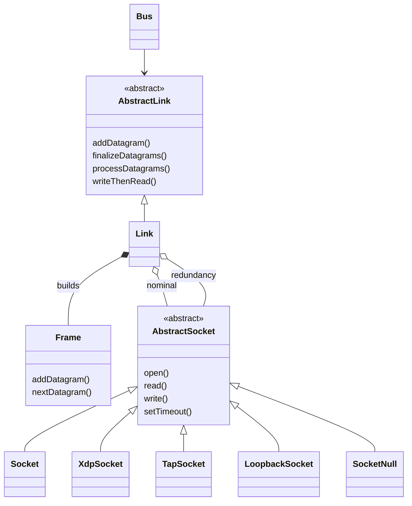
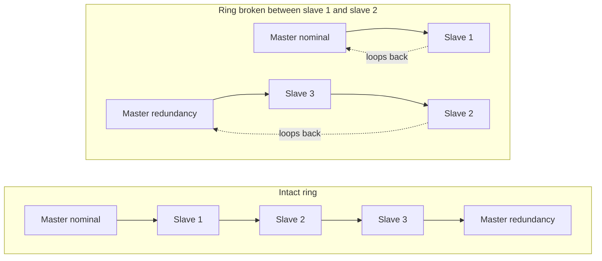

# Transport: links, frames and sockets

> How does the master send datagrams, process replies, and handle a cable break?
>
> You will learn:
>
> - the three layers between `Bus` and the network card
> - how `addDatagram()` associates a datagram with its callback
> - how the link reports missing, late, and invalid replies
> - how the link combines redundant frames
> - how to select a socket for hardware or simulation

## The problem: many small requests, one wire, no waiting

Each frame can carry several datagrams. Each datagram returns its data and a WKC,
as described in [Frames and datagrams](../ethercat/frames-and-datagrams.md). A cycle can include
logical reads and writes, mailbox checks, and error counter reads. Each request
needs its own result.

The transport layer has three tasks.

1. Pack requests into as few frames as possible.
2. Deliver each reply to its caller and handle missing or out-of-order frames.
3. Support network cards, kernel bypass, and simulation in the same process or
   another process.

Sending each request separately would add a round trip of tens of microseconds per
request. KickCAT queues requests, sends them together, and passes replies to
callbacks. Its blocking calls use the same operations (see [Overview and principles](principles.md)).

## Three layers



`Bus` sends datagrams through a link. The link builds frames and owns two sockets.

- **`AbstractLink`** is the datagram and callback interface for `Bus`. `Link`
  implements it. Unit tests can use a mock to test `Bus` in isolation.
- **`Frame`** holds an Ethernet frame with an EtherCAT header. It appends
  datagrams, tracks available space, and reads datagrams from a reply. It performs
  no network operations.
- **`AbstractSocket`** sends and receives raw Ethernet frames. The transport can
  use any network that carries them.

## The life of a datagram

```mermaid
sequenceDiagram
    participant Bus
    participant Link
    participant Frame
    participant Socket
    Bus->>Link: addDatagram(cmd, address, data, process, error)
    Link->>Frame: append datagram with index N
    Note over Link,Frame: frame full: send it now
    Bus->>Link: finalizeDatagrams()
    Link->>Socket: write last frame
    Bus->>Link: processDatagrams()
    loop once per frame sent
        Socket-->>Link: read frame (until timeout)
        Link->>Bus: process(header, data, wkc) for index N
    end
    Link->>Bus: error(state) for each datagram not OK
```

The datagram index identifies the callback for each reply.

**Queue.** `addDatagram()` takes a command, an address, an optional payload and
two callbacks:

- The **process callback** receives the answer: the header, the data and the
  working counter. It returns a state: `OK`, or an error such as `INVALID_WKC`.
  It must not throw.
- The **error callback** is called after the whole exchange if the datagram did
  not end `OK`. It receives the state and may throw.

The link assigns each datagram an index from 0 to 255. The slave returns that index
unchanged. If the current frame has too little space, the link sends it and appends
the datagram to a new frame. `addDatagram()` throws if more than 255 datagrams would
be pending.

**Send.** A frame leaves as soon as it is full. `finalizeDatagrams()` sends the
last, partly filled frame. Sending early lets the first frames travel while the
application is still queuing the next ones.

**Dispatch.** `processDatagrams()` sends what is left, then reads one answer for
each frame sent. For each datagram in an answer, it finds the callback by index
and calls the process callback. The order of the answers does not matter.

**Report.** For each datagram whose final state is not `OK`, the link calls its
error callback with the state.

| State | Meaning |
|---|---|
| `LOST` | No reply arrived before the timeout. |
| `SEND_ERROR` | The frame could not be written on any socket. |
| `INVALID_WKC` | The reply had an unexpected WKC. |
| `NO_HANDLER` | A mailbox answer arrived that no message was waiting for. |

If an error callback throws, the link finishes the cycle, clears the pending
datagrams, and rethrows.

## Late frames and timeouts

The link waits up to its **timeout** for each reply (`setTimeout()`, 2 ms by
default). Set the timeout below the cycle period in a real-time loop. Startup may
need a longer timeout while a slave handles mailbox messages.

A frame can arrive in the cycle after its timeout. The link recognizes a **stale**
frame by the datagram indexes, drops it, and reads again for the expected frame. The
old datagrams have already been reported as `LOST`.

## Synchronous use: writeThenRead

`writeThenRead()` sends one frame and waits for it without using callbacks or
merging replies. The bus uses this when it needs the reply for each copy, for
example when assigning station addresses with auto-increment addressing during
`init()`. Tools can use it to access registers. `readRegister()` and
`writeRegister()` handle one register on one slave.

## Cable redundancy

To form a ring, connect the last slave to a second network card on the master (see
[Topology, redundancy and clocks](../ethercat/topology-and-clocks.md)). A `Link` always has a **nominal** socket and
a **redundancy** socket. Without redundancy, it uses `SocketNull` for the second
socket. This socket accepts writes and never receives a frame.

With redundancy, the link sends every frame on both cards.

- **Intact ring.** Every slave processes the copy sent on the nominal card. It
  arrives at the redundancy card with the full WKC. The slaves forward the other
  copy without processing it. It arrives at the nominal card with a WKC of zero.
- **Broken ring.** Each copy reaches the last slave before the break and returns to
  the card that sent it. Each contains the result from its part of the bus.



The link matches datagrams from the two cards by index and adds their WKCs. If the
two copies together reached every expected slave, the sum is the expected WKC. The
operation determines how the link combines the data.

- For a **read**, the master sends zeros. Each slave writes only its own data. The
  link combines the two copies with a bitwise OR.
- For an **LRW**, inputs and outputs share addresses, so an OR would mix them. The
  bus gives the link a description of each mapped frame
  (`LogicalFrameDescription`, set with `setLogicalMapping()`): for each slave in
  bus order, it records the expected working counter and input offsets. The link
  uses each copy's working counter to find where the ring is broken, then takes
  each slave's inputs from the copy that crossed it.
- For a **write**, both copies echo the same payload, and the link keeps one.

The application receives one reply with the combined WKC. At startup,
`checkRedundancyNeeded()` sends a probe. If the ring is open, it calls the callback
passed to the `Link` constructor. The slaves' error counters and port status
indicate the location of the break (see [The master](master.md)).

## Events from the slaves

A slave sets bits in the datagram's event field for events enabled in its event mask
register. `Bus::enableIRQ()` enables one event and sets its callback, for example
for a data link status change. The link collects the bits from all replies. When a
bit changes from clear to set, it calls the callback once. The callback runs in
`processDatagrams()` on the application thread.

## Choosing a socket

`createSockets()` creates two sockets from interface names, which examples can
accept on the command line.

| Name | Socket | Use |
|---|---|---|
| `eth0` | `Socket` | A network card, through the platform's raw socket. |
| `xdp:eth0` | `XdpSocket` | A network card through Linux's address family for the eXpress Data Path (AF_XDP), which bypasses most of the kernel network stack. Needs a build with AF_XDP enabled. |
| `tap:server`, `tap:client` | `TapSocket` | A shared memory channel to another process on the same host, such as the network simulator. An optional `:name` suffix gives independent channels. |
| `?` | (asks) | Lists the interfaces and asks the user to choose. |
| empty | `SocketNull` | No interface: the usual choice for the redundancy side. |

`Socket` has one implementation per platform: Linux, Windows (through Npcap),
PikeOS and NuttX. The build selects the implementation for the target.

Create `LoopbackSocket` directly to connect a master to emulated slaves in the same
process. A write passes the frame through the emulated network and advances each
slave once. The next read returns the reply. The `simulated_bus` example uses this
socket to run the bus in one thread (see [Simulation internals](emulation.md)).

To add a transport, implement `AbstractSocket` operations to open and close the
socket, set its timeout, and read and write a frame.

## Summary

| Question | Answer |
|---|---|
| Which interface does `Bus` use? | An `AbstractLink`, in datagrams and callbacks. |
| When does a frame leave? | When it is full, or on `finalizeDatagrams()` or `processDatagrams()`. |
| How is an answer matched to its request? | By the datagram index, from 0 to 255. |
| What happens to a lost datagram? | Its error callback gets `LOST` after the timeout. |
| What happens to a late frame? | It is recognized as stale and dropped. |
| How does redundancy work? | Every frame goes out on both cards, and the two copies are merged. |
| How do I add a transport? | Implement `AbstractSocket`. |

## In the code

- `lib/master/include/kickcat/AbstractLink.h`: the link interface and
  `LogicalFrameDescription`.
- `lib/master/include/kickcat/Link.h` and `lib/master/src/Link.cc`: queuing,
  dispatch, stale frames and the redundancy merge.
- `lib/include/kickcat/Frame.h`: building frames and reading their datagrams.
- `lib/include/kickcat/AbstractSocket.h`: the socket interface.
- `lib/include/kickcat/OS/Linux/Socket.h`, `lib/include/kickcat/OS/Linux/XdpSocket.h`,
  `lib/include/kickcat/TapSocket.h`, `lib/include/kickcat/LoopbackSocket.h`,
  `lib/include/kickcat/SocketNull.h`: the socket implementations.
- `lib/master/include/kickcat/helpers.h`: `createSockets()` and interface
  selection.
- Read `examples/master/freedom-k64f/freedom_k64f_static_map_example.cc` for a
  link with redundancy and an event callback.

## Where to go next

- What the bus puts in the datagrams: [The master](master.md).
- The emulated network behind `LoopbackSocket` and `TapSocket`:
  [Simulation internals](emulation.md).
- How to tune Linux and the network card for low latency:
  [the performance guide](../../user-guide/realtime.md).
- Ports, rings and loop-back on the protocol side:
  [Topology, redundancy and clocks](../ethercat/topology-and-clocks.md).
