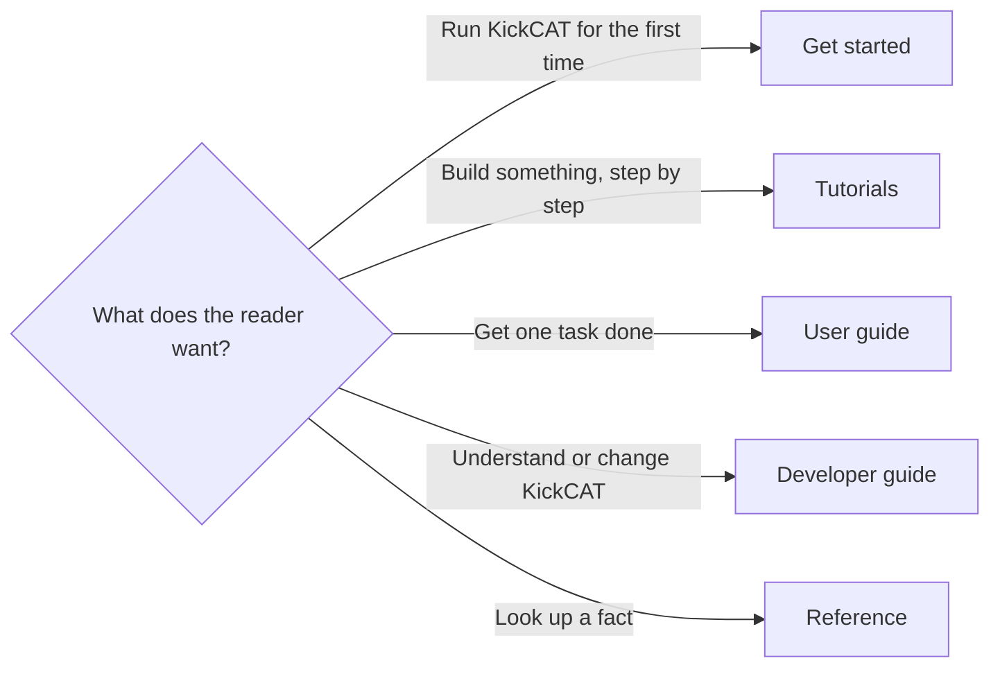

# Writing docs

!!! abstract "TL;DR"
    - Every page is one of five kinds. Put it in the matching section.
    - Short sentences, one idea per paragraph, a small diagram where it helps.
    - Explain KickCAT, not EtherCAT: link the [poster][etg-poster] and the ETG specifications.
    - Preview with `uvx zensical@0.1.1 serve`. CI builds with `--strict`.

## Pick the section



| Section | A page here... | Example |
|---|---|---|
| Get started | gets a newcomer running in minutes | Installation, a first bus on the simulator |
| Tutorials | builds one thing step by step; each page continues the previous one | Reach OP, write a cyclic loop |
| User guide | answers "how do I...?" for one task | Simulation, Tools |
| Developer guide | explains a component: its responsibilities, interfaces and design choices | The master, Transport |
| Reference | lists facts in tables, with little prose | Glossary, build options |

A topic has one home. Other pages link to it instead of repeating it.

## Page templates

=== "Tutorial"

    ```markdown
    # Reach OP

    !!! abstract "TL;DR"
        You map the process data and bring the bus to OP.

    ## Before you start
    What the reader needs, and a link to the previous step.

    ## 1. Map the process data
    One step: a snippet from a compiled example, then the expected output.

    ## Recap
    | You did | With |
    |---|---|
    ```

=== "User guide"

    ```markdown
    # <Task>

    !!! abstract "TL;DR"
        The command or call that does it, in one or two lines.

    ## <Do one thing>
    Steps, commands, a screenshot if the task has a UI.

    !!! warning
        The mistake people make here.
    ```

=== "Developer guide"

    ```markdown
    # <Component>

    !!! info "EtherCAT refresher"
        [Poster][etg-poster] → *<panel>*. Details: [ETG.1000][etg1000].4.

    !!! abstract "TL;DR"
        Three bullets and one block diagram.

    ## Responsibilities
    | Class | Owns | Talks to | Swappable? |
    |---|---|---|---|

    ## How it works
    One small diagram per interaction.

    ## Design choices
    Why X, not Y. A few lines each.

    ??? note "Deep dive: <topic>"
        Sequence diagrams, timing, protocol details.

    ## Source map
    The files to read, in order.
    ```

=== "Reference"

    ```markdown
    # <Topic>

    | Name | Value | Notes |
    |---|---|---|
    ```

## Style

- Write short sentences, one idea per paragraph.
- Write KickCAT types as code: `Bus`, `slave::Slave`.
- Say master and slave, as the code does. ETG documents say MainDevice and SubDevice; the
  [glossary](../../reference/glossary.md) maps the terms.
- Write acronyms as acronyms: the site shows their meaning on hover. Add a new acronym to
  `docs/includes/abbreviations.md`.
- Link to a page by its title, never by a number.
- Use the link names in `docs/includes/links.md`, such as `[poster][etg-poster]`. Add new
  external URLs there.

## EtherCAT knowledge

KickCAT pages do not teach EtherCAT. They say what KickCAT does with a concept and link
the rest.

| The reader needs | Source |
|---|---|
| What KickCAT does | These docs |
| A quick protocol refresher | The ETG [poster][etg-poster] |
| The full detail | The ETG specifications, see the [glossary](../../reference/glossary.md#where-to-look-it-up) |

Start a page that relies on protocol knowledge with a refresher box that names a poster
panel:

```markdown
!!! info "EtherCAT refresher"
    [Poster][etg-poster] → *SM and FMMU*. Details: [ETG.1000][etg1000].4.
```

The poster panels are *ESM*, *Terminology*, *CoE*, *Process data*, *SubDevice structure and
ESC*, *DC unit and synchronization*, *SM and FMMU* and *Frame processing and examples*, which
holds the three datagram examples and the *Commands* and *Working Counter* tables. Link to
the poster and the specifications; do not copy their tables.

## Diagrams

- One diagram, one idea. Keep it to about seven boxes.
- Label boxes with KickCAT types.
- Start with the overview. Sequence and timing diagrams go in a collapsed deep dive at the
  end of the page.
- Draw with Mermaid, in a `mermaid` code fence.

## Code

Use code from the examples, which CI compiles, so snippets stay in sync. Mark the section
in the source file:

```cpp
// ;--8<-- [start:bring-up]
bus.init(100ms);
// ;--8<-- [end:bring-up]
```

Then include it in the page:

```markdown
;--8<-- "examples/master/simulated_bus/simulated_bus.cc:bring-up"
```

Explain a line with a numbered annotation:

```cpp
bus.init(100ms);                                // (1)!
bus.createMapping(iomap.data(), iomap.size());  // (2)!
```

1. Finds the slaves and brings them to PRE-OP.
2. Lays out the process image in the application's buffer.

## Screenshots

- Take them against the simulator so anyone can reproduce them.
- Capture the full-screen window with no personal paths or host names in view.
- Save a PNG under about 300 KB in `docs/assets/screenshots/`.
- Put it in a figure with a caption, and add `{ loading=lazy }` to the image.

## Preview and check

```bash
uvx zensical@0.1.1 serve            # live preview
uvx zensical@0.1.1 build --strict   # what CI runs: fails on a broken link or anchor
```
