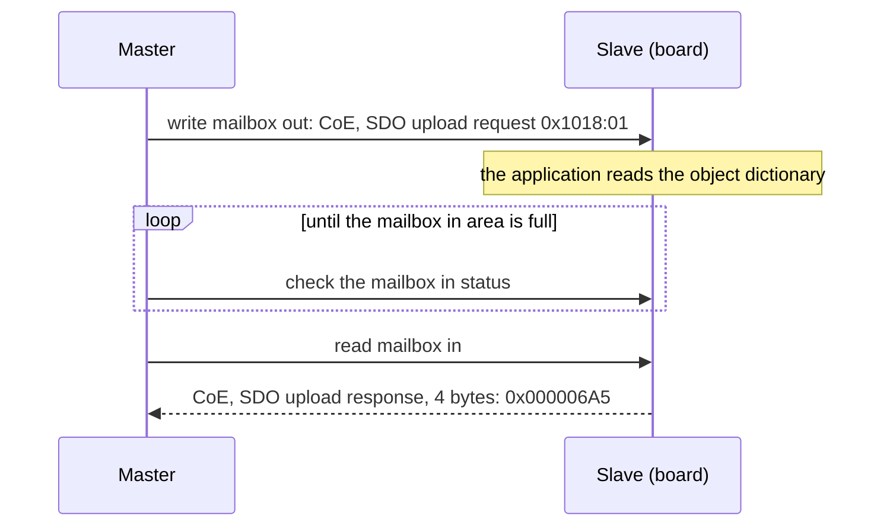

# Mailboxes: CoE and FoE

> How does EtherCAT carry messages
> outside the regular cycle?
>
> You will learn:
>
> - when to use a mailbox
> - how the master checks for a reply
> - how CoE uses SDOs to access the
>   object dictionary
> - how FoE transfers files

## The problem: data that is not cyclic

Process data has a fixed layout and travels every cycle (see [Process data](process-data.md)). Other data varies in size and is needed only at certain
times.

- **Configuration.** Before the machine starts, the master can set a gear ratio, a
  filter, or the PDO mapping of a drive.
- **Diagnostics.** A slave reports an error when it occurs.
- **Files.** A firmware image can be several hundred kilobytes.

Reserving space for this data in every cycle would waste bandwidth. A **mailbox**
lets the master send a message to one slave and read its reply when it is ready.

## The mailbox: two SyncManagers and a handshake

A slave reserves two memory areas for its mailbox. A SyncManager controls access to
each area (see [Inside a slave: the ESC](inside-a-slave.md)).

- the **mailbox out** area, written by the master and read by the slave (on the
  board: SyncManager 0 at `0x1000`, 128 bytes)
- the **mailbox in** area, written by the slave and read by the master (on the
  board: SyncManager 1 at `0x1400`, 128 bytes)

In **mailbox mode**, each area has one buffer. When the master writes the last byte
in the mailbox out area, the SyncManager marks the buffer full and signals the
slave. The master can write again once the slave reads the message and the buffer is
empty. The same rule applies in the other direction.

Every message starts with a **mailbox header** of 6 bytes:

| Field | Meaning |
|---|---|
| Length | The size of the data after the header. |
| Address | A station address, used to route a message through a mailbox gateway. |
| Channel and priority | Rarely used. Usually 0. |
| Type | The protocol, such as CoE, FoE, or EoE, or a mailbox error. |
| Counter | A number from 1 to 7 that changes with each new message, so that a slave can detect a repeated one. |

## The polling problem

Only the master starts frame exchanges. It can check for a reply in the mailbox in
area in two ways.

- **Read each slave's status.** The master reads the mailbox SyncManager status
  register on each slave. This costs one datagram per slave per check.
- **Map the status into logical space.** The master configures an additional FMMU
  on each slave to map the "mailbox full" bit into the logical address space. One
  logical read then checks every slave at once.

The master also checks that a mailbox out area is empty before it writes a new
message into it.

## CoE: CANopen over EtherCAT

**CoE** uses the application layer of CANopen, an earlier fieldbus. Its **object
dictionary** lists the values a slave exposes. A 16-bit **index** and an 8-bit
**subindex** identify each entry.

| Index range | Content | Example on the board |
|---|---|---|
| `0x1000` - `0x1FFF` | Communication: identity, PDO mappings, SyncManager settings | `0x1018`, the identity object |
| `0x6000` - `0x6FFF` | Input values of the device | `0x6000`, `accel_x` |
| `0x7000` - `0x7FFF` | Output values of the device | `0x7000`, `LED_R` |

An **SDO** transfer reads or writes one entry. An **upload** reads from the slave. A
**download** writes to the slave. The transfer format depends on the size.

- **Expedited:** up to 4 bytes travel inside the request or reply itself.
- **Normal:** the data fits in one mailbox message.
- **Segmented:** the data is larger than a mailbox. The rest follows in segments,
  each one asked for by the master.

This example reads the board's 4-byte vendor identifier (ID), `0x000006A5`, from
entry `0x1018`, subindex 1.

The master writes the request, polls for a reply, then reads it. If the transfer
fails, the slave sends an **abort** with an error code. A missing entry is one
possible cause.

CoE also supports these services.

- **SDO Information** lists dictionary objects with their names, data types, and
  access rights. A tool can display this information for an unfamiliar device.
- An **Emergency** reports an error code, an error register, and vendor-specific
  bytes. The slave places the message in its mailbox in area for the master to read.

## FoE: File over EtherCAT

**FoE** transfers files between the master and a slave. To write a file, the master
and slave use the following steps.

1. The master sends a **write request** with the file name and an optional
   password.
2. The slave accepts it with an **acknowledgment (ACK)** of packet 0.
3. The master sends **DATA** packets numbered 1, 2, 3, and the slave acknowledges
   each one.
4. A DATA packet shorter than the maximum packet size ends the transfer.

A read is the same exchange in the other direction: the master sends a **read
request**, the slave sends DATA packets, and the master acknowledges each one.
A slave can answer **BUSY** to ask the master to wait, for example while it
writes to flash memory. Either side can stop the transfer with an **ERROR**
packet that holds an error code.

FoE is commonly used for firmware updates. The master requests the **BOOT** state
(see [The EtherCAT state machine](state-machine.md)). In BOOT, the slave often runs a bootloader
that supports only FoE. The slave's EEPROM describes the bootloader's mailbox
areas.

## The other protocols

- **EoE** carries standard Ethernet frames, for example
  to reach a web server inside a slave.
- **SoE** carries the servo drive profile of
  International Electrotechnical Commission (IEC) 61800-7, used by the Serial
  Real-time Communication System (SERCOS).
- **AoE** carries Beckhoff ADS
  messages.
- **VoE** lets each vendor define its messages.

The **mailbox gateway** specification (EtherCAT Technology Group, ETG.8200) lets a
tool on another computer send mailbox messages through the master, for example over
the UDP.

## Summary

| Question | Answer |
|---|---|
| Why a mailbox? | For data that is not cyclic: configuration, diagnostics and files. |
| How many SyncManagers does it use? | Two: one for each direction, in mailbox mode. |
| How does the master know that a reply is waiting? | It polls the mailbox status, one slave at a time or all at once with a mapped status bit. |
| How is a value named in CoE? | By an index and a subindex in the object dictionary. |
| How does a slave receive a firmware update? | With FoE, usually in the BOOT state. |

## In KickCAT

KickCAT supports CoE on the master and the slave, including segmented transfers,
SDO Information and emergencies on the master. FoE is experimental on both sides,
and EoE is planned. See [Features](../../user-guide/features.md) for the details.
[Mailboxes in KickCAT](../architecture/mailboxes.md) shows how the mailboxes are built in the
code.

## Where to go next

- The state machine and the BOOT state: [The EtherCAT state machine](state-machine.md).
- How the master and the slave stacks implement mailboxes:
  [Mailboxes in KickCAT](../architecture/mailboxes.md).
- Where the object dictionary of a device comes from:
  [Describing a device](device-descriptions.md).
