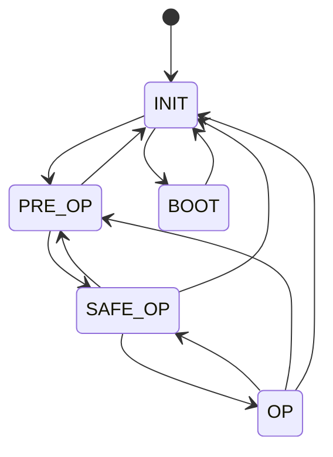
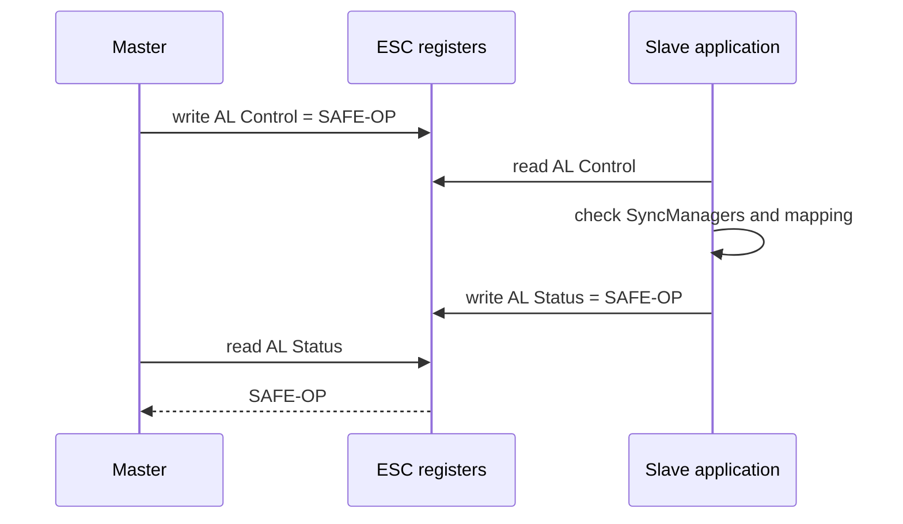

# The EtherCAT state machine

> How does a slave start, change state, and report errors in EtherCAT?
>
> You will learn:
>
> - INIT, PRE-OP, SAFE-OP,
>   OP, and BOOT states
> - what the master configures and what the slave allows in each state
> - how the master requests a state change and checks the result
> - how a slave reports an error and returns to a lower state

## The problem: start a machine safely

A motor must stay in a safe state until its outputs have been checked. Before
the first cycle, the master sets the station address, configures the mailbox,
selects the process data, and configures the SyncManagers and FMMUs. Each step
depends on the previous one.

The EtherCAT **state machine** controls when the slave can use each function. To
advance, the master must request the next state and the slave must accept the
configuration.

## The five states

| State | Mailbox | Inputs | Outputs | What the master does here |
|---|---|---|---|---|
| **INIT** | No | No | No | Sets the station address, reads the EEPROM, configures the mailbox SyncManagers. |
| **PRE-OP** | Yes | No | No | Configures the process data: the mapping, the process data SyncManagers and the FMMUs. |
| **SAFE-OP** | Yes | Yes | No, held in a safe state | Starts the cycle, so that valid outputs reach the slave. |
| **OP** | Yes | Yes | Yes | Runs the machine. |
| **BOOT** | Bootstrap mailbox only | No | No | Updates the firmware, see [Mailboxes: CoE and FoE](mailboxes.md). |

A slave advances one state at a time. It can skip states when returning to a lower state.

The slave refuses a request to skip a state on startup, such as INIT to SAFE-OP. It
can enter BOOT only from INIT and can leave BOOT only for INIT.

In SAFE-OP, the slave sends inputs so the master can calculate its first outputs.
The slave receives the outputs and keeps its actuators in a safe state. Once the
master sends valid outputs, it requests OP. The slave applies the outputs in OP.

## The running example

The Freedom K64F board starts in this order.

1. **INIT.** The master counts the slaves and finds one. It gives the board the station
   address 1001, reads the EEPROM, finds product code 0x00DEFEDE and a mailbox, and
   programs SyncManagers 0 and 1 at 0x1000 and 0x1400.
2. **PRE-OP.** The mailbox works. The master learns that the board has 3 output bytes
   and 12 input bytes, programs SyncManagers 2 and 3, and programs two FMMUs.
3. **SAFE-OP.** Each cycle now brings back the 12 sensor bytes. The master writes the 3
   color bytes, but the light does not change yet.
4. **OP.** The light follows the color bytes that the master writes in each cycle.

## Request and answer

The master and slave use three AL registers in the ESC.

- **AL Control** (at 0x0120): the master writes the state it
  wants.
- **AL Status** (at 0x0130): the slave writes the state it is in.
- **AL Status Code** (at 0x0134): the slave writes why it refused a request or left a
  state.

The slave application checks the configuration before accepting the request. If it
refuses, it stays in its current state. The master polls AL Status until the state
changes or the request times out.

## Errors

When the slave refuses a request, or must leave a state on its own, it does three
things:

- it stays in its current state, or falls to a lower one
- it sets the **error indication** bit in AL Status
- it writes a code in AL Status Code, for instance 0x0011 for an invalid state change,
  or 0x001D for an invalid output configuration

The master reads the code to report the cause. To clear the error, the master writes
AL Control again with the **error acknowledge** bit set. The slave then clears the
error indication bit.

The most common reason for a return to a lower state is a timeout on the process
data watchdog described in [Inside a slave: the ESC](inside-a-slave.md). When the master stops
sending outputs while the slave is in OP, the watchdog expires. The slave goes back
to SAFE-OP with the code 0x001B (sync manager watchdog), and its outputs return to
their safe state. With the watchdog enabled, a lost cable or a crashed master does
not leave a motor running on old commands.

## Summary

| Question | Answer |
|---|---|
| In which state does the mailbox start to work? | PRE-OP. |
| In which state does the master first receive inputs? | SAFE-OP. |
| In which state does the slave apply outputs? | OP only. |
| Who decides that a slave changes state? | The slave, after the master requests it. |
| Where does the slave say why it refused? | In AL Status Code, with the error indication bit in AL Status. |
| What happens when the master stops sending outputs in OP? | The watchdog expires and the slave falls back to SAFE-OP. |

## In KickCAT

The master requests states and waits for them, and the slave stack implements one
class per state. [The master](../architecture/master.md) shows the master side, and [The slave stack](../architecture/slave.md)
the slave side.

## Where to go next

- What the master configures between PRE-OP and SAFE-OP: [Process
  data](process-data.md).
- Mailbox services available in PRE-OP: [Mailbox protocols](mailboxes.md).
