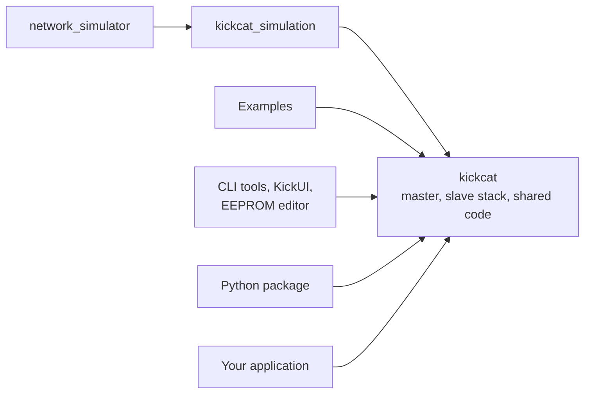

# The ecosystem

!!! abstract "TL;DR"
    Everything builds on one library, `kickcat`, which contains the master, the slave stack,
    and their shared protocol code. The examples, tools, simulator, and Python package build on
    it.

## What you get

| Part | What it gives you | How to get it | Learn more |
|---|---|---|---|
| `kickcat` library | The master, the slave stack and the shared protocol code | Always built; `KickCAT::kickcat` once installed; the Conan package | [Installation](installation.md) |
| `kickcat_simulation` library | Simulated slaves built from JSON files, device models such as a CiA 402 motor, topologies | `simulation` build option, on by default on Linux and Windows | [Simulation internals](../developer-guide/architecture/emulation.md) |
| `network_simulator` | Emulated slaves in a separate process, reached through `tap:client` | `simulation` build option | [Simulation](../user-guide/simulation.md) |
| Master examples | One program per device or use case, from `simulated_bus` to motor drives | `master_examples` build option, on by default | [First bus](first-bus.md), [Hardware](../user-guide/hardware.md) |
| Slave examples | Firmware for NuttX, Linux (Raspberry Pi) and KickOS boards | `scripts/build_slave_bin.sh` for the NuttX boards | [Hardware](../user-guide/hardware.md) |
| CLI tools | `eeprom`, `foe`, `scan_topology`, `check_network_stability`, `od_generator` | `tools` build option, on by default | [Tools](../user-guide/tools.md) |
| GUIs | KickUI, the EEPROM editor | `kickui` and `eeprom_editor` build options | [Tools](../user-guide/tools.md) |
| Python package | The master from Python | `pip install kickcat` | [Installation](installation.md#use-python) |

## Where to start

- To run something now: [your first bus](first-bus.md).
- To see what is supported: [Features](../user-guide/features.md).
- To find your way in the source tree: [A map of the code](../developer-guide/architecture/code-map.md).
