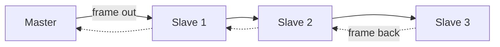
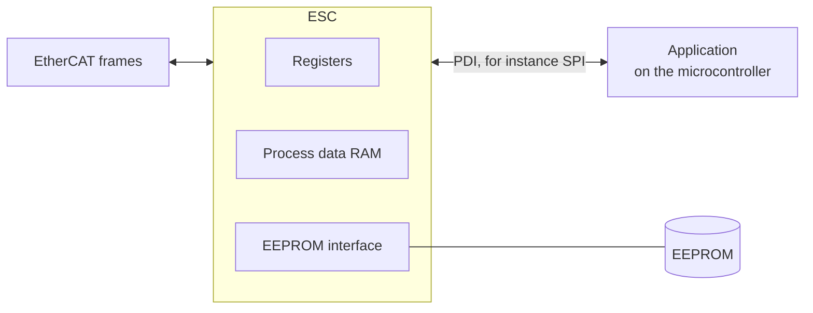
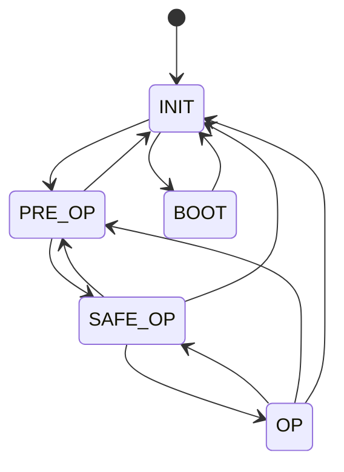
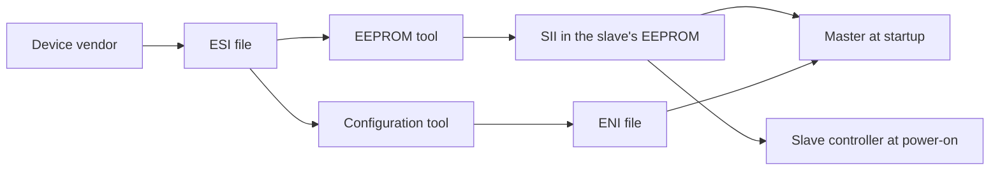

# EtherCAT primer

!!! info "Quick reference"
    Keep the ETG [poster][etg-poster] open next to this page: it covers the protocol on a
    single sheet. The [specifications](../reference/glossary.md#where-to-look-it-up) have the full
    detail.

!!! abstract "TL;DR"
    - The master sends frames. Each slave reads and writes its part as the frame passes through.
    - Each slave has an ESC that handles frames in hardware. The slave's software talks to the ESC.
    - Slaves move through states, from INIT to OP. They exchange process data every cycle, and
      mailbox messages when needed.
    - KickCAT provides both ends: the master (`Bus`) and the slave stack (`slave::Slave`).

## One frame for the whole bus

Only the master sends frames. A frame carries datagrams, and each datagram reads or writes
slave memory. Every slave that handles a datagram increments its working counter, so the
master knows which slaves took part.

| Addressing | KickCAT uses it to |
|---|---|
| By position (auto-increment) | assign station addresses during `Bus::init()` |
| By station address | talk to one slave: registers and mailboxes |
| Broadcast | count and reset the slaves |
| Logical | exchange process data every cycle |

In KickCAT, `Bus` builds the datagrams, `Link` packs them into frames and checks the working
counter, and an `AbstractSocket` sends them. See [Transport](../developer-guide/architecture/transport.md).
On the poster: *Frame processing and examples*, *Commands* and *Working Counter*.

## Inside a slave: the ESC

The ESC processes frames at wire speed. The slave's microcontroller reaches it through the
PDI. SyncManagers protect the shared memory: mailbox mode for messages, buffered mode for
process data. FMMUs map the logical address space onto the ESC's memory. The EEPROM holds the
SII, which describes the slave.

In KickCAT, the slave stack talks to an `AbstractESC`: `Lan9252`, `XMC4800`, or `EmulatedESC`
in simulation. See [The slave stack](../developer-guide/architecture/slave.md). On the poster:
*SubDevice structure and ESC* and *SM and FMMU*.

## The state machine

The master requests a state. The slave checks its configuration, then reaches the state or
refuses it with an AL status code.

| State | What works | On the KickCAT master |
|---|---|---|
| INIT | Register access only | `Bus::init()` starts here and reads the EEPROMs |
| PRE-OP | Mailbox | `Bus::init()` ends here. Configure the slaves over SDO, then call `createMapping()` |
| SAFE-OP | Mailbox and inputs; outputs stay in their safe state | `requestState(State::SAFE_OP)` |
| OP | Mailbox, inputs and outputs | `requestState(State::OPERATIONAL)`, after writing valid outputs |
| BOOT | Bootstrap mailbox, for firmware updates | `enterBootstrap()` |

On the slave, `ESM::StateMachine` holds one class per state. A refusal reaches the master as
an `ErrorAL`. See [The master](../developer-guide/architecture/master.md) and
[The slave stack](../developer-guide/architecture/slave.md). On the poster: *ESM*.

## Process data

Process data is the small set of values exchanged every cycle. PDO mapping objects list the
values: 0x16xx for outputs, 0x1Axx for inputs. Assignment objects, 0x1C12 and 0x1C13, attach
the PDOs to SyncManagers. One logical datagram, usually an LRW, can serve the whole bus: the
FMMUs of each slave pick its bytes out of the shared logical address space.

In KickCAT, `Bus::createMapping()` reads each slave's mapping and lays out the process image:
the inputs of all slaves, then their outputs. On the slave, `PDO` copies the bytes between the
ESC and the application. See [The master](../developer-guide/architecture/master.md). On the
poster: *Process data* and *Terminology*.

## Mailboxes

Data that is not cyclic, such as configuration and files, goes through a mailbox: two
SyncManagers, one for each direction. The master polls the slave to know when an answer is
waiting. CoE gives SDO access to the object dictionary, by index and subindex, and carries
emergency messages. FoE transfers files, often a firmware update in BOOT.

In KickCAT, the master uses `readSDO()` and `writeSDO()`, or a `MailboxSequencer` inside the
cyclic loop. The slave serves requests with `mailbox::response::Mailbox`, through `enableCoE()`
and `enableFoE()`. CoE is supported; FoE is experimental. See
[Mailboxes in KickCAT](../developer-guide/architecture/mailboxes.md). On the poster: *CoE* and
*Datagram example 2*.

## Topology, redundancy and clocks

A frame enters a slave on port 0 and leaves through its other ports. A port with no cable
sends the frame back. Wiring the last slave to a second master port closes a ring: if a cable
breaks, each half of the bus still responds. Distributed clocks give all slaves the same time,
so that they act at the same instant.

In KickCAT, `Link` handles redundancy with its two sockets. `Bus::enableDC()` and `Timer` set
up and follow the distributed clocks; master DC support is experimental. The emulator models
ports, broken cables and clocks. See [Transport](../developer-guide/architecture/transport.md)
and [Distributed clocks](../developer-guide/architecture/distributed-clocks.md). On the poster:
*Frame processing and examples* and *DC unit and synchronization*.

## Device descriptions

A vendor describes a device in an ESI file, in XML. An EEPROM tool writes the essentials to
the slave's EEPROM as the SII. The ESC reads it at power-on, and the master at startup. A
configuration tool can describe a whole network in an ENI file.

KickCAT reads each slave's SII at startup and needs no ENI. `ESI::Parser` turns an ESI file
into an EEPROM image, an object dictionary or an emulated slave. `ENI::loadFile()` loads a
network description into an `ENI::Config`. See
[From XML to bytes](../developer-guide/architecture/device-descriptions.md). Specifications:
[ETG.2000][etg2000] (ESI), [ETG.2010][etg2010] (SII), [ETG.2100][etg2100] (ENI).

## Recap

| Concept | In KickCAT | On the poster |
|---|---|---|
| Frames, datagrams, working counter | `Bus`, `Link`, `Frame` | Frame processing and examples |
| ESC | `AbstractESC`, `Lan9252`, `XMC4800`, `EmulatedESC` | SubDevice structure and ESC |
| State machine | `Bus::requestState()`, `ESM::StateMachine` | ESM |
| Process data | `Bus::createMapping()`, `PDO` | Process data |
| Mailboxes, CoE, FoE | `Bus::readSDO()`, `MailboxSequencer`, `mailbox::response::Mailbox` | CoE |
| Redundancy, distributed clocks | `Link`, `Bus::enableDC()`, `Timer` | DC unit and synchronization |
| ESI, SII, ENI | `ESI::Parser`, `eeprom::SII`, `ENI::loadFile()` | SubDevice structure and ESC |
