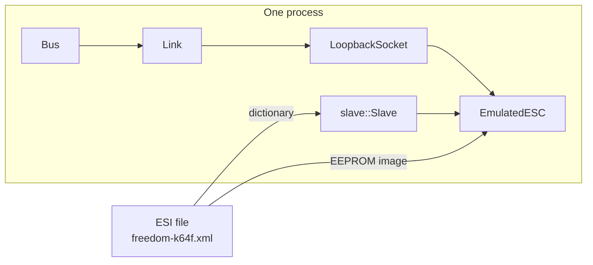

# Your first bus

!!! info "EtherCAT refresher"
    [Poster][etg-poster] → *ESM* and *SubDevice structure and ESC*.

!!! abstract "TL;DR"
    `simulated_bus` runs a master and an emulated slave in one process in five steps: parse
    an ESI file, build the slave, connect the master, bring the bus to OP, and exchange process
    data. The code below comes from the example that CI compiles.

## Run it

After [building from source](installation.md#build-from-source), from the repository root:

```bash
./build/examples/master/simulated_bus/simulated_bus \
    -f examples/slave/lan9252/freedom-k64f/nuttx/freedom-k64f.xml -t Board
```

```text
Device: Board  (product 0x00defede, revision 0x5a01)
Detected 1 slave(s)
SAFE_OP reached
OPERATIONAL reached
Process data: 12 input byte(s), 3 output byte(s)
```

## What runs



On hardware, a `Socket` on a network card replaces `LoopbackSocket`, and a `Lan9252` or
`XMC4800` replaces `EmulatedESC`. The rest of the code stays the same.

## 1. Parse the ESI

```cpp
--8<-- "examples/master/simulated_bus/simulated_bus.cc:parse"
```

- `loadDevice()` selects a device by its `<Type>` (`-t`), or uses the first one.
- One device description provides both the EEPROM image and the CoE dictionary.
- `materializeStorage()` allocates storage for dictionary entries that don't have any.

## 2. Build the emulated slave

```cpp
--8<-- "examples/master/simulated_bus/simulated_bus.cc:slave"
```

- `EmulatedESC` stands in for the ESC chip and loads the EEPROM image.
- `PDO` and `slave::Slave` are the classes used by slave firmware.
- The mailbox serves CoE requests from the dictionary. The application owns the dictionary
  and the process data buffers.

## 3. Connect the master

```cpp
--8<-- "examples/master/simulated_bus/simulated_bus.cc:wire"
```

- `LoopbackSocket` passes each frame to the emulated ESC, then calls `tick` to run one
  `routine()` of the slave stack.
- `Link` takes a nominal socket and a redundancy socket. `SocketNull` means there is no
  redundancy.
- `validateOutputData()` lets the slave enter OP. In real firmware, the application decides
  when its outputs are valid.

## 4. Bring the bus to OP

```cpp
--8<-- "examples/master/simulated_bus/simulated_bus.cc:cyclic"
--8<-- "examples/master/simulated_bus/simulated_bus.cc:iomap"
--8<-- "examples/master/simulated_bus/simulated_bus.cc:init"
```

- `init()` finds the slaves, assigns them addresses, reads their EEPROMs, and brings them to
  PRE-OP.
- `createMapping()` lays out the process image in `iomap`, which the application owns.

```cpp
--8<-- "examples/master/simulated_bus/simulated_bus.cc:op"
```

- A slave with outputs enters OP only after receiving valid outputs, so the example writes
  them before requesting OP.
- `waitForState()` keeps calling `cyclic` while it waits, so process data continues to flow.
- With `--dc`, the example also sets up distributed clocks before SAFE-OP.

## 5. Exchange process data

```cpp
--8<-- "examples/master/simulated_bus/simulated_bus.cc:exchange"
```

`processDataRead()` and `processDataWrite()` each send one datagram and wait for a reply. A
real-time loop batches datagrams instead; see [the cyclic loop](../developer-guide/architecture/master.md#the-cyclic-loop).

??? note "Deep dive: one cycle through both stacks"

    ```mermaid
    sequenceDiagram
        participant App as Application
        participant Bus
        participant Link
        participant Sock as LoopbackSocket
        participant ESC as EmulatedESC
        participant Sl as slave::Slave
        App->>Bus: processDataRead(), processDataWrite()
        Bus->>Link: datagrams
        Link->>Sock: write(frame)
        Sock->>ESC: process each datagram
        Sock->>Sl: routine()
        Sock-->>Link: read(frame)
        Link-->>Bus: callbacks
    ```

## Recap

| Step | KickCAT types |
|---|---|
| Device description | `ESI::Parser`, `ESI::buildEepromImage()` |
| Slave | `EmulatedESC`, `PDO`, `slave::Slave`, `mailbox::response::Mailbox` |
| Transport | `LoopbackSocket`, `Link`, `SocketNull` |
| Master | `Bus` |

## Next

- Emulate another device: pass any vendor ESI file with `-f`, such as one of
  [Beckhoff's ESI files][beckhoff-esi].
- Run several slaves in a separate process: see [Simulation](../user-guide/simulation.md).
- Run on real boards: see [Hardware](../user-guide/hardware.md).
