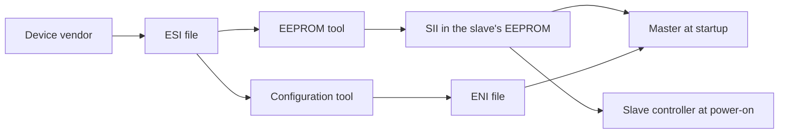

# Describing a device: ESI, SII and ENI

> How does a master learn what a slave is and how to configure it?
>
> You will learn:
>
> - what the ESI, SII and ENI files contain
> - who writes each one, and who reads it
> - how the three fit together, using the board as an example

## The problem: a master meets devices it has never seen

A master must work with slaves from many vendors. Before it can exchange process
data with a slave, it must know a lot about it: its identity, where its mailbox
is, which SyncManagers carry its process data, which PDOs it has, and which
values its object dictionary holds.

That knowledge could be written into the master's code for each device, but then
every new device would need a new master. EtherCAT describes devices with files
instead. There are three of them, and each has its own reader.

## ESI: the vendor's description of a device

The **EtherCAT Slave Information (ESI)** file is an XML file written by the
vendor of a device, following the ETG.2000 specification. One file can describe
several devices or several revisions of one device. For each device, it gives:

- the **identity**: vendor ID, product code and revision number
- the **SyncManagers** and **FMMUs**, with their addresses and sizes
- the **PDOs** and their entries
- the **object dictionary**, with the name, type and access of every entry
- the **mailbox protocols** the device supports, such as CoE or FoE
- the distributed clock modes, if any
- the content to program into the device's EEPROM

The board's ESI file describes one device of type `Board`, vendor ID
`0x000006A5` and product code `0x00DEFEDE`. It declares four SyncManagers: two
for the mailbox at `0x1000` and `0x1400`, one for the outputs at `0x1800` and one
for the inputs at `0x1C00`. It declares one RxPDO with the three LED values and
one TxPDO with the six sensor values, both fixed. Its mailbox supports CoE with
SDO Information.

The ESI is read by tools, not by the slave: a configuration tool that plans a
network, or a tool that builds the EEPROM content of a device.

## SII: the description stored inside the slave

The **Slave Information Interface (SII)** is the content of a small EEPROM next
to the slave controller. It is binary, and much smaller than the ESI: the board's
EEPROM holds 1024 bytes. It has two parts:

- A **fixed area** at the start. Its first words configure the slave controller
  itself: the controller reads them at power-on, for example to set up the
  interface to its microcontroller. The rest of the area holds the identity, the
  addresses and sizes of the mailbox areas (both the normal ones and the ones of
  the BOOT state), and the list of supported mailbox protocols.
- A list of **categories** after it. Each category has a type and a size. The
  common ones are Strings, General (names and flags of the device), FMMU,
  SyncManager, TxPDO, RxPDO and DC.

The master reads the SII of every slave at startup. That gives it, with no file
at all, what it needs to identify each slave, configure its mailbox and set up
simple process data. The SII is written once, by the vendor at production or by
a developer with an EEPROM tool, usually from the ESI.

The SII does not hold the object dictionary. When the master needs it, it asks
the slave over CoE (see [Chapter 0.6](mailboxes.md)).

## ENI: the description of a whole network

The **EtherCAT Network Information (ENI)** file is an XML file that follows the
ETG.2100 specification. A configuration tool writes it, from the ESI files of the
devices and from the network as it is wired. It describes a whole network:

- the expected slaves, in order, with their identity
- for each slave and each state change, the **init commands**: the datagrams and
  CoE writes to send, for example to set a PDO mapping
- the layout of the process image and the cyclic datagrams
- the mailbox and distributed clock settings

A master that reads an ENI does not need to work out the configuration by itself.
It replays what the tool planned, and checks that the real network matches.

## Who writes and who reads

The vendor's ESI feeds two tools: one programs the SII into the slave, and one
plans the network into an ENI. The master reads the SII of every slave, and may
also read an ENI.

## Summary

| File | Format | Written by | Read by | Describes |
|---|---|---|---|---|
| ESI | XML | The device vendor | Configuration and EEPROM tools | One device type, in full |
| SII | Binary, in EEPROM | An EEPROM tool, from the ESI | The slave controller and the master | One device, the essentials |
| ENI | XML | A configuration tool | The master | One whole network and its startup |

## In KickCAT

KickCAT reads the SII of every slave at startup, and works without an ENI. It can
also parse an ESI file: to build an EEPROM image, to generate the object
dictionary code of a slave, or to create an emulated slave. It can read an ENI
file into a configuration structure. [Chapter 9](from-xml-to-bytes.md) shows how.

## Where to go next

- How the master reads the SII during startup: [Chapter 3](master.md).
- How KickCAT turns ESI, SII and ENI files into data:
  [Chapter 9](from-xml-to-bytes.md).
- The tools that program an EEPROM and generate an object dictionary:
  [docs/TOOLS.md](../TOOLS.md).
