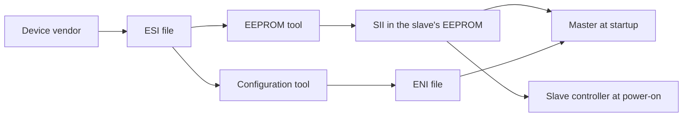

# Describing a device: ESI, SII and ENI

> How does a master identify and configure a slave in Ethernet for Control
> Automation Technology (EtherCAT)?
>
> You will learn:
>
> - what EtherCAT Slave Information (ESI), Slave Information Interface (SII), and
>   EtherCAT Network Information (ENI) describe
> - which tools write and read each format
> - how the example board uses these descriptions

## The problem: a master meets devices it has never seen

A master can use slaves from different vendors. Before exchanging process data, it
needs each slave's identity, mailbox layout, and process data SyncManagers. It also
needs to know which process data objects (PDOs) and object dictionary entries the
slave provides.

Device and network descriptions let the master use new devices without a code
change. Each description serves a different purpose.

## ESI: the vendor's description of a device

The vendor writes the **ESI** file in Extensible Markup Language (XML) according to
EtherCAT Technology Group specification ETG.2000. One file can describe several
devices or several revisions. The description includes the following information.

- the **identity**: vendor identifier (ID), product code and revision number
- the **SyncManagers** and **fieldbus memory management units (FMMUs)**, with their
  addresses and sizes
- the **PDOs** and their entries
- the **object dictionary**, with the name, type and access of every entry
- the **mailbox protocols** the device supports, such as CANopen over EtherCAT (CoE)
  or File over EtherCAT (FoE)
- the distributed clock modes, if any
- the content to program into the device's electrically erasable programmable
  read-only memory (EEPROM)

The board's ESI describes one device of type `Board` with vendor ID `0x000006A5` and
product code `0x00DEFEDE`. Its mailbox SyncManagers are at `0x1000` and `0x1400`.
The output SyncManager is at `0x1800` and the input SyncManager is at `0x1C00`. A
fixed receive PDO (RxPDO) holds three light-emitting diode (LED) values. A fixed
transmit PDO (TxPDO) holds six sensor values. The mailbox supports CoE with Service
Data Object (SDO) Information.

Configuration tools read the ESI to plan a network. EEPROM tools read it to build an
image for the slave.

## SII: the description stored inside the slave

The **SII** is the binary description in the slave's EEPROM. It is smaller than the
ESI. The board has 1024 bytes of EEPROM. The SII has two parts.

- The controller reads the first words of the **fixed area** at power-on, for
  example to set up its microcontroller interface. The rest holds the device
  identity and supported mailbox protocols. It also gives the addresses and sizes of
  the normal and bootstrap (BOOT) mailbox areas.
- A list of **categories** after it. Each category has a type and a size. The
  common ones are Strings, General (names and flags of the device), FMMU,
  SyncManager, TxPDO, RxPDO and distributed clocks (DC).

At startup, the master reads each slave's SII to identify the device, configure its
mailbox, and set up simple process data. It needs no local file for these steps. The
vendor writes the SII once during production, or a developer writes it with an
EEPROM tool. Both usually use the ESI as the source.

The SII does not hold the object dictionary. When the master needs it, it asks
the slave over CoE (see [Chapter 0.6](mailboxes.md)).

## ENI: the description of a whole network

A configuration tool writes the **ENI** as an XML file according to ETG.2100. It
uses the devices' ESI files and the physical network layout. The ENI contains the
following settings.

- the expected slaves, in order, with their identity
- for each slave and each state change, the **init commands**: the datagrams and
  CoE writes to send, for example to set a PDO mapping
- the layout of the process image and the cyclic datagrams
- the mailbox and distributed clock settings

The master can apply the configuration from the ENI and check it against the
connected network.

## Who writes and who reads

The EEPROM tool uses the ESI to program the slave's SII. The configuration tool uses
the ESI to generate an ENI for the network. The master reads each slave's SII and
can also read an ENI.

## Summary

| File | Format | Written by | Read by | Describes |
|---|---|---|---|---|
| ESI | XML | The device vendor | Configuration and EEPROM tools | One device type, in full |
| SII | Binary, in EEPROM | An EEPROM tool, from the ESI | The slave controller and the master | One device, the essentials |
| ENI | XML | A configuration tool | The master | One whole network and its startup |

## In KickCAT

KickCAT reads each slave's SII at startup and can run without an ENI. Its ESI parser
can build an EEPROM image, generate slave object dictionary code, or create an
emulated slave. Its ENI parser loads a network configuration into a structure. See
[Chapter 9](from-xml-to-bytes.md).

## Where to go next

- How the master reads the SII during startup: [Chapter 3](master.md).
- How KickCAT turns ESI, SII and ENI files into data:
  [Chapter 9](from-xml-to-bytes.md).
- The tools that program an EEPROM and generate an object dictionary:
  [docs/TOOLS.md](../TOOLS.md).
