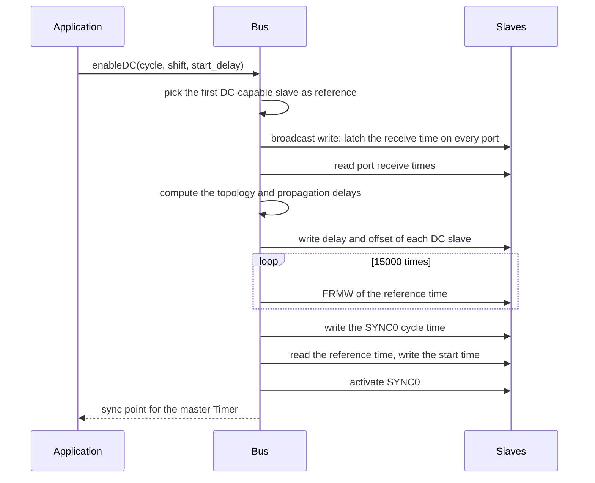
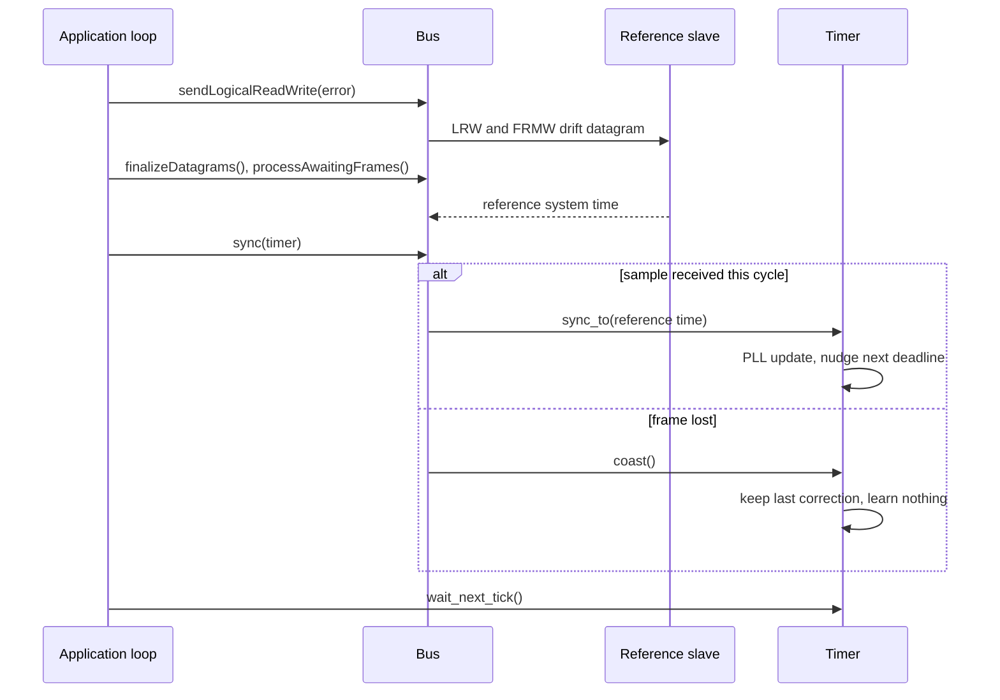

# Distributed clocks

> How does KickCAT make every slave agree on the time, and how does the master
> keep its own cycle in step with them?
>
> You will learn:
>
> - what `Bus::enableDC()` does, step by step
> - how the slaves stay synchronized during the cycle
> - why the master follows the reference clock instead of steering it
> - how a soft phase-locked loop keeps the master's cycle aligned
> - how to check that the bus is synchronized

**Distributed clocks support on the master is experimental.** It works on the
emulator and on the hardware the maintainers use, but it has not yet run long
enough on real buses to be called production ready (see the
[feature matrix](../FEATURES.md)).

## The problem: two kinds of clock error

[Chapter 0.7](topology-and-clocks.md) introduced distributed clocks (DC). Each
slave with DC has a local clock. One slave is the **reference clock**, and the
others copy its time. Once they agree, each slave can fire a **SYNC0** signal at
the same instant, so that every drive samples its inputs and applies its outputs
together.

Two things stop the clocks from agreeing:

- **Offset and delay.** At power-on, every clock starts at its own value. A frame
  also takes time to reach each slave, so a time read on the wire is already old
  when a downstream slave sees it. The master must measure the propagation delay
  to each slave and the offset of each clock once.
- **Drift.** Each clock runs from its own quartz. No two quartz crystals have
  exactly the same frequency, so the clocks drift apart by a few parts per
  million (ppm). This must be corrected all the time.

The master has a clock problem of its own. Its cycle runs from the host's clock,
which also drifts. If the master sends its frames at a slightly different rate
than SYNC0 fires, the frames slowly slide across the slaves' cycle, and one day a
frame arrives just as a slave samples its data.

## Setting up the clocks: enableDC

`Bus::enableDC(cycle_time, shift, start_delay)` sets up the whole bus in one
call. The application calls it after `init()` and before it requests SAFE-OP.
Some slaves need it while they are still in INIT.

The sequence shows the three phases: measure, compensate the static drift, then
start SYNC0.

**1. Choose the reference.** The reference is the first slave, in bus order,
whose ESC supports DC. If there is none, `enableDC()` throws.

**2. Measure.** The master reads its own time, then sends one broadcast write
to the receive time register. Every slave latches the time at which this frame
crosses each of its ports. The master reads the four port times back from each
slave.

**3. Compute delays and offsets.** From the port status of each slave, the bus
rebuilds the topology: which slave hangs on which port of which parent. For each
DC slave, it finds the port where the frame entered and its DC parent. Then it
computes the delay from the reference with the formula of the EtherCAT
specification: half of the difference between the round trip seen by the parent
and the round trip inside the child's own branch. Branches and slaves without DC
are handled on the way. The bus writes this delay into each slave, together
with the **offset** that moves the slave's clock onto the master's time. The time
base is the EtherCAT epoch, the first of January 2000.

**4. Compensate the static drift.** The bus sets the filters of the slaves'
clock control loop, then sends 15 000 drift compensation frames in a row. Each one
spreads the reference time to all other slaves (see below). This lets every
slave's control loop learn the frequency of the reference before the cycle
starts.

**5. Start SYNC0.** The bus writes the cycle time, reads the reference time, and
chooses a start time on the cycle grid: the next cycle boundary, plus `shift`,
plus `start_delay`. `shift` places SYNC0 inside the cycle, and `start_delay`
gives the frame time to reach every slave before the start. Then it activates
SYNC0.

**6. Return a sync point.** `enableDC()` returns the start of the DC cycle grid,
converted to the master's monotonic clock. The application passes it to
`Timer::start()`, so that the master's cycle starts aligned with SYNC0.

## Keeping the slaves together: the drift datagram

Once DC is enabled, `sendLogicalWrite()` and `sendLogicalReadWrite()` add one more
datagram to the frame: a **FRMW** (configured address read, multiple write) on
the system time of the reference. The reference puts its current time in the
datagram. Every slave after it reads that time as the frame passes, and its
control loop corrects its own clock. This is the standard relay of the EtherCAT
specification. The slaves stay together with no help from the master's clock.

The datagram is pre-filled with the master's time. If the ring is broken and a
slave cannot see the reference, it receives that value instead, so it follows the
master and is not pushed to zero.

## Keeping the master in step

The answer to the drift datagram brings the reference time back to the master.
The master now has one sample of the reference clock per cycle. It has two ways to
use it:

- **Write the master's time into the reference.** Some masters do this. Then the
  reference follows the master. But the master samples its time in software, and
  its loop wakes with some jitter, tens of microseconds on a busy host. That
  jitter would go straight into the DC domain of every slave, and could make a
  slave's SYNC0 control loop lose its lock.
- **Let the reference run free, and move the master's cycle.** The reference
  keeps its quartz frequency, and the master adjusts the instant it wakes up so
  that it stays at the same place in the DC cycle.

KickCAT takes the second way. The slaves see a clean clock, and only the master
absorbs the jitter of the host.

The master's cycle is a `Timer`. Each `Timer` owns a **soft phase-locked loop**
(`SoftPll`). Once per cycle, the application calls `Bus::sync(timer)`. If the
drift datagram answered this cycle, `sync()` feeds its reference time to the
timer. The loop measures where the master woke inside the DC cycle, compares it
with the target phase, and moves the next deadline by a small correction. The
period of the timer does not change: only its phase moves.

The sequence shows one DC cycle on the master side: the drift datagram goes out
with the process data, and its answer steers the next wake-up.

The loop is a filtered proportional-integral controller. The proportional part
pulls the phase. The integral part learns the frequency difference between the
host clock and the reference, in ppm. A few rules keep it stable on a real host:

- **One sample, one use.** `sync()` consumes the sample. If the next drift
  datagram is lost, there is no fresh sample, and the timer **coasts**: it
  applies the last correction again and learns nothing. A lost frame does not
  feed an old value into the loop.
- **Late wake-ups are rejected.** A cycle that woke after its deadline gives a
  wrong phase, so its sample is ignored.
- **Corrections are limited.** The deadline moves by at most a few tens of
  microseconds per cycle, so the cycle never jumps.
- **Lock is reported.** `Timer::locked()` becomes true once the filtered error
  stays small for a number of cycles. An application can wait for it before it
  enables its drives.

The gains and limits are in `SoftPll::Config`. The defaults are the values
validated on hardware.

## Putting it together

The order of calls is:

1. `init()`, then `enableDC()`, which returns a sync point.
2. Map the process data and bring the bus to SAFE-OP, then OP, as in
   [Chapter 3](master.md).
3. Create a `Timer` with the DC cycle time and start it at the sync point.
4. In each cycle: exchange process data, call `bus.sync(timer)`, then
   `timer.wait_next_tick()`.

`Bus::isDCSynchronized(threshold)` reads the system time difference register of
every DC slave except the reference. Each slave keeps there the error between its
clock and the time it receives. The call returns true when every error is below
the threshold, and false if one is above or if a slave did not answer. It sends
its own frame, so it suits bring-up and monitoring, not every cycle.

## Summary

| Question | Answer |
|---|---|
| Which slave is the reference? | The first slave in bus order with DC. |
| When is `enableDC()` called? | After `init()`, before SAFE-OP. |
| How do the slaves follow the reference? | A FRMW datagram added to each cyclic write. |
| Does the master write its time into the reference? | No. The reference runs free. |
| How does the master stay in step? | `Bus::sync()` feeds the reference time to the `Timer`'s soft PLL. |
| What happens when a drift frame is lost? | The timer coasts for that cycle. |
| How do I know the bus is synchronized? | `isDCSynchronized()` for the slaves, `Timer::locked()` for the master. |

## In the code

- `lib/master/src/dc.cc`: `enableDC()`, the delay computation, the drift
  datagram, `sync()` and `isDCSynchronized()`.
- `lib/master/include/kickcat/Bus.h`: the DC calls of the bus.
- `lib/include/kickcat/OS/Timer.h`: the cyclic timer and its `sync_to()` and
  `coast()`.
- `lib/include/kickcat/OS/SoftPll.h`: the soft PLL and its settings.
- Read `examples/master/marvin/marvin.cc` for a bus with DC, a timer started
  at the sync point, and the PLL state printed while it runs. The emulator also
  models DC clocks with drift, so `simulated_bus --dc` runs the set-up without
  hardware.

## Where to go next

- How DC works on the protocol side: [Chapter 0.7](topology-and-clocks.md).
- The cyclic loop around `sync()`: [Chapter 3](master.md).
- How the emulator models a drifting clock: [Chapter 8](simulation.md).
- How to tune Linux for a stable cycle: [the performance guide](../PERFORMANCE.md).
