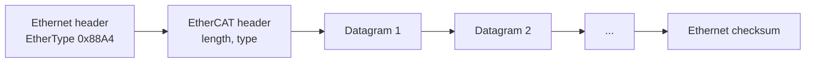

# Frames and datagrams

> How does a slave find its data in a frame, and how does the master check the result?
>
> You will learn:
>
> - how EtherCAT uses Ethernet frames
> - what a datagram header contains
> - the four ways to address a slave
> - what the WKC tells the master

## The problem: one frame, many readers

An EtherCAT frame passes through every slave, as described in [Chapter
0.1](what-is-ethercat.md). One frame can contain several requests for different
slaves.

Each request is a **datagram**. Its address selects the data to access. Its WKC
records successful operations.

## The frame

An EtherCAT frame is a standard Ethernet frame. The Ethernet header contains a
destination address, a source address, and an **EtherType** that identifies the
payload. EtherCAT uses EtherType **0x88A4**. Every slave processes every EtherCAT
frame, regardless of its Ethernet addresses.

A 2-byte EtherCAT header follows the Ethernet header. It gives the length and type
of the data that follows. The frame then carries one or more datagrams.

## The datagram

A datagram is one request: read, write, or both, at one address. It has three parts.

1. A 10-byte **header**:
    - the **command**, which specifies the operation and addressing mode
    - an **index**, a number chosen by the master. Slaves do not change it. The master
      uses it to match a returning datagram with the request it sent.
    - a 4-byte **address**
    - the **length** of the data, and a flag that says whether another datagram
      follows in the same frame
    - an **interrupt** field, which slaves use to report events to the master
2. The **data**. For a read, the master sends empty bytes and the slave fills them.
   For a write, the master sends the bytes to write.
3. A 2-byte **WKC**.

For example, the master can read a status register on every slave and exchange
process data in the same frame.

## Four ways to address a slave

The command combines an operation (read, write, or read-write) with an addressing
mode. The name gives the mode and operation. For example, `FPRD` means configured
address physical read, and `LRW` means logical read-write.

| Mode | Commands (read, write, read-write) | Address | Typical use |
|---|---|---|---|
| Auto-increment physical (position) | `APRD`, `APWR`, `APRW` | The position of the slave in the line, and a register | Startup, before slaves have station addresses |
| Configured station address | `FPRD`, `FPWR`, `FPRW` | An address the master gave the slave, and a register | Accessing one known slave |
| Broadcast | `BRD`, `BWR`, `BRW` | A register in every slave | Counting slaves, resetting all of them |
| Logical | `LRD`, `LWR`, `LRW` | An address in one large shared memory space | Cyclic process data |

**Auto-increment.** The master uses position 0 for the first slave, -1 for the
second, and -2 for the third. Each slave adds one as the frame passes. The slave
that receives 0 executes the request. The master uses this mode at startup before it
assigns station addresses.

**Configured station address.** At startup, the master writes a 16-bit station
address to each slave, for example 1001 for the first slave. This address still
selects that slave if another slave is added before it.

**Broadcast.** Every slave executes the request. On a read, the slaves combine their
register values with a bitwise OR. Each slave also increments the WKC, so the master
can count the slaves with a broadcast read.

**Logical.** The master defines a logical address space of 4 gibibytes (GiB). It
assigns each slave a range. Each slave reads or writes its part as the frame passes.
One logical datagram can carry process data for all the slaves. [Chapter
0.3](inside-a-slave.md) describes the hardware.

Two more commands read one slave's register and write its value to the same register
on each following slave. Auto-increment read multiple write (`ARMW`) selects the
source by position. Configured address read multiple write (`FRMW`) selects it by
station address. These commands distribute the reference time (see [Chapter
0.7](topology-and-clocks.md)).

## The working counter

A slave increments the datagram's WKC for each successful operation.

- a successful read adds 1
- a successful write adds 1
- a read-write adds 1 for the read and 2 for the write, so 3 when both succeed

The master calculates the expected WKC from the operations and slaves in the
request. A lower value means at least one expected operation failed. A slave may be
missing, in the wrong state, or missing the address configuration. The master checks
the WKC first on every datagram.

## The example: two datagrams for one board

In this example, the master assigns station address 1001 to the Freedom K64F board
from [Chapter 0.1](what-is-ethercat.md).

To read the board's state, the master sends an `FPRD` for 2 bytes at station address
1001 and the state register address. The board writes its state into the datagram
and adds 1 to the WKC. The master expects a WKC of 1.

For one cycle, the master sends a 15-byte `LRW` to the board's logical address. The
board reads the 3 color bytes and writes its 12 sensor bytes into the remaining
space. It adds 3 to the WKC, 1 for the read and 2 for the write. The master checks
for a WKC of 3 and copies the 12 sensor bytes to its inputs.

Both datagrams can travel in the same frame.

## Summary

| Question | Answer |
|---|---|
| How does a slave recognize an EtherCAT frame? | By its EtherType, 0x88A4. |
| What is a datagram? | One read, write or read-write request, with a header, data and a working counter. |
| How is a slave addressed before it has an address? | By its position in the line (auto-increment). |
| Which mode carries cyclic process data? | Logical addressing, usually with `LRW`. |
| How does the master detect a slave that did not respond? | The working counter is lower than expected. |
| How does the master match a reply with its request? | By the index it put in the datagram header. |

## In KickCAT

On the master, every request becomes a datagram with a callback that receives the
data and the working counter. [Chapter 4](transport.md) shows how datagrams are packed
into frames and matched when they return.

## Where to go next

- What the slave does with a datagram: Chapter 0.3, [Inside a slave](inside-a-slave.md).
- How the logical address space is built for the process data: Chapter 0.5,
  [Process data](process-data.md).
