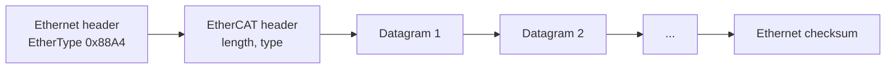

# Frames and datagrams

> What travels on the wire, how does a slave know which part is for it, and how does
> the master know that the slave did its part?
>
> You will learn:
>
> - how an EtherCAT frame is built inside an Ethernet frame
> - what a datagram is, and what its header says
> - the four ways to address a slave
> - what the working counter tells the master

## The problem: one frame, many readers

[Chapter 0.1](what-is-ethercat.md) showed one frame passing through every slave. That
raises three questions. How does a slave find the bytes meant for it while the frame
is moving? How does the master ask different slaves for different things in the same
frame? And when the frame comes back, how does the master know that each slave
really did what it asked?

EtherCAT answers with two ideas: the frame carries a list of small requests called
**datagrams**, and each datagram counts the slaves that served it.

## The frame

An EtherCAT frame is a standard Ethernet frame. The Ethernet header holds a
destination address, a source address and an **EtherType**, a number that says what
the frame carries. EtherCAT uses the EtherType **0x88A4**. Slaves do not use the
Ethernet addresses to decide whether a frame is for them. Every slave processes
every EtherCAT frame.

After the Ethernet header comes a 2-byte EtherCAT header. It gives the length of what
follows and a type. Then come one or more datagrams, one after the other.

The diagram below shows the layout, from left to right.

## The datagram

A datagram is one request: read, write, or both, at one address. It has three parts.

1. A 10-byte **header**:
    - the **command**, which says what to do and how the address is to be understood
    - an **index**, a number chosen by the master. Slaves do not change it. The master
      uses it to match a returning datagram with the request it sent.
    - a 4-byte **address**
    - the **length** of the data, and a flag that says whether another datagram
      follows in the same frame
    - an **interrupt** field, which slaves use to report events to the master
2. The **data**. For a read, the master sends empty bytes and the slave fills them.
   For a write, the master sends the bytes to write.
3. A 2-byte **working counter**, described below.

One frame can carry many datagrams. The master can, for instance, read a status
register of every slave and exchange all the process data in a single frame.

## Four ways to address a slave

The command combines an operation (read, write, or read-write) with an addressing
mode. The name of a command is the mode followed by the operation: `FPRD` is a
configured-address read, `LRW` a logical read-write.

| Mode | Commands | The address means | Typical use |
|---|---|---|---|
| Auto-increment (position) | `APRD`, `APWR`, `APRW` | The position of the slave in the line, and a register | Start-up, before slaves have an address |
| Configured station address | `FPRD`, `FPWR`, `FPRW` | An address the master gave the slave, and a register | Talking to one known slave |
| Broadcast | `BRD`, `BWR`, `BRW` | A register in every slave | Counting slaves, resetting all of them |
| Logical | `LRD`, `LWR`, `LRW` | An address in one large shared memory space | Cyclic process data |

**Auto-increment.** The master puts a position in the address: 0 for the first slave,
-1 for the second, -2 for the third. Each slave adds one to the value as the frame
passes. The slave that receives the value 0 is the one that executes the request.
This works before any slave has an address, so the master uses it at start-up.

**Configured station address.** During start-up, the master writes a 16-bit address
into each slave, for instance 1001 for the first one. From then on, the master can
reach a slave by that address, even if another slave is added before it in the line.

**Broadcast.** Every slave executes the request. On a read, the slaves combine their
values with a bitwise OR, so the master sees one result for all of them. Each
slave also increments the working counter (see below), so a broadcast read tells
the master how many slaves are on the network.

**Logical.** Here the address does not name a slave. It names a position in a
**logical address space** of 4 GiB that the master defines. The master tells each
slave which part of that space belongs to it, and the slave reads and writes that
part as the frame passes. One logical datagram can therefore carry the process data
of every slave at once. [Chapter 0.3](inside-a-slave.md) shows the hardware that does
this.

Two more commands, `ARMW` and `FRMW`, read a register in one slave and write the
value into the same register of every following slave. They exist to share a time
value, and [Chapter 0.7](topology-and-clocks.md) uses them.

## The working counter

Each slave that serves a datagram increments its **working counter (WKC)** as the
frame passes:

- a successful read adds 1
- a successful write adds 1
- a read-write adds 1 for the read and 2 for the write, so 3 when both succeed

The master knows how many slaves should serve each datagram, so it knows which value
to expect. When the frame comes back with a lower value, at least one slave did not do
its part. It may be missing, in the wrong state, or not configured for that address.
The working counter is the first thing the master checks on every datagram.

## The example: two datagrams for one board

Take the Freedom K64F board from [Chapter 0.1](what-is-ethercat.md), and assume that
the master gave it the station address 1001.

To read the state of the board, the master sends an `FPRD` with the address made of
1001 and the register of the state, 2 bytes long. The board fills the 2 bytes and
adds 1 to the working counter. The expected value is 1.

To run one cycle, the master sends an `LRW` of 15 bytes at the logical address it
assigned to the board. On the way out, the frame carries the 3 colour bytes. The board
takes them, writes its 12 sensor bytes into the rest of the datagram, and adds 3 to
the working counter: 1 for the read and 2 for the write. When the frame comes back,
the master checks for the value 3 and copies the 12 sensor bytes to its inputs.

Both datagrams can travel in the same frame.

## Summary

| Question | Answer |
|---|---|
| How does a slave recognise an EtherCAT frame? | By its EtherType, 0x88A4. |
| What is a datagram? | One read, write or read-write request, with a header, data and a working counter. |
| How is a slave addressed before it has an address? | By its position in the line (auto-increment). |
| Which mode carries cyclic process data? | Logical addressing, usually with `LRW`. |
| How does the master detect a slave that did not respond? | The working counter is lower than expected. |
| How does the master match a reply with its request? | By the index it put in the datagram header. |

## In KickCAT

On the master, every request becomes a datagram with a callback that receives the
data and the working counter. [Chapter 4](transport.md) shows how datagrams are packed
into frames and matched when they return.

## Where to go next

- What the slave does with a datagram: Chapter 0.3, [Inside a slave](inside-a-slave.md).
- How the logical address space is built for the process data: Chapter 0.5,
  [Process data](process-data.md).
