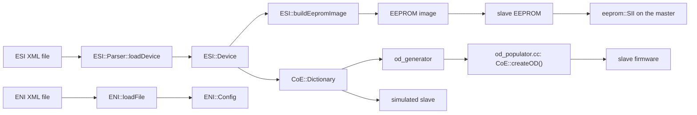

# From XML to bytes

> How does an XML description of a device become the EEPROM image and the object dictionary that a slave serves?
>
> You will learn:
>
> - which XML file KickCAT reads, and what it builds from each one
> - why the XML parsers run on the host and never on a slave
> - how the firmware and the simulator get their object dictionary in two different ways
> - how the master reads the EEPROM back
> - what the ENI parser does today

[Chapter 0.8](device-descriptions.md) introduced three descriptions: the
EtherCAT Slave Information (ESI) file, an XML file from the vendor that
describes a device, the Slave Information Interface (SII), the binary content
of the slave's EEPROM, and the EtherCAT Network Information (ENI) file, an XML
file that describes a whole network. This chapter follows the bytes from one
form to the next.

## The problem: one device, three forms

The same facts about a device appear in three places. The vendor writes them
once, in the ESI file. The slave must carry part of them in its EEPROM, so that
a master can identify it and configure its SyncManagers without any file. A
slave with a CoE mailbox must also serve an object dictionary that agrees with
both.

If each form is written by hand, they drift apart: an EEPROM that announces 12
input bytes, a dictionary that maps 10, and a master that trusts one of them.
The fix is to derive the binary forms from the XML, with tools, so that one
source of truth produces the rest.

## The data flow

KickCAT compiles one ESI device into everything the slave needs. The master
reads the result back from the slave, never from the ESI file.

The diagram shows two paths from one parsed device, one to the EEPROM and one to the dictionary, and a separate path for the ENI file.

## Parsing an ESI file

An ESI file can describe many devices: one vendor file often lists every
revision of every terminal in a product family. `ESI::Parser::loadDevice`
selects one device with a `DeviceFilter`: by type name, by product code, by
revision, or by position in the file. `listDevices` returns a summary of every
device without building them, and `loadAllDevices` builds all of them from one
parse.

The result is an `ESI::Device`: a plain structure with the identity (vendor,
product code, revision), the SyncManagers, the Fieldbus Memory Management Units
(FMMUs), the Process Data Objects (PDOs) with their entries, the mailbox and the
protocols it supports, the distributed clock modes, the EEPROM section of the
file, and the object dictionary.

For the Freedom K64F board, the device has four SyncManagers: two for the
mailbox at 0x1000 and 0x1400, one for 3 output bytes at 0x1800, and one for 12
input bytes at 0x1C00. It has one receive PDO, 0x1600, with the three LED
objects 0x7000 to 0x7002, and one transmit PDO, 0x1A00, with the six sensor
objects 0x6000 to 0x6005.

### Filling the gaps in vendor files

ESI files do not always declare everything a slave must serve. The parser
completes the dictionary from the rest of the device:

- It creates the data objects that a PDO entry references but the dictionary
  does not declare, such as 0x6000, so that the mapping resolves.
- It creates the PDO mapping objects (0x16xx, 0x1Axx) and the SyncManager
  assignment objects (0x1C12, 0x1C13) from the PDO list, when the dictionary
  does not declare them.
- It fills the SyncManager type object, 0x1C00, from the SyncManager list when
  the file declares the object with no values. A master reads 0x1C00 to find
  the process data SyncManagers, so without this step such a slave shows no
  process data. A value written in the ESI file always wins.

The parser never replaces what the file states. It only adds what is missing
and can be derived.

### Storage for the dictionary

An entry in the dictionary needs memory for its value. The ESI file gives a
default value for some entries and none for others. `CoE::materializeStorage`
gives every entry that can be read or written over SDO a zero-filled storage,
when it has none. It does not invent entries and it does not touch entries that
already have a value. Both `od_generator` and the simulator call it before they
use a dictionary.

## The EEPROM path

`ESI::buildEepromImage` turns the device into the bytes of an EEPROM image. It
builds an `eeprom::SII` structure with the identity, the strings, the general
category, the SyncManagers, the FMMUs and the PDO mappings, and serializes it.
If the ESI file already contains a raw EEPROM image, that image is used as it
is.

The image reaches the slave in one of two ways:

- **A real slave.** The `eeprom` tool writes the image through the master into
  the slave's EEPROM (see [TOOLS](../TOOLS.md)). The EEPROM editor can also
  build or change an image.
- **A simulated slave.** The simulator loads the image straight into the
  emulated ESC.

**On the master**, `Bus::init` reads the EEPROM of each slave through the ESC
registers and parses it into the slave record, in an `eeprom::SII`. This is the
same structure the builder filled, read in the other direction. The master
uses it to name the slave, size and place its mailbox, and find its PDOs. The
master needs no ESI file to run a bus.

## The dictionary path

A slave with a CoE mailbox serves its dictionary over SDO, and maps its process
data from it (see [Chapter 6](slave.md)). The dictionary comes from the same
`ESI::Device` in one of two ways.

**On a firmware**, the dictionary is generated at build time. `od_generator`
parses the ESI file on the host, gives the dictionary its storage, and checks
it with `CoE::validateDictionary`. The check reports every entry that the SDO
server could not serve safely, such as an SDO-accessible entry with no storage,
or an array whose entry count is missing. If it finds a problem, the tool
refuses to write any code. If not, it writes `od_populator.cc`, which defines
`CoE::createOD()`. The firmware calls `createOD()` at start and trusts the
result: there is no check on the microcontroller.

**In the simulator**, the dictionary is built at run time from the same ESI
file, with the same parser and the same storage step. The `simulated_bus`
example does exactly this in its first lines.

Both paths rest on one principle of [Chapter 1](principles.md): validate the
configuration once, where errors are cheap to report, then trust it where
checks are expensive. A host tool can print a list of problems and stop. A
slave in the middle of a cycle cannot.

## Why the XML stays on the host

The ESI and ENI parsers use an XML library and allocate freely. They are host
components, built only for host targets (`ENABLE_ESI_PARSER` and
`ENABLE_ENI_PARSER`). A slave firmware links none of them: it receives a
generated dictionary and an EEPROM written by a tool. This keeps the firmware
small and keeps parsing errors where a developer can see them.

## The ENI file

An ENI file is written by a configuration tool for one network. It lists the
slaves in order, the commands to send at each state transition, the CoE values
to write, the process data layout and the cyclic frames.

`ENI::loadFile` and `ENI::loadString` parse such a file into an `ENI::Config`:
the master's commands, one entry per slave with its identity, init commands,
process data, mailbox settings and distributed clock settings, the cyclic
frames, and the process image. A malformed file raises an exception that names
the faulty element.

Today the ENI support stops at parsing. No part of the master reads an
`ENI::Config` yet. Running a bus from an ENI file is work in progress.

## Summary

| Question | Answer |
|---|---|
| What does KickCAT build from an ESI device? | An EEPROM image and an object dictionary. |
| Does the master need the ESI file? | No. It reads the EEPROM of each slave. |
| Where is a firmware dictionary checked? | On the host, by `od_generator`, before any code is written. |
| What does the parser add to a vendor file? | Missing data, mapping and assignment objects, and empty 0x1C00 values. Never more than it can derive. |
| What does the ENI parser give? | An `ENI::Config`. Nothing consumes it yet. |

## In the code

- `lib/include/kickcat/ESI/Parser.h`, `Device.h`: the ESI parser and the parsed device.
- `lib/include/kickcat/ESI/SIIBuilder.h`: `buildSII` and `buildEepromImage`.
- `lib/include/kickcat/SIIParser.h`: `eeprom::SII`, parsed by the master and built by the builder.
- `lib/include/kickcat/CoE/OD.h`: `CoE::Dictionary`, `materializeStorage`, `validateDictionary`, `createOD`.
- `lib/include/kickcat/ENI/Parser.h`, `Config.h`: the ENI parser and its result.
- `tools/od_generator.cc`: the dictionary generator.
- Example: `examples/master/simulated_bus/simulated_bus.cc` builds a slave from an ESI file in its first step. `examples/slave/lan9252/freedom-k64f/nuttx/od_populator.cc` is a generated dictionary.

## Where to go next

- What ESI, SII and ENI are: [Chapter 0.8](device-descriptions.md).
- How the slave serves and maps its dictionary: [Chapter 6](slave.md).
- How the simulator assembles a slave: [Chapter 8](simulation.md).
- How the master uses the SII during initialization: [Chapter 3](master.md).
