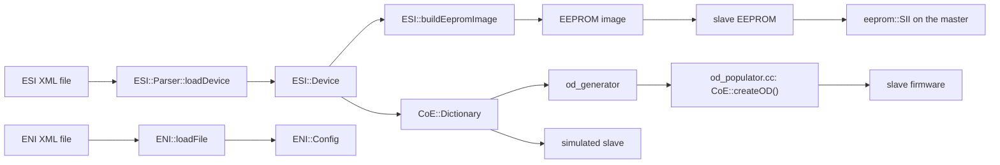

# From XML to bytes

> How does KickCAT use a device description written in XML?
>
> You will learn:
>
> - what the XML parsers read and produce
> - why the parsers run on the host
> - how firmware and the simulator build an object dictionary
> - how the master reads EEPROM
> - which network settings the parser can read

EtherCAT uses three descriptions: the ESI file describes a device in XML, the SII
is its binary description in the slave's EEPROM, and the ENI file describes a
network in XML. See [Chapter 0.8](device-descriptions.md).

## The problem: one device, three forms

The vendor describes a device in the ESI file. The slave stores some of that
information in EEPROM so the master can identify it and configure its SyncManagers
without a local file. A slave with a CoE mailbox also needs
a matching object dictionary.

Separate descriptions can disagree. For example, the EEPROM could list 12 input
bytes while the dictionary maps only 10. Generating both from the ESI file keeps the
sizes consistent.

## The data flow

KickCAT builds the EEPROM image and object dictionary from the same ESI device. At
startup, the master reads the description from the slave.

## Parsing an ESI file

An ESI file can list several devices and revisions. `ESI::Parser::loadDevice`
selects one using a `DeviceFilter` for the type name, product code, revision, or
position in the file. `listDevices` summarizes the devices without building them.
`loadAllDevices` builds them all in one pass.

The resulting `ESI::Device` structure holds the vendor, product code, revision,
SyncManagers, FMMUs, and PDOs with their entries. It also holds mailbox settings
and protocols, distributed clock modes, EEPROM data, and the object dictionary.

For the Freedom K64F board, the device has four SyncManagers: two for the
mailbox at 0x1000 and 0x1400, one for 3 output bytes at 0x1800, and one for 12
input bytes at 0x1C00. It has one receive PDO, 0x1600, with the three LED
objects 0x7000 to 0x7002, and one transmit PDO, 0x1A00, with the six sensor
objects 0x6000 to 0x6005.

### Filling the gaps in vendor files

The parser uses the rest of the device description to complete missing dictionary entries.

- It creates the data objects that a PDO entry references but the dictionary
  does not declare, such as 0x6000, so that the mapping resolves.
- It creates the PDO mapping objects (0x16xx, 0x1Axx) and the SyncManager
  assignment objects (0x1C12, 0x1C13) from the PDO list, when the dictionary
  does not declare them.
- It fills the SyncManager type object, 0x1C00, from the SyncManager list when
  the file declares the object with no values. A master reads 0x1C00 to find
  the process data SyncManagers, so without this step such a slave shows no
  process data. An explicit ESI value takes precedence.

The parser adds only values it can derive from the file.

### Storage for the dictionary

Some ESI entries specify a default value. For entries accessible by SDO transfers
that have no storage, `CoE::materializeStorage` allocates zero-filled storage. It
preserves existing entries and values. Both `od_generator` and the simulator call
it before using the dictionary.

## The EEPROM path

`ESI::buildEepromImage` generates the EEPROM bytes. It fills an `eeprom::SII`
structure with the identity, strings, general category, SyncManagers, FMMUs, and PDO
mappings, then serializes it. If the ESI already contains a raw EEPROM image, it
uses that image directly.

The image reaches the slave in one of two ways:

- **A real slave.** The `eeprom` tool writes the image through the master into
  the slave's EEPROM (see [TOOLS](../TOOLS.md)). The EEPROM editor can also
  build or change an image.
- **A simulated slave.** The simulator loads the image into the emulated ESC.

**On the master**, `Bus::init` reads each EEPROM through ESC registers. It parses
the bytes into an `eeprom::SII` in the slave record. The master uses this
information to identify the slave, locate and size its mailbox, and find its PDOs.
It can run the bus without an ESI file.

## The dictionary path

A slave with a CoE mailbox serves its dictionary over SDO, and maps its process
data from it (see [Chapter 6](slave.md)). The dictionary comes from the same
`ESI::Device` in one of two ways.

**For firmware**, `od_generator` parses the ESI file on the host, allocates
dictionary storage, and calls `CoE::validateDictionary`. The check reports entries
the SDO server cannot serve safely. Examples include missing storage for an
accessible entry and an array without an entry count. If validation fails, the tool
stops before writing code. Otherwise, it writes `od_populator.cc`, which defines
`CoE::createOD()`. The firmware calls `createOD()` at startup without repeating
validation.

**In the simulator**, the same parser and storage function build the dictionary at
runtime. The `simulated_bus` example starts with this step.

Checking the configuration on the host lets the tool report errors before the slave
enters its cycle (see [Chapter 1](principles.md)).

## Why the XML stays on the host

The ESI and ENI parsers use an XML library and dynamic allocation. Only host builds
include them (`ENABLE_ESI_PARSER` and `ENABLE_ENI_PARSER`). The slave uses the
generated dictionary and the programmed EEPROM. Parsing on the host reduces firmware
size and lets developers see parse errors there.

## The ENI file

An ENI file is written by a configuration tool for one network. It lists the
slaves in order, the commands to send at each state transition, the CoE values
to write, the process data layout and the cyclic frames.

`ENI::loadFile` and `ENI::loadString` produce an `ENI::Config`. It contains master
commands, cyclic frames, and the process image. Each slave entry contains its
identity, startup commands, process data, mailbox settings, and distributed clock
settings. A parse error raises an exception that identifies the invalid element.

The master does not yet use `ENI::Config` to start a bus. ENI support currently
covers parsing.

## Summary

| Question | Answer |
|---|---|
| What does KickCAT build from an ESI device? | An EEPROM image and an object dictionary. |
| Does the master need the ESI file? | No. It reads the EEPROM of each slave. |
| Where is a firmware dictionary checked? | On the host, by `od_generator`, before any code is written. |
| What does the parser add to a vendor file? | Missing data, mapping and assignment objects, and empty 0x1C00 values. Never more than it can derive. |
| What does the ENI parser give? | An `ENI::Config`. Nothing consumes it yet. |

## In the code

- `lib/include/kickcat/ESI/Parser.h`, `Device.h`: the ESI parser and the parsed device.
- `lib/include/kickcat/ESI/SIIBuilder.h`: `buildSII` and `buildEepromImage`.
- `lib/include/kickcat/SIIParser.h`: `eeprom::SII`, parsed by the master and built
  by the builder.
- `lib/include/kickcat/CoE/OD.h`: `CoE::Dictionary`, `materializeStorage`,
  `validateDictionary`, `createOD`.
- `lib/include/kickcat/ENI/Parser.h`, `Config.h`: the ENI parser and its result.
- `tools/od_generator.cc`: the dictionary generator.
- Example: `examples/master/simulated_bus/simulated_bus.cc` builds a slave from an
  ESI file in its first step.
  `examples/slave/lan9252/freedom-k64f/nuttx/od_populator.cc` is a generated
  dictionary.

## Where to go next

- What ESI, SII and ENI are: [Chapter 0.8](device-descriptions.md).
- How the slave serves and maps its dictionary: [Chapter 6](slave.md).
- How the simulator assembles a slave: [Chapter 8](simulation.md).
- How the master uses the SII during initialization: [Chapter 3](master.md).
