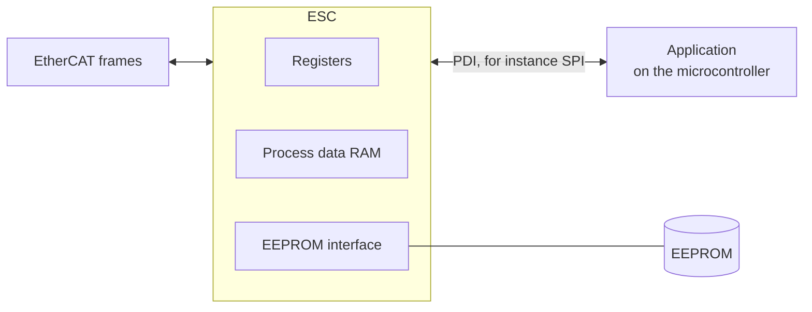

# Inside a slave: the ESC

> What does the chip in a slave do with a passing frame, and how does the slave's own
> program see the data?
>
> You will learn:
>
> - the two halves of a slave: the ESC and the application
> - the ESC's memory: registers and process data RAM
> - how SyncManagers protect shared memory, and why there are two modes
> - how FMMUs connect the logical address space to the ESC's memory
> - what the EEPROM holds, and the watchdogs that guard the slave

## The problem: a fast wire and a slow program

[Chapter 0.2](frames-and-datagrams.md) described datagrams that a slave serves while
the frame passes, in less than a microsecond. No program on a microcontroller can
react that fast. The program that drives the light and reads the sensors runs at its
own pace, and it may be busy when the frame arrives.

So a slave is split in two halves that meet in a shared memory:

- The **EtherCAT Slave Controller (ESC)** is a dedicated chip, or a block inside a
  microcontroller. It handles the frames at wire speed.
- The **application** is the program on the slave's microcontroller. It reads and
  writes the ESC's memory when it is ready.

The ESC talks to the application through the **Process Data Interface (PDI)**. On the
Freedom K64F board, the ESC is a LAN9252 and the PDI is a Serial Peripheral Interface
(SPI) bus between the LAN9252 and the K64F microcontroller. On other slaves, the ESC
is inside the microcontroller itself, and the PDI is a bus inside the chip.

The diagram below shows the two halves and what each side reaches.

## The ESC's memory

The ESC has a small memory with its own addresses. It has two areas:

- The **registers**, from address 0x0000 to 0x0FFF. They configure the ESC and report
  its status: the station address, the state of the slave, the link status of each
  port, error counters, and the settings of the SyncManagers and FMMUs described
  below.
- The **process data RAM**, from address 0x1000. It is a few kilobytes of memory that
  hold the mailbox messages and the process data.

The master reaches both areas with the physical addressing modes of [Chapter
0.2](frames-and-datagrams.md): auto-increment, configured station address and
broadcast. The application reaches them through the PDI.

## SyncManagers: who may touch the memory, and when

The master and the application both access the process data RAM, at times that
nothing coordinates. Without a rule, the application could read a buffer while a
frame is halfway through writing it, and get half old and half new data.

A **SyncManager** is the ESC's rule for one area of the process data RAM. It gives the
area a start address, a length and a direction: the master writes and the application
reads, or the reverse. It then enforces one of two modes.

**Mailbox mode** is a handshake. The area holds one buffer. The writer fills it
completely, and then the buffer is locked: the writer cannot write again until the
reader has read the whole buffer. No message is lost or overwritten. This suits
messages, where every message counts.

**Buffered mode** keeps the latest value. The ESC uses three buffers behind the one
address range, so the area takes three times its length in memory. The writer always
has a free buffer to write into, and the reader always gets the last complete one.
Neither side ever waits for the other. This suits cyclic data, where only the newest
value matters.

The Freedom K64F board uses four SyncManagers, numbered from 0:

| SyncManager | Address | Length | Mode | Direction | Use |
|---|---|---|---|---|---|
| 0 | 0x1000 | 128 bytes | Mailbox | Master writes | Messages to the slave |
| 1 | 0x1400 | 128 bytes | Mailbox | Slave writes | Messages to the master |
| 2 | 0x1800 | 3 bytes | Buffered | Master writes | Outputs: the light |
| 3 | 0x1C00 | 12 bytes | Buffered | Slave writes | Inputs: the sensors |

This order, two mailbox SyncManagers followed by the outputs and the inputs, is the
usual layout.

## FMMUs: from the logical space to the ESC's memory

[Chapter 0.2](frames-and-datagrams.md) introduced the logical address space, where one
`LRW` datagram carries the process data of every slave. Each slave must know which
bytes of that space are its own, and where to put them in its memory.

A **Fieldbus Memory Management Unit (FMMU)** does that translation. The master
programs each FMMU with a logical start address, a length, a physical start address
in the ESC's memory, and a direction. When a logical datagram passes, the ESC checks
each FMMU. Where the datagram covers an FMMU's logical range, the ESC copies bytes
between the frame and its memory as the frame passes.

For the board, the master needs two FMMUs. For instance:

- logical 0x0000 to 0x0002, written to the ESC at 0x1800: the 3 output bytes
- logical 0x0003 to 0x000E, read from the ESC at 0x1C00: the 12 input bytes

The SyncManager then takes over: the output bytes land in SyncManager 2's buffer, and
the input bytes come from SyncManager 3's latest buffer. An FMMU can also map single
bits, so that several small slaves share one byte of the logical space.

## The EEPROM and the SII

Every ESC has a small non-volatile memory, the **EEPROM**. Its content follows a
layout called the **Slave Information Interface (SII)**. It holds:

- settings that the ESC itself reads at power-up, such as the kind of PDI to use
- the identity of the slave: vendor ID, product code, revision and serial number. For
  the board, the product code is 0x00DEFEDE.
- the mailbox layout: where the mailbox SyncManagers are, and which mailbox protocols
  the slave supports
- descriptions of the SyncManagers, FMMUs and process data, and text strings for
  names

The master reads the EEPROM through ESC registers during start-up. This is how it
learns what each slave is and how to configure it, without any file on the master
side. [Chapter 0.8](device-descriptions.md) explains how the EEPROM content is
produced.

## Ports and link status

An ESC has two to four **ports**, each one a cable connector. Port 0 faces the master.
The other ports lead to more slaves. The ESC reports, for each port, whether a cable is
connected and whether the port is open or closed. A port with no cable is closed, and
the ESC passes the frame to the next open port instead. In the last slave of a line,
the only open port is port 0, so the frame goes back toward the master. This is how
the last slave returns the frame. [Chapter 0.7](topology-and-clocks.md) builds on this.

## Watchdogs

The ESC has two watchdogs, timers that detect when one side stops working:

- The **PDI watchdog** expires when the application stops accessing the ESC. It tells
  the master that the slave's program is no longer running.
- The **process data watchdog** expires when the master stops writing the outputs.
  The ESC reports it to the application, which must then put its outputs in a safe
  state instead of keeping them frozen at their last value. [Chapter
  0.4](state-machine.md) shows how the slave then leaves the operational state.

## Summary

| Question | Answer |
|---|---|
| What handles frames at wire speed? | The ESC. |
| How does the application reach the ESC? | Through the PDI, for instance SPI on the LAN9252. |
| What keeps the master and the application from reading half-written data? | SyncManagers. |
| Mailbox mode or buffered mode? | Mailbox for messages, buffered for cyclic data. |
| What connects a logical datagram to the ESC's memory? | FMMUs. |
| Where does the master learn what a slave is? | In the EEPROM, laid out as the SII. |

## In KickCAT

The slave stack talks to every ESC through one interface, so the same code runs on a
LAN9252, on an XMC4800, and on a software ESC used for simulation. [Chapter
6](slave.md) describes that interface, and [Chapter 8](simulation.md) the software ESC.

## Where to go next

- When the ESC allows mailboxes and process data: Chapter 0.4, [The EtherCAT state
  machine](state-machine.md).
- How the master chooses the logical addresses and the mapping: Chapter 0.5, [Process
  data](process-data.md).
