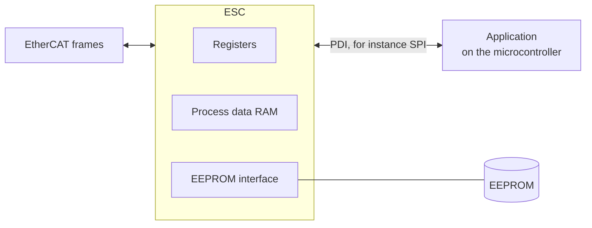

# Inside a slave: the ESC

> How does a slave share data with its application in EtherCAT?
>
> You will learn:
>
> - what the ESC and the application do
> - how the ESC uses registers and RAM
> - how the two SyncManager modes protect shared data
> - how FMMUs map logical addresses
> - what the EEPROM stores and
>   what the watchdogs detect

## The problem: a fast wire and a slow program

The ESC processes a datagram in less than a microsecond as the frame passes. See
[Chapter 0.2](frames-and-datagrams.md). A program on a microcontroller cannot
answer in that time. The application controls the light and reads the sensors on its own
schedule. It may be busy when a frame arrives.

The ESC and the application share memory.

- The **ESC** is a dedicated chip or part of a microcontroller. It processes frames
  at wire speed.
- The **application** runs on the slave's microcontroller. It reads and writes the
  shared memory when it is ready.

The ESC communicates with the application through the **PDI**. On the Freedom K64F board, the ESC is a LAN9252 and the PDI is an SPI bus between the LAN9252 and the K64F microcontroller. On
other slaves, the ESC is part of the microcontroller, and the PDI is a bus inside
the chip.

## The ESC's memory

The ESC has its own address space with two areas.

- The **registers**, from address 0x0000 to 0x0FFF. They configure the ESC and report
  its status: the station address, the state of the slave, the link status of each
  port, error counters, and the settings of the SyncManagers and FMMUs described
  below.
- The **process data RAM**, from address 0x1000. It is a few kilobytes of memory that
  hold the mailbox messages and the process data.

The master reaches both areas with the physical addressing modes of [Chapter
0.2](frames-and-datagrams.md): auto-increment, configured station address and
broadcast. The application reaches them through the PDI.

## SyncManagers: who may touch the memory, and when

The master and application access process data RAM independently. Without access
control, the application could read some old bytes and some new bytes during a
write.

A **SyncManager** controls access to one area of process data RAM. Its settings
specify a start address, length, direction, and mode. In one direction the master
writes and the application reads. In the other, the application writes and the
master reads.

**Mailbox mode** uses one buffer. Once the writer fills it, the buffer stays locked
until the reader finishes reading it. This prevents the writer from overwriting an
unread message.

**Buffered mode** uses three buffers for the same address range. It needs three
times as much memory as one buffer. The writer always has a free buffer, and the
reader gets the latest complete value. Neither has to wait. This mode is used for
cyclic data.

The Freedom K64F board uses four SyncManagers, numbered from 0:

| SyncManager | Address | Length | Mode | Direction | Use |
|---|---|---|---|---|---|
| 0 | 0x1000 | 128 bytes | Mailbox | Master writes | Messages to the slave |
| 1 | 0x1400 | 128 bytes | Mailbox | Slave writes | Messages to the master |
| 2 | 0x1800 | 3 bytes | Buffered | Master writes | Outputs: the light |
| 3 | 0x1C00 | 12 bytes | Buffered | Slave writes | Inputs: the sensors |

This order, two mailbox SyncManagers followed by the outputs and the inputs, is the
usual layout.

## FMMUs: from the logical space to the ESC's memory

In the logical address space described in [Chapter 0.2](frames-and-datagrams.md),
one logical read-write (`LRW`) datagram can carry data for all slaves. Each slave
needs a mapping from its logical addresses to its ESC memory.

The master configures each **FMMU** with a logical start address, length, physical
start address in ESC memory, and direction. As a logical datagram passes, the ESC
checks each FMMU. It copies the bytes in each matching range between the frame and
ESC memory.

The board needs two FMMUs. The following example assigns separate address ranges to
its outputs and inputs.

- logical 0x0000 to 0x0002, written to the ESC at 0x1800: the 3 output bytes
- logical 0x0003 to 0x000E, read from the ESC at 0x1C00: the 12 input bytes

SyncManager 2 buffers the outputs. SyncManager 3 supplies the latest complete
inputs. An FMMU can also map individual bits, so several slaves can share one
logical byte.

## The EEPROM and the SII

Every ESC reads its configuration from a small nonvolatile memory, the **EEPROM**.
Some ESCs, such as the XMC4800, emulate it in flash memory. It stores data in the
**SII** format.

- settings that the ESC itself reads at power-up, such as the kind of PDI to use
- the identity of the slave: vendor identifier, product code, revision and serial
  number. For the board, the product code is 0x00DEFEDE.
- the mailbox layout: where the mailbox SyncManagers are, and which mailbox protocols
  the slave supports
- descriptions of the SyncManagers, FMMUs and process data, and text strings for
  names

At startup, the master reads the EEPROM through ESC registers to identify and
configure each slave. It does not need a local device description file. [Chapter
0.8](device-descriptions.md) explains how to generate the EEPROM contents.

## Ports and link status

An ESC has two to four **ports**, each with a cable connector. Port 0 faces the
master. The other ports connect to more slaves. The ESC reports the link status and
whether each port is open or closed. When a port has no cable, it closes and the ESC
uses the next open port. At the end of a line, only port 0 is open, so the frame
returns toward the master. See [Chapter 0.7](topology-and-clocks.md).

## Watchdogs

The ESC has two watchdogs, timers that detect when one side stops working:

- The **PDI watchdog** expires when the application stops accessing the ESC. The master
  can see it and knows that the application no longer serves the ESC.
- The **process data watchdog** expires when the master stops writing the outputs.
  The ESC reports it to the application, which must then put its outputs in a safe
  state instead of keeping them frozen at their last value. [Chapter
  0.4](state-machine.md) shows how the slave then leaves the operational state.

## Summary

| Question | Answer |
|---|---|
| What handles frames at wire speed? | The ESC. |
| How does the application reach the ESC? | Through the PDI, for instance SPI on the LAN9252. |
| What keeps the master and the application from reading half-written data? | SyncManagers. |
| Mailbox mode or buffered mode? | Mailbox for messages, buffered for cyclic data. |
| What connects a logical datagram to the ESC's memory? | FMMUs. |
| Where does the master learn what a slave is? | In the EEPROM, laid out as the SII. |

## In KickCAT

The slave stack uses one ESC interface for the LAN9252, the XMC4800, and the
software ESC used in simulation. [Chapter 6](slave.md) describes that interface, and
[Chapter 8](simulation.md) the software ESC.

## Where to go next

- When the ESC allows mailboxes and process data: Chapter 0.4, [The EtherCAT state
  machine](state-machine.md).
- How the master chooses the logical addresses and the mapping: Chapter 0.5, [Process
  data](process-data.md).
