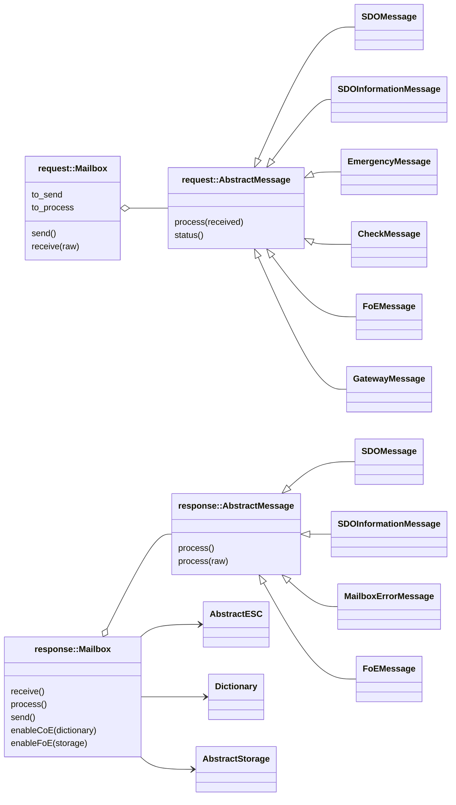
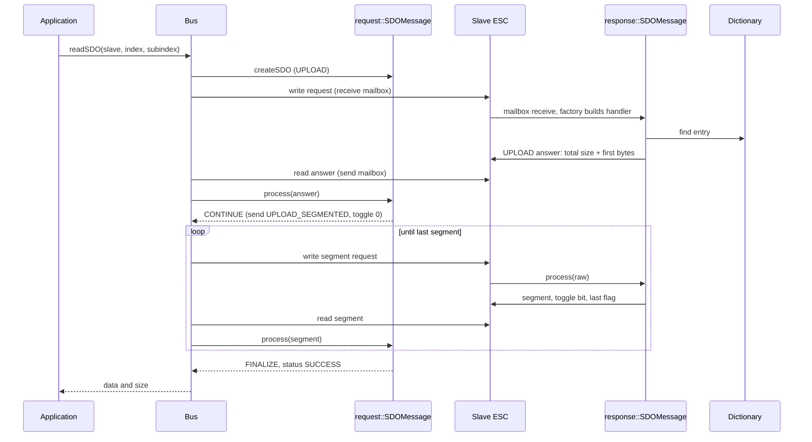

# Mailboxes in KickCAT

> How do the master and slave handle mailbox requests in Ethernet for Control
> Automation Technology (EtherCAT)?
>
> You will learn:
>
> - why the master and slave have separate mailbox classes
> - how a message object tracks a request
> - how the master schedules mailbox work in the cyclic loop
> - how the slave handles dictionary and file requests
> - how to add a mailbox protocol

A mailbox uses two SyncManagers to exchange messages outside the regular process
data cycle. Examples include Service Data Object (SDO) transfers, emergency
messages, and files. See [Chapter 0.6](mailboxes.md).

## The problem: one exchange, many cycles

A mailbox exchange can take several process data cycles. The master writes a request
to the slave's receive mailbox. The slave reads it, processes it, and writes a reply
to its send mailbox. The master reads the reply when that mailbox is full. A
segmented transfer repeats these steps for each segment.

Several slaves can have requests pending at the same time. The master tracks each
request, matches each reply, and checks for timeouts.

There are two common ways to handle a pending request.

- **Blocking call.** The function sends a request and waits for the reply. This is
  simple to use, but the calling thread cannot exchange process data while it waits.
- **State object.** An object tracks one exchange. The cyclic loop passes replies to
  it. The object checks for a match and decides what to send next. The caller checks
  for completion.

KickCAT uses state objects for both interfaces. A blocking helper waits for the
object to finish. The application controls the loop (see [Chapter
1](principles.md)).

## Two sides, one protocol codebase

The master sends requests and processes replies. The slave handles requests and
builds replies. One header defines both interfaces in separate namespaces.

- `mailbox::request` is the master side. Its `Mailbox` belongs to one remote
  slave, and its messages are requests waiting for an answer.
- `mailbox::response` is the slave side. Its `Mailbox` is bound to an
  EtherCAT Slave Controller (ESC), and its messages are handlers that build
  answers.

The two sides share mailbox headers, CANopen over EtherCAT (CoE) and File over
EtherCAT (FoE) headers, SDO command codes, and abort codes.



Each mailbox holds message objects with one subclass per service.

## The master side

### A message is one exchange

Each master-side slave record owns a `mailbox::request::Mailbox`. Its factory
methods are `createSDO`, `createSDOInfoGetOD`, `createFoERead`, `createFoEWrite`,
and `createGatewayMessage`. Each creates a message, adds it to `to_send`, and
returns a shared pointer. The caller reads `status()` through this pointer. The
result is `RUNNING`, `SUCCESS`, `TIMEDOUT`, or a service error code.

When the bus writes a message to the slave, the mailbox moves it to the
`to_process` list. When the bus reads an answer, the mailbox offers it to each
message in `to_process`, in order. Each message returns one of four results:

| Result | Action |
|---|---|
| `NOOP` | The reply does not match. Try the next message. |
| `CONTINUE` | The reply matches. Return the message to `to_send` for the next request. |
| `FINALIZE` | The reply completes the exchange. Remove the message. |
| `FINALIZE_AND_KEEP` | The reply matches. Keep the handler for later replies. |

For a segmented transfer, `CONTINUE` lets the same object request the next segment.
A persistent listener uses `FINALIZE_AND_KEEP`. After initialization, the bus adds
an `EmergencyMessage` to each CoE slave. It stores incoming CoE emergencies in the
`emergencies` list and remains active. A persistent `CheckMessage` logs and discards
unsupported protocol messages and unexpected SDO requests from slaves.

The timeout of a message is checked each time the mailbox sends or receives.
An FoE message restarts its timeout at each exchange, so a long file transfer
does not time out as long as the slave keeps answering.

### The bus moves the bytes

The `Bus` handles network access. Each step queues datagrams for slaves with mailboxes.

1. `sendMailboxesReadChecks` reads the status of the slave's send mailbox. It
   sets `can_read` when an answer is waiting.
2. `sendReadMessages` reads the answer from each slave with `can_read`, and
   gives it to the slave's mailbox.
3. `sendMailboxesWriteChecks` reads the status of the slave's receive mailbox.
   It sets `can_write` when the slave has room for a new request.
4. `sendWriteMessages` writes the next request of each slave with `can_write`.

These calls only queue datagrams. The frames leave and the callbacks run when
the application calls `finalizeDatagrams` and `processAwaitingFrames`, as for
process data (see [Chapter 4](transport.md)).

`configureMailboxStatusCheck` uses extra fieldbus memory management units (FMMUs) to
map the mailbox status bits into the cyclic frame. The master can then read them
without separate datagrams for steps 1 and 3.

### Two ways to drive it

**From the cyclic loop.** `MailboxSequencer` runs the four steps in order, one per
call. Reading first frees the slave's send mailbox before the next request. A
configurable period sets the number of cycles between steps. The sequencer skips
status checks already mapped into the cyclic frame.

```cpp
auto sdo = slave.mailbox.createSDO(0x1018, 1, false, CoE::SDO::request::UPLOAD, &value, &size);
MailboxSequencer sequencer(bus);
while (true)
{
    bus.sendLogicalRead(error);
    bus.sendLogicalWrite(error);
    sequencer.step(error);
    bus.finalizeDatagrams();
    bus.processAwaitingFrames();
    if (sdo->status() != mailbox::request::MessageStatus::RUNNING)
    {
        // done: SUCCESS, TIMEDOUT, or an abort code
    }
}
```

**With a blocking helper.** `Bus::readSDO`, `writeSDO`, `readFoE`, and `writeFoE`
create a message and repeat the four steps until its status changes from `RUNNING`.
They throw on failure. Use these helpers during configuration in the pre-operational
state (PRE-OP). Use the sequencer in the operational state (OP) so the cyclic thread
can keep sending process data.

### A segmented SDO upload

In this example, a blocking `readSDO` reads an object too large for one mailbox
message. The slave returns it in segments.



If the slave aborts a transfer, the request returns `FINALIZE` and sets its status
to the abort code. The blocking `readSDO` then throws.

## The slave side

### Receive, process, send

The slave creates a `mailbox::response::Mailbox` with an `AbstractESC`, a maximum
message size, and a limit on simultaneous exchanges. The application enables each
protocol it needs.

- `enableCoE(dictionary)` serves SDO and SDO information requests from the
  object dictionary.
- `enableFoE(storage)` serves file reads and writes from an
  `FoE::AbstractStorage`.

Both take a reference. The application owns the dictionary and the storage,
and they must outlive the mailbox.

`slave::Slave::routine` drives the mailbox with three calls each time:

1. `receive` reads the receive mailbox through the ESC, if a request is there.
2. `process` lets the open handlers do their work and queue answers.
3. `send` writes the next answer into the send mailbox, if it is empty.

The mailbox first passes a request to active handlers so that segments reach the
handler for their transfer. If none accepts it, the mailbox tries each enabled
protocol's factory. If no factory accepts it, the mailbox returns
`UNSUPPORTED_PROTOCOL`. If the exchange limit is reached, it returns
`NO_MORE_MEMORY`. The slave can also repeat its last reply if the master requests it
after a loss.

The object dictionary is validated when it is built. The slave uses it without
repeating that validation at runtime (see [Chapter 9](from-xml-to-bytes.md)).

### Files: the storage interface

FoE accesses files through `FoE::AbstractStorage`. The `openRead` and `openWrite`
calls take a file name and password. They return an error code and a reader or
writer. The writer receives one packet at a time. The handler calls `commit` after
the last packet. If the writer is destroyed before commit, it must discard the
incomplete data.

Firmware can store files in flash. The simulator uses a host directory. Both use the
same FoE handlers. FoE is experimental on the master and slave (see
[FEATURES](../FEATURES.md)).

### The bootstrap mailbox

In the bootstrap state (BOOT), the slave uses a second mailbox layout from its
electrically erasable programmable read-only memory (EEPROM), usually for FoE
firmware updates. The slave application provides a second mailbox with
`setBootstrapMailbox`. Without it, the slave refuses BOOT. `Bus::enterBootstrap`
requests the initialization state (INIT), clears pending messages, switches to the
bootstrap mailbox layout, and requests BOOT. `exitBootstrap` reverses the change and
returns the slave to PRE-OP.

## The mailbox gateway

EtherCAT Technology Group specification ETG.8200 defines a mailbox gateway. An
external tool sends raw mailbox messages to the master over the User Datagram
Protocol (UDP). The master forwards them to the addressed slave.

`Gateway` reads requests from an `AbstractDiagSocket` (`UdpDiagSocket` on
Linux) and passes them to `Bus::addGatewayMessage`. The bus reads the address
in the mailbox header. A slave address queues a `GatewayMessage` in that
slave's mailbox, and the message keeps the raw answer when it arrives.
`Gateway::processPendingRequests` sends completed answers back to the tool.

Address 0 selects the master. If the application installed a mailbox with
`setMasterMailbox`, it handles the request immediately using the master's object
dictionary. `MasterOD` builds this dictionary according to ETG.1510. The mailbox
uses `mailbox::response::Mailbox` without an ESC and uses the same SDO handlers as a
slave.

## Adding a protocol

Ethernet over EtherCAT (EoE) is planned. KickCAT currently has EoE protocol
definitions only. To add handlers for a new protocol, follow the FoE implementation.

1. **Protocol definitions.** Put the headers, opcodes and error codes in a
   `<Protocol>/protocol.h` shared by both sides.
2. **Master side.** Write a `mailbox::request::AbstractMessage` subclass. Its
   `process` returns `NOOP` for any message that is not its answer, so the next
   handler can check it. Add a factory call in `mailbox::request::Mailbox`, and a
   blocking helper on `Bus` if the protocol needs one. If the slave can send
   unsolicited messages, add a persistent handler in `Bus::addMailboxHandlers`, as
   for emergencies.
3. **Slave side.** Write a `mailbox::response::AbstractMessage` subclass and a
   factory function that returns a handler for a message of your type, or
   `nullptr`. Register the factory with an `enable<Protocol>` call on the
   response mailbox, which also takes the application object the protocol needs.
4. **Simulation.** Enable the protocol in the simulated slave, so that a master
   test can run against the real slave code (see [Chapter 8](simulation.md)).

## Summary

| Question | Answer |
|---|---|
| Who keeps the state of an exchange? | The message object. |
| Who moves the bytes? | The `Bus` on the master, `slave::Slave::routine` on the slave. |
| Does a mailbox call block? | Only the `Bus` helpers. The core never blocks. |
| Who owns the dictionary and the files? | The application. The mailbox holds references. |
| How does the slave reject a message? | With a mailbox error or an SDO abort code, never an exception. |

## In the code

- `lib/include/kickcat/Mailbox.h`: both mailboxes and the message base classes.
- `lib/include/kickcat/CoE/mailbox/request.h`, `response.h`: CoE messages.
- `lib/include/kickcat/FoE/mailbox/request.h`, `response.h`, `FoE/Storage.h`: FoE.
- `lib/master/include/kickcat/MailboxSequencer.h`: the round robin of the four steps.
- `lib/master/src/CoE.cc`, `FoE.cc`: the blocking helpers and the bootstrap switch.
- `lib/master/include/kickcat/Gateway.h`, `MasterOD.h`: the ETG.8200 gateway and the
  master dictionary.
- Example: `examples/master/gateway/` for the gateway, and `tools/foe.cc` for FoE.

## Where to go next

- What a mailbox is on the wire: [Chapter 0.6](mailboxes.md).
- How datagrams are queued and sent: [Chapter 4](transport.md).
- How the slave state machine activates the mailbox: [Chapter 6](slave.md).
- How the object dictionary is built and validated: [Chapter 9](from-xml-to-bytes.md).
