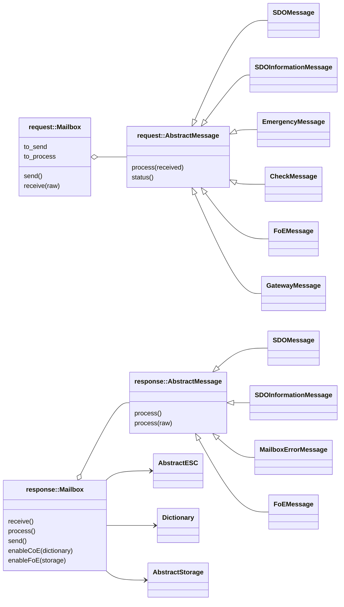
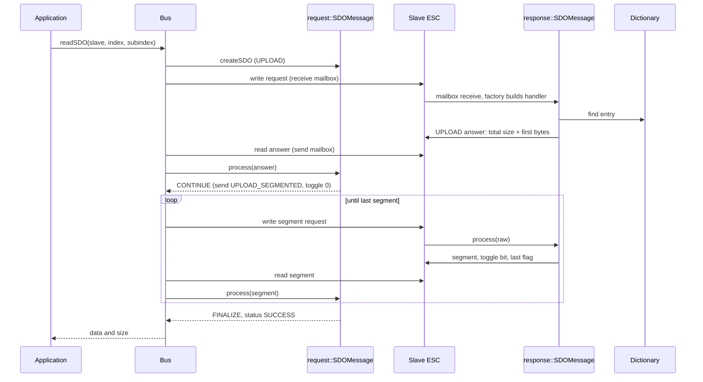

# Mailboxes in KickCAT

> How does KickCAT send a mailbox message and wait for its answer, on both sides of the wire?
>
> You will learn:
>
> - why the master and the slave each have their own mailbox class
> - how a message object carries one exchange from request to answer
> - how the master spreads mailbox work over its cyclic loop
> - how the slave serves requests from its object dictionary and its files
> - what to add to support a new mailbox protocol

[Chapter 0.6](mailboxes.md) explained what a mailbox is: a pair of
SyncManagers that carry messages which are not cyclic, such as Service Data
Objects (SDOs), emergencies and files. This chapter shows how KickCAT builds
that exchange in code.

## The problem: one exchange, many cycles

A mailbox exchange is slow compared to a process data cycle. The master writes a
request into the slave's receive mailbox. Later, the slave application reads
it, does the work, and writes an answer into its send mailbox. Later again, the
master sees that the send mailbox is full and reads the answer. A segmented
transfer repeats this loop once per segment.

So one exchange spans many cycles, and several exchanges can be open at the
same time on different slaves. Something must remember where each exchange is,
match an answer to the request that caused it, and give up when the slave does
not answer.

There are two common ways to write this:

- **A blocking call.** The function sends the request, then waits in a loop
  until the answer arrives. It is simple to read, but it holds the thread, and
  the cyclic process data stops while it waits.
- **A state object.** Each exchange is an object that knows its own state. The
  cyclic loop gives it each received message, and the object decides if the
  message is its answer and what to send next. It never blocks, but the caller
  must check the object for completion.

**KickCAT keeps the state object at the core and builds the blocking call on
top of it.** This follows the principle in [Chapter 1](principles.md): the
application owns the loop, and blocking helpers are a convenience.

## Two sides, one protocol codebase

The master and the slave see the same mailbox from opposite sides. The master
sends requests and processes answers. The slave receives requests and sends
answers. KickCAT puts both sides in one header, in two namespaces:

- `mailbox::request` is the master side. Its `Mailbox` belongs to one remote
  slave, and its messages are requests waiting for an answer.
- `mailbox::response` is the slave side. Its `Mailbox` is bound to an
  EtherCAT Slave Controller (ESC), and its messages are handlers that build
  answers.

Both sides share the protocol definitions: the mailbox header, the CoE and FoE
headers, the SDO command codes and the abort codes. A protocol is written once,
and each side implements its own half of the exchange.



The diagram shows the two hierarchies: each side has a mailbox that holds message objects, one subclass per service.

## The master side

### A message is one exchange

On the master, each slave record owns a `mailbox::request::Mailbox`. The
mailbox is a factory: `createSDO`, `createSDOInfoGetOD`, `createFoERead`,
`createFoEWrite` and `createGatewayMessage` build a message, put it in the
`to_send` queue, and return a shared pointer to it. The caller keeps that
pointer and reads `status()` to know where the exchange is: `RUNNING`,
`SUCCESS`, `TIMEDOUT`, or an error code of the service.

When the bus writes a message to the slave, the mailbox moves it to the
`to_process` list. When the bus reads an answer, the mailbox offers it to each
message in `to_process`, in order. Each message returns one of four results:

| Result | Meaning |
|---|---|
| `NOOP` | The answer is not mine. Offer it to the next message. |
| `CONTINUE` | The answer is mine, and I have another request to send. Put me back in `to_send`. |
| `FINALIZE` | The answer is mine, and the exchange is over. Remove me. |
| `FINALIZE_AND_KEEP` | The answer is mine, but keep me for the next one. |

`CONTINUE` is how a segmented transfer works: the same object sends the next
segment request. `FINALIZE_AND_KEEP` is how a listener works. After
initialization, the bus adds an `EmergencyMessage` to every slave that supports
CoE. It catches every CoE emergency the slave sends, stores it in the
mailbox's `emergencies` list, and stays in place. A `CheckMessage` also stays
in place: it logs and drops the messages of protocols that the master does not
handle, and the SDO requests that a slave should not send.

The timeout of a message is checked each time the mailbox sends or receives.
An FoE message restarts its timeout at each exchange, so a long file transfer
does not time out as long as the slave keeps answering.

### The bus moves the bytes

The mailbox does not touch the network. The `Bus` does, in four steps, each a
set of datagrams for all slaves that have a mailbox:

1. `sendMailboxesReadChecks` reads the status of the slave's send mailbox. It
   sets `can_read` when an answer is waiting.
2. `sendReadMessages` reads the answer from each slave with `can_read`, and
   gives it to the slave's mailbox.
3. `sendMailboxesWriteChecks` reads the status of the slave's receive mailbox.
   It sets `can_write` when the slave has room for a new request.
4. `sendWriteMessages` writes the next request of each slave with `can_write`.

These calls only queue datagrams. The frames leave and the callbacks run when
the application calls `finalizeDatagrams` and `processAwaitingFrames`, as for
process data (see [Chapter 4](transport.md)).

The status checks can also ride in the cyclic process data frame. With
`configureMailboxStatusCheck`, the bus maps the mailbox status bits of each
slave into the logical frame with extra Fieldbus Memory Management Units
(FMMUs), so steps 1 and 3 come for free with each cycle.

### Two ways to drive it

**From the cyclic loop.** `MailboxSequencer` runs one of the four steps per
call, in a round robin. Reads come before writes, so the answer is freed from
the slave before the next request arrives. A period lets the application run a
step only every N cycles. When the status checks are mapped in the cyclic
frame, the sequencer skips them.

```cpp
auto sdo = slave.mailbox.createSDO(0x1018, 1, false, CoE::SDO::request::UPLOAD, &value, &size);
MailboxSequencer sequencer(bus);
while (true)
{
    bus.sendLogicalRead(error);
    bus.sendLogicalWrite(error);
    sequencer.step(error);
    bus.finalizeDatagrams();
    bus.processAwaitingFrames();
    if (sdo->status() != mailbox::request::MessageStatus::RUNNING)
    {
        // done: SUCCESS, TIMEDOUT, or an abort code
    }
}
```

**With a blocking helper.** `Bus::readSDO`, `writeSDO`, `readFoE` and
`writeFoE` create the message, then loop on the four steps until the status
leaves `RUNNING`. They throw on failure, as the master does for every error.
They are right during configuration, in PRE-OP, when nothing else runs. During
OP, they would hold the thread that must send process data, so use the
sequencer instead.

### A segmented SDO upload

The sequence shows one blocking `readSDO` of an object too large for one
mailbox message. On the slave, the dictionary answers in segments.



An abort from the slave at any step ends the exchange: the request message
returns `FINALIZE` with the abort code as its status, and `readSDO` throws.

## The slave side

### Receive, process, send

On the slave, `mailbox::response::Mailbox` is built on an `AbstractESC` and a
memory budget: the largest message it accepts, and how many exchanges may be
open at once. It knows no protocol until the application enables one:

- `enableCoE(dictionary)` serves SDO and SDO information requests from the
  object dictionary.
- `enableFoE(storage)` serves file reads and writes from an
  `FoE::AbstractStorage`.

Both take a reference. The application owns the dictionary and the storage,
and they must outlive the mailbox.

`slave::Slave::routine` drives the mailbox with three calls each time:

1. `receive` reads the receive mailbox through the ESC, if a request is there.
2. `process` lets the open handlers do their work and queue answers.
3. `send` writes the next answer into the send mailbox, if it is empty.

A new request is first offered to the open handlers, so a segment reaches the
handler of its transfer. If no handler claims it, each enabled protocol has a
factory that may build a new handler. If no factory accepts it, the mailbox
answers with a mailbox error, `UNSUPPORTED_PROTOCOL`. If too many exchanges are
open, it answers with `NO_MORE_MEMORY`. The mailbox also handles the repeat
request of the protocol: if the master lost an answer, the slave writes it
again.

The slave does not check its dictionary at run time. The dictionary is
validated once, when it is built (see [Chapter 9](from-xml-to-bytes.md)), and
then trusted.

### Files: the storage interface

FoE asks the application for files through `FoE::AbstractStorage`. It has two
calls, `openRead` and `openWrite`, which take a file name and a password and
return an error code and a reader or a writer. A writer receives the data packet
by packet, and `commit` is called when the last packet arrives. If the writer is
destroyed without a commit, the transfer failed and the data must be dropped.

This is a hardware boundary, like the socket and the ESC. The firmware can store
a file in flash, the simulator stores it in a host directory, and the FoE
handlers do not change. FoE is experimental on both sides, see
[FEATURES](../FEATURES.md).

### The bootstrap mailbox

In the BOOT state, a slave uses a second mailbox layout, declared in its
EEPROM, usually to receive new firmware over FoE. On the slave, the application
gives a second mailbox with `setBootstrapMailbox`. Without one, the slave
refuses BOOT. On the master, `Bus::enterBootstrap` moves the slave to INIT,
clears its pending messages, switches the mailbox to the bootstrap layout and
requests BOOT. `exitBootstrap` does the reverse and returns to PRE-OP.

## The mailbox gateway

The EtherCAT Technology Group document ETG.8200 defines a mailbox gateway: a
tool outside the master, for example a configuration tool on another computer,
sends raw mailbox messages to the master over UDP, and the master forwards
them to the right slave.

`Gateway` reads requests from an `AbstractDiagSocket` (`UdpDiagSocket` on
Linux) and passes them to `Bus::addGatewayMessage`. The bus reads the address
in the mailbox header. A slave address queues a `GatewayMessage` in that
slave's mailbox, and the message keeps the raw answer when it arrives.
`Gateway::processPendingRequests` sends completed answers back to the tool.

Address 0 is the master itself. If the application gave the bus a master
mailbox with `setMasterMailbox`, the request is served at once from the
master's own object dictionary, built by `MasterOD` (ETG.1510). That mailbox is
a `mailbox::response::Mailbox` with no ESC: the same code that serves SDOs on a
slave serves them on the master.

## Adding a protocol

Ethernet over EtherCAT (EoE) is the next protocol on the roadmap. Today
KickCAT has its protocol definitions only, and no handler on either side. A new
protocol follows the path of FoE:

1. **Protocol definitions.** Put the headers, opcodes and error codes in a
   `<Protocol>/protocol.h` shared by both sides.
2. **Master side.** Write a `mailbox::request::AbstractMessage` subclass. Its
   `process` returns `NOOP` for any message that is not its answer, so it can
   live next to the others. Add a factory call in `mailbox::request::Mailbox`,
   and a blocking helper on `Bus` if the protocol needs one. If the slave can
   send messages that no request caused, add a persistent handler in
   `Bus::addMailboxHandlers`, as for emergencies.
3. **Slave side.** Write a `mailbox::response::AbstractMessage` subclass and a
   factory function that returns a handler for a message of your type, or
   `nullptr`. Register the factory with an `enable<Protocol>` call on the
   response mailbox, which also takes the application object the protocol needs.
4. **Simulation.** Enable the protocol in the simulated slave, so that a master
   test can run against the real slave code (see [Chapter 8](simulation.md)).

## Summary

| Question | Answer |
|---|---|
| Who keeps the state of an exchange? | The message object. |
| Who moves the bytes? | The `Bus` on the master, `slave::Slave::routine` on the slave. |
| Does a mailbox call block? | Only the `Bus` helpers. The core never blocks. |
| Who owns the dictionary and the files? | The application. The mailbox holds references. |
| How does the slave reject a message? | With a mailbox error or an SDO abort code, never an exception. |

## In the code

- `lib/include/kickcat/Mailbox.h`: both mailboxes and the message base classes.
- `lib/include/kickcat/CoE/mailbox/request.h`, `response.h`: CoE messages.
- `lib/include/kickcat/FoE/mailbox/request.h`, `response.h`, `FoE/Storage.h`: FoE.
- `lib/master/include/kickcat/MailboxSequencer.h`: the round robin of the four steps.
- `lib/master/src/CoE.cc`, `FoE.cc`: the blocking helpers and the bootstrap switch.
- `lib/master/include/kickcat/Gateway.h`, `MasterOD.h`: the ETG.8200 gateway and the master dictionary.
- Example: `examples/master/gateway/` for the gateway, and `tools/foe.cc` for FoE.

## Where to go next

- What a mailbox is on the wire: [Chapter 0.6](mailboxes.md).
- How datagrams are queued and sent: [Chapter 4](transport.md).
- How the slave state machine activates the mailbox: [Chapter 6](slave.md).
- How the object dictionary is built and validated: [Chapter 9](from-xml-to-bytes.md).
