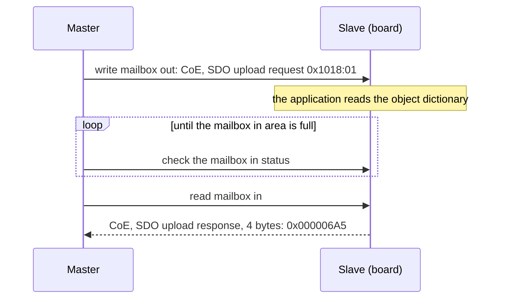

# Mailboxes: CoE and FoE

> How do the master and a slave exchange data that is not part of the cycle?
>
> You will learn:
>
> - why EtherCAT needs a second kind of traffic beside process data
> - how a mailbox works, and how the master learns that a reply is waiting
> - what the CANopen object dictionary and SDOs are
> - how a file, such as a new firmware, reaches a slave with FoE

## The problem: data that is not cyclic

Process data ([Chapter 0.5](process-data.md)) has a fixed layout and travels
every cycle. Much of the data a master needs is different:

- **Configuration.** Before the machine starts, the master sets parameters: a
  gear ratio, a filter, the PDO mapping of a drive.
- **Diagnostics.** A slave reports an error when it happens, not every cycle.
- **Files.** A new firmware can be several hundred kilobytes.

This data is sent once, at an unknown time, and its size varies. Putting it in
the cyclic frame would waste bandwidth on every cycle. EtherCAT sends it in a
separate exchange called the **mailbox**. A message goes to one slave, and the
slave answers when it is ready.

## The mailbox: two SyncManagers and a handshake

A slave with a mailbox reserves two areas of its memory, each guarded by a
SyncManager (see [Chapter 0.3](inside-a-slave.md)):

- the **mailbox out** area, written by the master and read by the slave (on the
  board: SyncManager 0 at `0x1000`, 128 bytes)
- the **mailbox in** area, written by the slave and read by the master (on the
  board: SyncManager 1 at `0x1400`, 128 bytes)

These SyncManagers work in **mailbox mode**. There is one buffer, and it is
either **full** or **empty**. When the master writes the last byte of the
mailbox out area, the buffer becomes full and the slave is told. The master
cannot write again until the slave has read the message, which makes the buffer
empty again. The mailbox in area works the same way in the other direction. This
handshake makes sure that no message is overwritten before its reader has seen
it.

Every message starts with a **mailbox header** of 6 bytes:

| Field | Meaning |
|---|---|
| Length | The size of the data after the header. |
| Address | The station address of the sender, used when a message is routed through a gateway. |
| Channel and priority | Rarely used. Usually 0. |
| Type | The protocol of the message: CoE, FoE, EoE, and so on, or an error. |
| Counter | A number from 1 to 7 that changes with each new message, so that a slave can detect a repeated one. |

## The polling problem

A slave cannot speak first on EtherCAT: every frame comes from the master. So
the master must find out by itself that a reply is waiting in a mailbox in area.
There are two ways:

- **Read the status of each slave.** The master reads the status register of the
  mailbox in SyncManager of each slave. The cost is one datagram per slave and
  per check.
- **Map the status into the logical space.** The master configures one more FMMU
  in each slave, which maps the "mailbox full" bit into the logical address
  space. One logical read then checks every slave at once.

The master also checks that a mailbox out area is empty before it writes a new
message into it.

## CoE: CANopen over EtherCAT

**CANopen over EtherCAT (CoE)** reuses the application layer of CANopen, a
fieldbus that existed before EtherCAT. Its center is the **object dictionary**:
the table of every value a slave exposes. Each entry is named by a 16-bit
**index** and an 8-bit **subindex**. The index ranges follow a convention:

| Index range | Content | Example on the board |
|---|---|---|
| `0x1000` - `0x1FFF` | Communication: identity, PDO mappings, SyncManager settings | `0x1018`, the identity object |
| `0x6000` - `0x6FFF` | Input values of the device | `0x6000`, `accel_x` |
| `0x7000` - `0x7FFF` | Output values of the device | `0x7000`, `LED_R` |

A **Service Data Object (SDO)** transfer reads or writes one entry. Reading is
called an **upload** (from the slave to the master), and writing is called a
**download**. There are three sizes of transfer:

- **Expedited:** up to 4 bytes travel inside the request or reply itself.
- **Normal:** the data fits in one mailbox message.
- **Segmented:** the data is larger than a mailbox. The rest follows in segments,
  each one asked for by the master.

The sequence below shows an expedited upload of the board's vendor ID, entry
`0x1018` subindex 1. It is a 4-byte value, `0x000006A5`.

The master writes the request, polls until the reply is ready, and reads it.
When an SDO fails, for example because the entry does not exist, the slave
answers with an **abort** that carries an error code instead.

CoE has two more services that matter here:

- **SDO Information** lets the master read the list of objects in the dictionary
  and the description of each one: its name, data type and access rights. A tool
  can show the dictionary of a device it has never seen.
- An **Emergency** is a short message that the slave sends when an error happens.
  It holds an error code, an error register and a few vendor bytes. It waits in
  the mailbox in area until the master reads it.

## FoE: File over EtherCAT

**File over EtherCAT (FoE)** moves a file between the master and a slave. A
write goes like this:

1. The master sends a **write request** with the file name and an optional
   password.
2. The slave accepts it with an **acknowledgement (ACK)** of packet 0.
3. The master sends **DATA** packets numbered 1, 2, 3, and the slave acknowledges
   each one.
4. A DATA packet shorter than the largest one possible ends the transfer.

A read is the same exchange in the other direction: the master sends a **read
request**, the slave sends DATA packets, and the master acknowledges each one.
A slave can answer **BUSY** to ask the master to wait, for example while it
writes to flash memory. Either side can stop the transfer with an **ERROR**
packet that holds an error code.

FoE is the usual way to update a firmware. For that, the master moves the slave
to the **BOOT** state ([Chapter 0.4](state-machine.md)). In that state, the slave
often runs a small bootloader that only knows FoE, with its own mailbox areas
described in its EEPROM.

## The other protocols

- **Ethernet over EtherCAT (EoE)** carries standard Ethernet frames, for example
  to reach a web server inside a slave.
- **Servo drive profile over EtherCAT (SoE)** carries the servo drive profile of
  IEC 61800-7, known from SERCOS.
- **ADS over EtherCAT (AoE)** carries Beckhoff's Automation Device Specification
  messages.
- **Vendor specific over EtherCAT (VoE)** is free for each vendor to define.

A **mailbox gateway** (ETG.8200) lets a tool on another computer send mailbox
messages to the slaves through the master, for example over UDP.

## Summary

| Question | Answer |
|---|---|
| Why a mailbox? | For data that is not cyclic: configuration, diagnostics and files. |
| How many SyncManagers does it use? | Two: one for each direction, in mailbox mode. |
| How does the master know that a reply is waiting? | It polls the mailbox status, one slave at a time or all at once with a mapped status bit. |
| How is a value named in CoE? | By an index and a subindex in the object dictionary. |
| How does a firmware reach a slave? | With FoE, usually in the BOOT state. |

## In KickCAT

KickCAT supports CoE on the master and the slave, including segmented transfers,
SDO Information and emergencies on the master. FoE is experimental on both sides,
and EoE is planned. See [docs/FEATURES.md](../FEATURES.md) for the details.
[Chapter 5](mailbox-implementation.md) shows how the mailboxes are built in the
code.

## Where to go next

- The state machine and the BOOT state: [Chapter 0.4](state-machine.md).
- How the master and the slave stacks implement mailboxes:
  [Chapter 5](mailbox-implementation.md).
- Where the object dictionary of a device comes from:
  [Chapter 0.8](device-descriptions.md).
