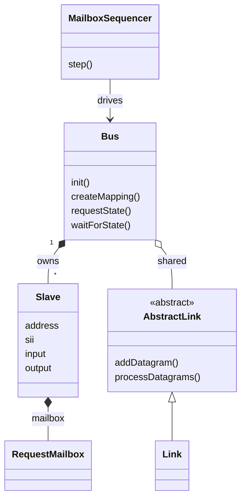
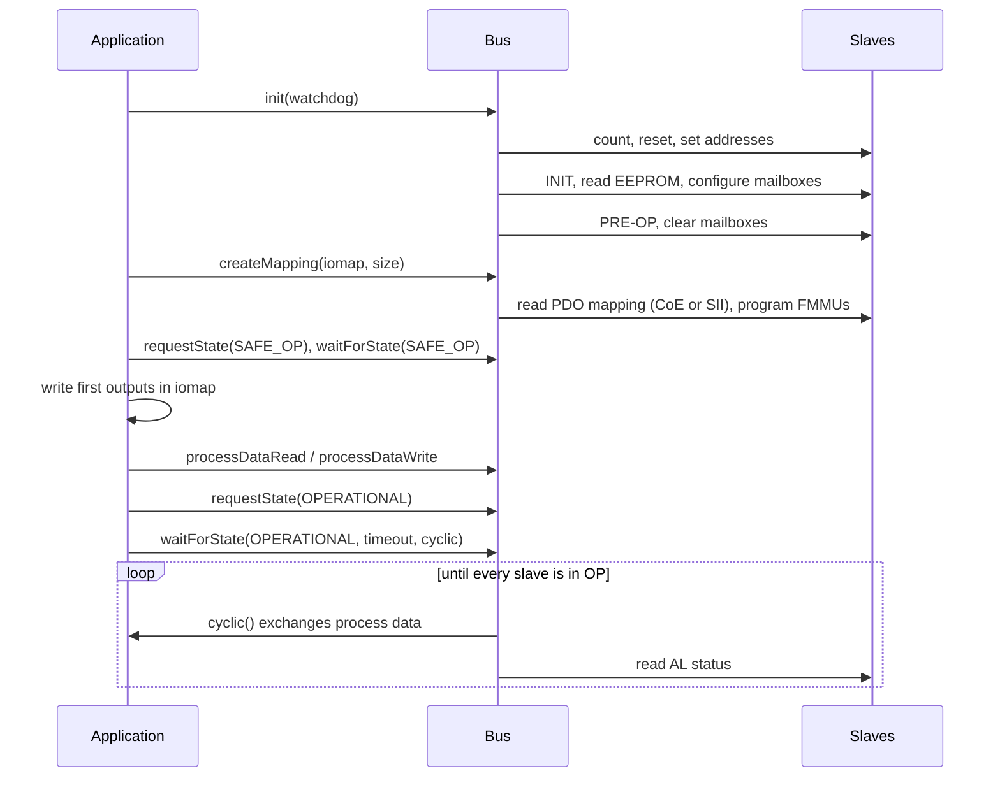
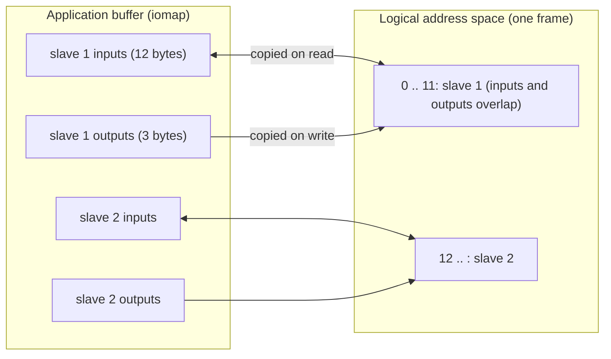

# The master: from discovery to OP

> How does a KickCAT master find its slaves, map their process data, and run the
> cycle?
>
> You will learn:
>
> - which objects make up a master, and who owns what
> - the order of calls that takes a bus from power-on to OPERATIONAL
> - how the process image is laid out in your buffer and on the wire
> - how to write the cyclic loop, and where mailbox traffic fits in it
> - how errors reach your code

## The problem: one program drives a whole bus

A master application wants simple things. It wants to read 12 bytes of sensor
data from the Freedom K64F board and write 3 bytes to its LEDs, every
millisecond. It wants to read a parameter now and then. It wants to know when
something breaks.

Between that wish and the wire there is a lot of work. The master must find the
slaves, give each one an address, read each EEPROM, configure the mailboxes,
discover the process data mapping, program the FMMUs and SyncManagers, and walk
every slave through the state machine (see [Chapter 0.4](state-machine.md)).
Then it must exchange process data at a fixed rate, without blocking on a slow
mailbox.

A master library can take one of two shapes:

- **A framework.** It owns a thread, runs the cycle itself and calls the
  application back. The application is easy to start, but it cannot choose its
  scheduling, its thread priority, or what else runs in the same cycle.
- **A toolbox.** It gives the application the steps of a cycle, and the
  application calls them in its own loop. The application writes a few more
  lines, but it keeps control of time.

KickCAT is a toolbox. The stack starts no thread (see
[Chapter 1](principles.md)). Your `main` owns the loop and decides when frames
go out.

## The objects of a master

A master is built from three layers:

- **`Bus`** is the central object. It holds the list of slaves, runs the
  bring-up sequence, builds the process data frames and offers the calls of
  the cyclic loop.
- **`Slave`** (`kickcat::Slave`) is the master's record of one remote slave: its
  station address, its parsed EEPROM (the SII), its ESC description, its last AL
  status, its error counters, its request mailbox and its process data mapping.
  It is plain data that `Bus` fills in. Do not confuse it with
  `kickcat::slave::Slave`, which is the slave stack itself (see
  [Chapter 6](slave.md)).
- **`AbstractLink`** (implemented by `Link`) carries datagrams to the wire and
  back. `Bus` only talks to the link, never to a socket. [Chapter 4](transport.md)
  covers this layer.



The diagram shows that `Bus` owns its slaves, shares the link with the
application, and that each slave record holds a request mailbox
(`mailbox::request::Mailbox`, see [Chapter 5](mailbox-implementation.md)).

The application creates the link first, then hands it to `Bus`. It keeps its own
reference to the link, because some settings belong to the link and not to the
bus, such as the read timeout.

## Bring-up: from power-on to OPERATIONAL

The bring-up has three parts, and the application calls each one.

**`Bus::init()` takes the bus to PRE-OP.** It counts the slaves with a broadcast
read (the working counter gives the number of slaves), resets their registers,
gives each one a station address, and reads its ESC and data link
descriptions. It requests INIT, reads every EEPROM, configures the mailbox
SyncManagers, and requests PRE-OP. Last, it empties the mailboxes and installs
the handlers for messages a slave can send on its own, such as CoE emergencies.
After `init()`, `bus.slaves()` lists every slave with its SII parsed.

**`Bus::createMapping()` prepares the process data.** It finds the size of each
slave's inputs and outputs, gives them logical addresses, places them in your
buffer, builds the frames of the cycle and programs the FMMUs. It does not
change the state of any slave.

**The application then requests SAFE-OP and OP.** It calls `requestState()` and
`waitForState()` for each state. A slave enters OP only once it has received
valid outputs, so the application writes outputs before it asks for OP, and
keeps exchanging process data while it waits.



The sequence shows that the application drives each step, and that
`waitForState()` calls back into the application to keep process data moving.

`requestState()` and `waitForState()` exist in two forms: one for the whole bus,
and one for a single slave. The single-slave form lets a tool move one slave
without touching the others, for example to enter the Bootstrap state for a
firmware update (see [Chapter 5](mailbox-implementation.md)).

Steps that need the slaves before mapping go between `init()` and
`createMapping()`. This is where an application writes SDOs to configure a
drive, or changes a PDO mapping. Mailbox calls such as `readSDO()` work from
PRE-OP onwards.

## Finding the process data mapping

`createMapping()` must know how many bytes each slave sends and receives, and
which SyncManager carries them. There are three sources of truth, and KickCAT
uses them in this order for each slave:

1. **Static mapping.** If the application sets `is_static_mapping` on a slave,
   with the byte sizes and SyncManagers of its input and output, the bus trusts
   those values and asks the slave nothing.
2. **CoE.** If the slave supports CoE, the bus reads the SyncManager types
   (object 0x1C00), the PDO assignment of each process data SyncManager
   (0x1C12 and 0x1C13) and each assigned PDO mapping, over SDO. This is the
   live mapping, so it reflects any change the application made in PRE-OP.
3. **SII.** Otherwise, the bus adds up the PDO entries described in the EEPROM.

To change the mapping of a CoE slave, write the new mapping in PRE-OP, before
`createMapping()`. The free function `mapPDO()` does this for the common case of
one PDO per direction: it writes the PDO mapping object, then assigns it to the
SyncManager.

KickCAT supports one input and one output block per slave (see the
[feature matrix](../FEATURES.md)).

## The process image

The **process image** is the memory where the application reads its inputs and
writes its outputs. KickCAT does not allocate it. The application passes a
buffer and its size to `createMapping()`, and the bus throws if the buffer is too
small. This follows the principle that the caller owns the memory.

Two layouts must be kept apart:

- **In your buffer**, the bus places the inputs of all slaves first, in bus
  order, then the outputs of all slaves. After mapping, each `Slave` holds a
  pointer to its blocks: `slave.input.data` and `slave.output.data`, with their
  sizes in `bsize`.
- **On the wire**, each slave gets a range of the logical address space (see
  [Chapter 0.5](process-data.md)). The inputs and the outputs of one slave share
  the same logical range. The FMMUs of the slave route reads to its input
  SyncManager and writes to its output SyncManager. This overlap makes a
  logical read-write (LRW) frame as short as possible. A frame holds at most
  1486 bytes of data, so a slave that does not fit starts the next frame.



The flowchart shows that your buffer and the frame have different layouts, and
that the bus copies between them at each exchange.

With the Freedom K64F board alone, the buffer holds 12 input bytes followed by 3
output bytes. On the wire, the slave owns logical bytes 0 to 11: an LRW frame
writes the 3 LED bytes and reads back the 12 sensor bytes in the same 12 bytes.

The copies happen in the datagram callbacks. With a logical read (LRD), the bus
copies the inputs into your buffer even if the working counter is wrong, and
then reports the error. With a logical read-write (LRW), it copies the inputs
only when the working counter is right. On a write, it copies your outputs into
the frame just before sending.

The application must keep the buffer alive and in place as long as the bus runs.
If it needs another layout, `mapProcessImage()` binds a new buffer to an
existing mapping without touching the slaves.

## The cyclic loop

The bus gives two ways to exchange process data.

**Blocking helpers.** `processDataRead()`, `processDataWrite()` and
`processDataReadWrite()` send one kind of datagram and wait for the answer. They
are simple, and they suit bring-up, tools and tests.

**Batched calls.** For a real-time cycle, the application queues several
operations, sends them in as few frames as possible, and processes all answers
at once:

- `sendLogicalRead()`, `sendLogicalWrite()` or `sendLogicalReadWrite()` queue
  the process data datagrams.
- `MailboxSequencer::step()` queues one mailbox operation (see below).
- Other `send*()` calls queue diagnostics, such as `sendRefreshErrorCounters()`.
- `finalizeDatagrams()` sends the last, partly filled frame.
- `processAwaitingFrames()` reads the answers and calls the callbacks.

```mermaid
sequenceDiagram
    participant App as Application loop
    participant Bus
    participant Link
    participant Wire
    App->>Bus: sendLogicalRead(error)
    App->>Bus: sendLogicalWrite(error)
    App->>Bus: sequencer.step(error)
    Bus->>Link: addDatagram(...) for each
    App->>Bus: finalizeDatagrams()
    Link->>Wire: send frame(s)
    App->>Bus: processAwaitingFrames()
    Wire-->>Link: frames come back
    Link->>Bus: process callbacks (copy inputs, check WKC)
    Link->>App: error callbacks for failed datagrams
    App->>App: wait for the next tick
```

The sequence shows one cycle: everything is queued first, then sent, then all
answers are processed in one place.

The loop also decides the rate. A typical loop waits on a `Timer` at the start
of each iteration, then runs the calls above. The stack does not care where the
loop runs, so the application chooses the thread, its priority and its CPU.

Choose between separate read and write datagrams (LRD and LWR) and one
read-write datagram (LRW). LRW is shorter on the wire. Separate datagrams still
deliver the inputs when the working counter shows that a slave did not take
part.

## Mailboxes inside the cycle

A mailbox exchange takes four steps: check if the slave has a message to read,
read it, check if the slave can accept a message, write one. Doing all four on
every cycle would load the bus for no gain.

`MailboxSequencer` runs one of the four steps per call, in a round. Reads come
before writes, so a slave's outbox is freed early. A `period` parameter slows
the round down further: with a period of 2, the sequencer acts every second
call.

The blocking mailbox helpers, `readSDO()`, `writeSDO()`, `readFoE()` and
`writeFoE()`, are built on the same calls. They queue a message, then loop on
mailbox checks and transfers until the message completes or times out. This is
the principle of an asynchronous core with blocking helpers on top. Use the
blocking helpers outside the cycle. Inside the cycle, create the message on the
slave's mailbox and let the sequencer carry it, then poll its status.

The mailbox state can also travel in the process data frame. With
`configureMailboxStatusCheck()`, called in PRE-OP before `createMapping()`, the
bus maps the mailbox status bits of each slave with extra FMMUs. The cyclic
logical read then updates them for free, and the sequencer skips the matching
check step. The slave must have enough FMMUs, and the bus checks this.

## Errors

The master reports errors with C++ exceptions. Three types carry extra
information:

- `ErrorAL` carries the AL status code of a slave that refused a state change.
  `waitForState()` throws it when a slave sets its error flag.
- `ErrorCoE` and `ErrorFoE` carry the abort or error code of a mailbox transfer.
- `ErrorDatagram` carries the state of a failed datagram, such as `LOST` or
  `INVALID_WKC`.

All of them derive from `kickcat::Error`, which derives from `std::exception`.

The batched calls take an **error callback** instead of throwing on their own.
The link calls it once for each datagram that was lost or whose working counter
was wrong. The callback decides: it may log and continue, count errors, or
throw. If it throws, the link finishes the cycle, then rethrows. A real-time
loop usually tolerates a lost frame now and then, so the choice belongs to the
application.

## Higher layers

Some features sit on top of `Bus` and use only its public API:

- **`CoE::CiA::DS402::Drive`** drives one CiA 402 servo drive. It configures the
  drive's PDO mapping over SDO before `createMapping()`, attaches to the drive's
  process data after mapping, and runs the CiA 402 state machine on each call
  to `update()` in the cycle.
- **The mailbox gateway** (`Gateway`) forwards mailbox requests from outside
  tools to the slaves, and the **master object dictionary** (`MasterOD`) answers
  the requests addressed to the master itself. [Chapter 5](mailbox-implementation.md)
  covers both.
- **Diagnostics** helpers rebuild the topology from the port status of each
  slave, and the bus refreshes the error counters with
  `sendRefreshErrorCounters()`.

## Summary

| Question | Answer |
|---|---|
| Who runs the cycle? | The application, in its own loop and thread. |
| Who allocates the process image? | The application. `createMapping()` checks the size. |
| Does `createMapping()` change the state? | No. The application requests SAFE-OP, then OP. |
| Where does the mapping come from? | Static settings, then CoE, then the SII. |
| How does mailbox traffic share the cycle? | `MailboxSequencer` runs one mailbox step per call. |
| How are errors reported? | Exceptions, and error callbacks for cyclic datagrams. |

## In the code

- `lib/master/include/kickcat/Bus.h`: the bus, the mapping and the cyclic calls.
- `lib/master/include/kickcat/Slave.h`: the master's record of a slave.
- `lib/master/include/kickcat/MailboxSequencer.h`: mailbox steps in the cycle.
- `lib/include/kickcat/Error.h`: the error types.
- `lib/master/include/kickcat/CoE/CiA/DS402/Drive.h`: the CiA 402 helper.
- Read `examples/master/simulated_bus/simulated_bus.cc` for the shortest
  complete bring-up, and
  `examples/master/freedom-k64f/freedom_k64f_static_map_example.cc` for a real
  cyclic loop with a timer and a mailbox sequencer.

## Where to go next

- How datagrams reach the wire and come back: [Chapter 4](transport.md).
- How mailbox messages work on both sides: [Chapter 5](mailbox-implementation.md).
- How to lock the cycle to the slaves' clocks: [Chapter 7](distributed-clocks.md).
- The protocol behind the process image: [Chapter 0.5](process-data.md).
