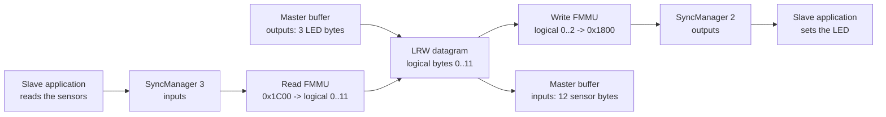

# Process data

> How do the inputs and outputs of every slave travel, cycle after cycle?
>
> You will learn:
>
> - what process data is, and why "input" and "output" depend on who speaks
> - what a PDO, a PDO mapping and a PDO assignment are
> - how one logical datagram reaches many slaves at once
> - what the working counter of that datagram tells the master

## The problem: the same small exchange, again and again

A machine controller runs a **cycle**: read the sensors, compute, write the
actuators, and start again, often every millisecond. The data of that loop is
called **process data**. It is small, its layout never changes while the machine
runs, and it must arrive on time, every time.

The Freedom K64F board of the running example has 3 bytes of outputs, the red,
green and blue levels of its LED, and 12 bytes of inputs: three accelerometer
axes and three magnetometer axes, each a 16-bit signed integer. Every cycle, the
master must send the 3 LED bytes to the board and bring back the 12 sensor bytes.

Reading registers slave by slave would cost one datagram per slave and per
direction. On a machine with fifty slaves, that is a hundred datagrams for one
cycle. EtherCAT does the whole exchange with one datagram.

## Inputs, outputs, RxPDO and TxPDO

Two points of view name the same bytes:

- The **master** speaks of **outputs** (data it sends to the field) and
  **inputs** (data it reads from the field).
- The **slave** speaks of what it receives and what it transmits.

A **Process Data Object (PDO)** is a group of values that travel together. A
**RxPDO** is received by the slave, so it carries the master's outputs. A
**TxPDO** is transmitted by the slave, so it carries the master's inputs.

**Master outputs travel in RxPDOs. Master inputs travel in TxPDOs.**

On the board, RxPDO `0x1600` holds the three LED values and TxPDO `0x1A00` holds
the six sensor values.

## Mapping and assignment: what goes where

The content of a PDO is described inside the slave's **object dictionary**, the
table of every value the slave exposes (see [Chapter 0.6](mailboxes.md)). Two
kinds of objects describe it:

- A **PDO mapping** object lists the values that make up one PDO, in order, with
  their size in bits. RxPDO mappings use the indexes `0x1600` to `0x17FF`, and
  TxPDO mappings use `0x1A00` to `0x1BFF`. Mapping `0x1600` of the board says:
  "object `0x7000` (8 bits), then `0x7001` (8 bits), then `0x7002` (8 bits)".
- A **PDO assignment** object lists the PDOs that one SyncManager carries.
  `0x1C12` assigns RxPDOs to the output SyncManager, and `0x1C13` assigns TxPDOs
  to the input SyncManager.

A **SyncManager** is the part of the slave controller that guards one area of
its memory (see [Chapter 0.3](inside-a-slave.md)). For the board, SyncManager 2
holds the 3 output bytes at address `0x1800`, and SyncManager 3 holds the 12
input bytes at address `0x1C00`. Process data SyncManagers work in **buffered
mode**: the slave controller keeps three buffers, so that a reader always gets
the last complete write and never a half-written one.

A mapping is either **fixed**, written into the device once and for all, or
**configurable**, so that the master may choose the values it wants in PRE-OP
by writing the mapping and assignment objects. The board's mapping is fixed.
A drive is the usual example of a configurable one: the master picks the
position, velocity or torque values that its control mode needs.

## One datagram for the whole bus: the logical address space

The master does not address each slave for process data. It uses a **logical
address space**: a flat range of 4 GiB that exists only by convention between
the master and the slaves. The master gives each slave a window in that range.

Each slave holds a few **Fieldbus Memory Management Units (FMMU)**. An FMMU
translates one window of logical addresses to one area of the slave's own
memory, in one direction. The board has two FMMUs:

- one maps its logical output window to SyncManager 2, for writing
- one maps its logical input window to SyncManager 3, for reading

The master then sends one **Logical Read Write (LRW)** datagram that covers the
whole logical range. As the frame passes through each slave, every FMMU that
matches a part of the range acts on it: a write FMMU copies the bytes from the
frame into the slave's memory, and a read FMMU puts the slave's bytes into the
frame. The frame comes back with the inputs of every slave, and every slave has
taken its outputs.

The diagram follows the board's bytes: the LED values go from the master's
buffer through the write FMMU into SyncManager 2, and the sensor values come
back from SyncManager 3 through the read FMMU into the same datagram.

The input and output windows of one slave may even overlap. A slave controller
takes the output bytes from the frame before it puts its input bytes in their
place, so one range of 12 bytes is enough for the board's 3 outputs and 12
inputs.

On the master side, the bytes of every slave land in one buffer called the
**process image**. The application reads its inputs and writes its outputs
there, at the offsets the master gave each slave.

## The working counter: did everyone take part?

Each datagram carries a **working counter (WKC)** that the slaves increment
when they act on it (see [Chapter 0.2](frames-and-datagrams.md)). For a logical
datagram, each slave adds:

| What the slave did | Added to the WKC |
|---|---|
| read data into the frame (an input FMMU matched) | +1 |
| wrote data from the frame (an output FMMU matched) | +2 |
| both | +3 |

The board has both, so an LRW over a bus with only the board comes back with a
WKC of 3. The master knows the value to expect from its own configuration. When
the WKC is lower, at least one slave did not exchange its data: it may be
unplugged, it may not be in a state where it exchanges that data (see
[Chapter 0.4](state-machine.md)), or a cable may be broken. The data of that cycle cannot be trusted, and the master must react.

## Summary

| Question | Answer |
|---|---|
| Who calls the LED values outputs? | The master. The slave receives them in a RxPDO. |
| What lists the values in a PDO? | A PDO mapping object, `0x16xx` or `0x1Axx`. |
| What ties PDOs to a SyncManager? | The PDO assignment objects `0x1C12` and `0x1C13`. |
| How many datagrams does a cycle need? | One logical datagram (LRW) for the whole bus, if it fits in a frame. |
| What translates logical addresses to slave memory? | The FMMUs of each slave. |
| How does the master detect a missing slave? | The working counter is lower than expected. |

## In KickCAT

KickCAT reads each slave's mapping at startup, gives each slave one logical
window where inputs and outputs overlap, and builds the frames of the cycle once.
The application owns the process image buffer. [Chapter 3](master.md) shows this
in the master's code.

## Where to go next

- The SyncManagers and FMMUs inside the slave controller:
  [Chapter 0.3](inside-a-slave.md).
- The traffic that is not cyclic, and the object dictionary behind the PDO
  mappings: [Chapter 0.6](mailboxes.md).
- How the master builds the process image and runs the cycle:
  [Chapter 3](master.md).
