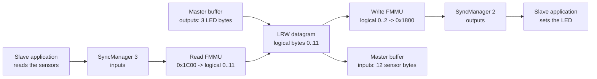

# Process data

> How does the master exchange inputs and outputs with each slave?
>
> You will learn:
>
> - how the master and slave name process data
> - what a process data object (PDO), mapping, and assignment are
> - how a logical datagram reaches several slaves
> - how the master checks the working counter (WKC)

## The problem: the same small exchange, again and again

In each **cycle**, the controller reads sensors, calculates commands, and writes to
actuators. The cycle often repeats every millisecond. The small set of values
exchanged each cycle is called **process data**. Its layout stays fixed while the
machine runs. The data must arrive on time.

Each cycle, the master sends 3 output bytes to the Freedom K64F board. They set the
red, green, and blue levels of its light-emitting diode (LED). The board returns 12
input bytes. Its accelerometer and magnetometer each return three signed 16-bit
values.

Separate register reads and writes would take two datagrams per slave, or 100 per
cycle for 50 slaves. EtherCAT can use
one datagram for the exchange.

## Inputs, outputs, RxPDO and TxPDO

The direction depends on the device.

- The **master** sends outputs and reads inputs.
- The **slave** receives the master's outputs and transmits the master's inputs.

A **PDO** groups values for transfer. A receive PDO (**RxPDO**) carries outputs to
the slave. A transmit PDO (**TxPDO**) carries inputs to the master.

On the board, RxPDO `0x1600` holds the three LED values and TxPDO `0x1A00` holds
the six sensor values.

## Mapping and assignment: what goes where

A slave's **object dictionary** lists the values it exposes. Two types of objects
describe its PDOs. See [Chapter 0.6](mailboxes.md).

- A **PDO mapping** object lists the values that make up one PDO, in order, with
  their size in bits. RxPDO mappings use the indexes `0x1600` to `0x17FF`, and TxPDO
  mappings use `0x1A00` to `0x1BFF`. On the board, mapping `0x1600` lists `0x7000`,
  `0x7001`, and `0x7002` in that order. Each entry is 8 bits.
- A **PDO assignment** object lists the PDOs that one SyncManager carries.
  `0x1C12` assigns RxPDOs to the output SyncManager, and `0x1C13` assigns TxPDOs
  to the input SyncManager.

A **SyncManager** controls access to an area of slave memory (see [Chapter
0.3](inside-a-slave.md)). On the board, SyncManager 2 holds the 3 output bytes at
`0x1800`. SyncManager 3 holds the 12 input bytes at `0x1C00`. Process data uses
**buffered mode**. The controller keeps three buffers so the reader always gets the
latest complete value.

A **fixed** mapping stays the same. With a **configurable** mapping, the master
writes the mapping and assignment objects in the pre-operational state (PRE-OP). The
board has a fixed mapping. A drive can have a configurable mapping for position,
velocity, or torque, depending on its control mode.

## One datagram for the whole bus: the logical address space

For cyclic data, the master uses one **logical address space** of 4 gibibytes (GiB).
It assigns each slave a range of logical addresses.

A slave's **fieldbus memory management units (FMMUs)** map logical address ranges to
slave memory. Each FMMU maps data in one direction. The board uses two FMMUs.

- one maps the logical output range to SyncManager 2, for writing
- one maps the logical input range to SyncManager 3, for reading

The master sends a **logical read-write (LRW)** datagram that covers the configured
range. For each matching address, a write FMMU copies data from the frame to slave
memory. A read FMMU copies data from slave memory into the frame. The master
receives the slaves' inputs in the returning frame.

The input and output ranges of one slave can overlap. The controller reads its
outputs before writing its inputs into the frame. The board therefore needs only 12
logical bytes for its 3 output bytes and 12 input bytes.

The **process image** is the master's buffer for all slaves. The application reads
inputs and writes outputs at each slave's assigned offsets.

## The working counter: did everyone take part?

Each slave increments the datagram's WKC for the operations it completes (see
[Chapter 0.2](frames-and-datagrams.md)). The table gives the WKC increments for a
logical read-write datagram (LRW). A plain logical read or logical write adds 1.

| What the slave did | Added to the WKC |
|---|---|
| read data into the frame (an input FMMU matched) | +1 |
| wrote data from the frame (an output FMMU matched) | +2 |
| both | +3 |

On a bus with only this board, the master expects an LRW to return a WKC of 3
because the board has both inputs and outputs. A lower WKC means an expected
transfer failed. A slave may be disconnected or in the wrong state (see [Chapter
0.4](state-machine.md)). A cable may also be broken. The master must treat that
cycle's data as unreliable.

## Summary

| Question | Answer |
|---|---|
| Who calls the LED values outputs? | The master. The slave receives them in an RxPDO. |
| What lists the values in a PDO? | A PDO mapping object, `0x16xx` or `0x1Axx`. |
| What ties PDOs to a SyncManager? | The PDO assignment objects `0x1C12` and `0x1C13`. |
| How many datagrams does a cycle need? | One logical datagram (LRW) for the whole bus, if it fits in a frame. |
| What translates logical addresses to slave memory? | The FMMUs of each slave. |
| How does the master detect a missing slave? | The working counter is lower than expected. |

## In KickCAT

KickCAT reads each slave's mapping at startup, gives each slave one logical
range for both inputs and outputs, and builds the frames of the cycle once.
The application owns the process image buffer. [Chapter 3](master.md) shows this
in the master's code.

## Where to go next

- The SyncManagers and FMMUs inside the slave controller:
  [Chapter 0.3](inside-a-slave.md).
- The traffic that is not cyclic, and the object dictionary behind the PDO
  mappings: [Chapter 0.6](mailboxes.md).
- How the master builds the process image and runs the cycle:
  [Chapter 3](master.md).
