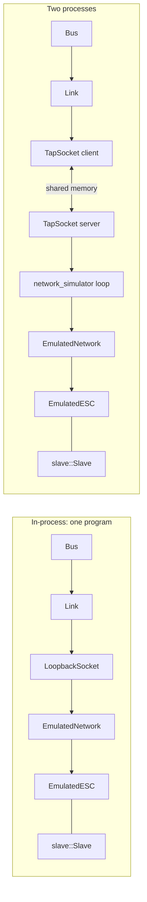

# Simulation internals

> How can a master test EtherCAT
> devices without hardware?
>
> You will learn:
>
> - why KickCAT emulates the hardware
> - how the emulated ESC and network process frames
> - how to run a simulation in one or two processes
> - how to configure slaves with JSON files and add a device

## The problem: EtherCAT without hardware

Master development needs repeatable tests. A CI job may run
on a computer without an EtherCAT port. Redundancy tests need to break a connection
at a known point. Physical cards, cables, and slaves take time to set up for these
tests.

## The ways to fake a slave

A test can replace different parts of a slave.

1. **Return fixed replies.** A script returns the bytes the master expects. This
   tests the master against the script, but cannot check whether a real slave would
   give the same reply.
2. **Model the protocol.** A model handles SDO requests, state changes, and process
   data. This requires a second protocol implementation that must stay consistent
   with the slave stack.
3. **Emulate the hardware.** A software ESC and network run the same slave stack
   as the microcontroller.

KickCAT uses hardware emulation.

The slave uses `AbstractESC`, so an emulated ESC can replace a LAN9252 or XMC4800.
The master uses `AbstractSocket`, so a software network can replace a network card.
The protocol code between them runs unchanged. See [Chapter 1](principles.md).

The emulator must model the registers used by the slave stack and the network
behavior seen by the master. The same emulator can then test both stacks, including
new slave protocol features.

## The emulated ESC

`EmulatedESC` implements `AbstractESC`. It stores the ESC registers and process data memory.

The emulator provides two interfaces.

- **EtherCAT.** `processDatagram()` applies a physical read or write, a broadcast,
  or a logical read or write through the FMMUs. It updates the WKC.
- **PDI.** The slave stack calls `read()` and `write()`. The SyncManagers provide
  the same mailbox and buffered modes as a physical ESC.

The emulator models the following parts of the controller.

- eight SyncManagers and eight FMMUs
- the AL control and status registers used by the state machine
- EEPROM loaded from a raw image or built from an ESI file
- a distributed clock with configurable drift and jitter, receive times, and SYNC0
  pulses
- the PDI and process data watchdogs

It does not emulate interrupts. The slave stack polls the ESC, so it does not
need them.

## The emulated network

`EmulatedNetwork` connects emulated ESC ports and routes frames in EtherCAT port
order. From port 0, the forwarding order is port 3, port 1, then port 2. It travels
to the end of each branch before returning. A port with no link, or a broken
connection, sends the frame back.

The master connects at one or two points. Its nominal port connects at the head of
the network. Its optional redundancy port connects at the tail to close the ring.

The default topology is a line: each slave port 1 is wired to the next slave
port 0. A test or a topology file can replace it with any tree, through
`connect()`, `setInjection()` and `setRedundancyInjection()`.

`setLinkState()` breaks or restores a connection between slaves while the network is
running. A test can break the ring and check that the master's two ports still reach
all slaves.

The network calculates the processing order, each port's DL status, and DC
receive time offsets. It repeats the calculation only when a link changes. Each
frame then follows the stored order.

## Two ways to plug a master in

The master uses `AbstractSocket` in both simulation modes.



**In one process.** `LoopbackSocket` owns an `EmulatedNetwork`. A write routes the
frame immediately and calls the application's `tick` function. That function calls
`slave::Slave::routine()` and runs any application work needed between frames. The
next read returns the processed frame. Each write advances the simulation once. No
separate thread or timer schedules the steps, so the run is repeatable and can be
stepped through in a debugger.

**In two processes.** `TapSocket` provides two shared memory queues for interprocess
communication. It is independent of a Linux network tap (TAP) device. The master
opens `tap:client` and `network_simulator` opens `tap:server`. The same master
program can run on a physical network.

The following sequence shows the order in one process.

```mermaid
sequenceDiagram
    participant Bus
    participant Link
    participant LS as LoopbackSocket
    participant Net as EmulatedNetwork
    participant ESC as EmulatedESC
    participant App as tick (slave stack)
    Bus->>Link: queue datagrams, finalize
    Link->>LS: write(frame)
    LS->>Net: route(frame)
    loop each ESC in port order
        Net->>ESC: processDatagram(header, data, wkc)
    end
    LS->>App: tick()
    App->>ESC: routine(): PDI read/write
    Link->>LS: read(frame)
    LS-->>Link: processed frame
    Link-->>Bus: datagram callbacks
```

The slave stack runs after the frame, so it sees what the master just wrote and
prepares what the master will read on the next frame.

## The network simulator

For each slave, the `network_simulator` loop performs the work of the in-process tick.

1. Read a frame from the master socket and, if present, the redundant socket.
2. Route it through the network. Send it back on the opposite master port when
   the ring is intact, or on the same port when the ring is broken.
3. Apply pending control commands (see below).
4. Run each slave: `routine()`, output validation in SAFE-OP, then its device
   behavior. A slave without one gets a rolling test pattern on its inputs.

The loop waits for a socket read with a timeout so it can check for a stop signal.
It does not sleep between iterations.

## Building a slave from a file

The `kickcat_simulation` library in `lib/simulation` builds slaves from
configuration files. `sim::buildSlave()` reads a JSON file and returns a
`SimulatedSlave`. The object owns the ESC, PDO handler, slave stack, dictionary,
mailboxes, FoE storage, device behavior, and process data buffers.

The slave image comes from one of two sources:

- With an ESI file and device filter, the parser builds the EEPROM image and CoE
  dictionary from the same device description.
- With a raw EEPROM image, the configuration can also provide a CoE dictionary in
  XML.

If the SII declares FoE and the configuration specifies a directory,
`DirectoryStorage` serves files from it. It implements the same
`FoE::AbstractStorage` interface as a device using flash. It buffers received data
in memory and writes the file only after the last packet. If the SII declares a
bootstrap mailbox, the slave uses a second mailbox in BOOT.

The configuration keys are listed in the [simulation user guide](../SIMULATION.md).

## Device behaviour

The ESC and slave stack can exchange data without a device application, but the
input values stay fixed. A simulated motor drive also needs to process its control
word and update its position.

`sim::DeviceApp` defines a `step()` method that runs once per cyclic frame. The
existing `Ds402Motor` device implements the CiA 402 drive state machine and models
a motor with following error and limited bandwidth.

`sim::makeDeviceApp()` selects the device from the JSON configuration. To add a
device, implement a `DeviceApp` subclass and add a case to `makeDeviceApp()`. The
rest of the simulator uses the common interface.

## Topology and control

Use `--topology` to supply a JSON file describing a tree. It lists the master
connection, links between slaves, and an optional redundancy connection.
`sim::parseTopology()` checks the node and port indexes. `sim::applyTopology()`
connects the ports. Tests can check the indexes without building a network.

A pair of shared memory queues carries control commands separately from EtherCAT
frames. The host uses `SimulatorControl.h` to break or restore a link or add slave
clock jitter. `SimulatorControlServer` applies commands between frames and returns
an acknowledgment and frame timing statistics. KickUI uses this channel to simulate
cable breaks.

## Summary

| Question | Answer |
|---|---|
| What is emulated? | The ESC and the wire. The slave stack is the real one. |
| What does the master see? | An `AbstractSocket`, like a network card. |
| How do I run everything in one program? | `LoopbackSocket` and a tick function. |
| How do I run an unmodified master? | `network_simulator` with `tap:server`, the master with `tap:client`. |
| Where does a slave come from? | `sim::buildSlave()`, from an ESI file or an EEPROM image. |
| How do I add a device behavior? | A `DeviceApp` subclass and one case in `makeDeviceApp()`. |
| What is not emulated? | Interrupts. |

## In the code

- `lib/slave/include/kickcat/ESC/EmulatedESC.h`: the software ESC.
- `lib/slave/include/kickcat/EmulatedNetwork.h`: ports, wiring, routing and fault injection.
- `lib/include/kickcat/LoopbackSocket.h`: the in-process socket.
- `lib/include/kickcat/TapSocket.h`: the shared memory socket between two processes.
- `lib/simulation/include/kickcat/simulation/`: `SimulatedSlave.h`, `DeviceApp.h`,
  `devices/Ds402Motor.h`, `Topology.h`, `DirectoryStorage.h`, `SimulatorControlServer.h`.
- `lib/include/kickcat/SimulatorControl.h`: the control channel messages.
- `simulation/network_simulator.cc`: the two-process runner.
- Example to read: `examples/master/simulated_bus/simulated_bus.cc` builds one slave
  by hand, with the same steps as `sim::buildSlave()`, and requests OP.

## Where to go next

- How to run the simulator, and the JSON configuration keys:
  [Simulation and emulation](../SIMULATION.md).
- What the slave stack does on top of the ESC: Chapter 6,
  [The slave stack](slave.md).
- How the master sends the frames the emulator receives: Chapter 4,
  [Transport: links, frames and sockets](transport.md).
- How ESI files become EEPROM images and dictionaries: Chapter 9,
  [From XML to bytes](from-xml-to-bytes.md).
- How tests use the emulator: Chapter 11, [Testing a change](testing.md).
