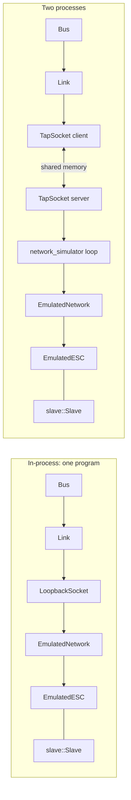

# Simulation internals

> How can a master talk to slaves that do not exist, and still test real code?
>
> You will learn:
>
> - why KickCAT emulates the hardware and not the protocol
> - what the emulated ESC and the emulated network do
> - how a frame travels through the emulator, in one process or in two
> - how the simulator builds a slave from a JSON file, and where to add a new device

## The problem: EtherCAT without hardware

An EtherCAT bus needs a network card, cables and slaves. A developer who changes
the master wants to run it many times a day. A Continuous Integration (CI) job
must run it on a machine with no EtherCAT port at all. A test of cable redundancy
needs a cable that breaks on demand. Real hardware is slow to set up, and it does
not break on command.

So KickCAT needs slaves in software. The question is which part of a slave to
write in software.

## The ways to fake a slave

There are three levels at which a slave can be faked.

1. **Fake the answers.** A test script returns the bytes the master expects. This
   is quick to write, but it only proves that the master agrees with the script.
   Nothing checks that a real slave would answer the same way.
2. **Fake the protocol.** A model of a slave answers SDO requests, state changes
   and process data. This is more complete, but it is a second implementation of
   the slave protocol. It can disagree with the real slave stack, and both must be
   kept in step.
3. **Fake the hardware.** Emulate the EtherCAT Slave Controller (ESC) and the
   wire, and run the real slave stack on top of the emulated ESC. The master then
   talks to the same protocol code that runs on a microcontroller.

**KickCAT emulates the hardware, and runs the real slave stack on top of it.**

This choice follows from a principle of [Chapter 1](principles.md): the hardware
boundaries are interfaces. The slave stack reaches its ESC through
`AbstractESC`, so a software ESC can take the place of a LAN9252 or an XMC4800.
The master reaches the wire through `AbstractSocket`, so a software network can
take the place of a network card. Everything between those two interfaces is the
production code.

The cost of this choice is the emulator itself. It must model the ESC registers
closely enough for the slave stack, and the wire closely enough for the master.
The benefit is that one emulator tests both stacks, and every protocol feature
added to the slave stack works in simulation at once.

## The emulated ESC

`EmulatedESC` is a software ESC. It implements `AbstractESC`, the same interface
the slave stack uses for real chips, and it holds a copy of the ESC memory map:
the registers and the process data memory.

It has two sides, like a real ESC.

- **The EtherCAT side.** `processDatagram()` takes one datagram from a frame. It
  applies the command (a physical read or write, a broadcast, or a logical
  read or write through the FMMUs) and increments the working counter, as an ESC
  does when a frame passes through it.
- **The PDI side.** `read()` and `write()` are the Process Data Interface (PDI)
  accesses of the slave stack. They go through the SyncManagers, so the mailbox
  and buffered modes behave as on a real chip.

Around this core, it models what a master can observe:

- the SyncManagers and the FMMUs (8 of each are advertised)
- the AL control and AL status registers that carry the state machine
- the EEPROM, loaded from a raw image or from an image built from an ESI file
- a distributed clock with a configurable drift and jitter, receive times and SYNC0
- the PDI and process data watchdogs.

It does not emulate interrupts. The slave stack polls the ESC, so it does not
need them.

## The emulated network

One ESC is not a network. `EmulatedNetwork` wires several emulated ESCs together
through their ports, as cables would. It routes each frame through the slaves in
the real EtherCAT order: a slave forwards from port 0 to port 3, then 1, then 2,
and a branch is followed to its end before the frame comes back. An open port, or
a broken wire, sends the frame back the way it came.

The network has one or two master injection points. The head is where the
nominal master port is plugged in. The tail, when it is set, is where the
redundant master port closes the ring.

The default topology is a line: each slave port 1 is wired to the next slave
port 0. A test or a topology file can replace it with any tree, through
`connect()`, `setInjection()` and `setRedundancyInjection()`.

`setLinkState()` breaks or heals the wire between two slaves while frames flow.
This is fault injection: it lets a test cut the ring and check that the master
still reaches every slave from both ends.

The topology changes rarely, but frames pass every cycle. So the network computes
the processing order, the DL status of each port and the DC receive time offsets
once, and only recomputes them when a link changes. Routing a frame is then a
flat walk over a precomputed list.

## Two ways to plug a master in

The master does not know it talks to an emulator. It only sees an
`AbstractSocket`. KickCAT provides two sockets for the emulator, one for each way
of running it.



The diagram shows that only the socket changes between the two modes: the master
stack above it and the emulator below it are the same.

**In one process.** `LoopbackSocket` holds an `EmulatedNetwork`. When the master
writes a frame, the socket routes it through the network at once, then calls a
`tick` function given by the application. The tick runs the slave stack:
`slave::Slave::routine()`, and whatever the application wants to do between
frames. The next read returns the processed frame. One master write is one
simulator iteration. There is no thread and no timing, so a run is repeatable and
easy to step through in a debugger.

**In two processes.** `TapSocket` is a pair of frame queues in shared memory.
The simulator opens it as the server, and the master opens it as the client. It is
an IPC channel between two host processes, not a Linux TAP device. The master
selects it with the interface name `tap:client`, and the `network_simulator`
program with `tap:server`. This mode runs an unmodified master program, as it
would run on a real network.

The sequence below follows one frame through the in-process mode.

```mermaid
sequenceDiagram
    participant Bus
    participant Link
    participant Loop as LoopbackSocket
    participant Net as EmulatedNetwork
    participant ESC as EmulatedESC
    participant App as tick (slave stack)
    Bus->>Link: queue datagrams, finalize
    Link->>Loop: write(frame)
    Loop->>Net: route(frame)
    loop each ESC in port order
        Net->>ESC: processDatagram(header, data, wkc)
    end
    Loop->>App: tick()
    App->>ESC: routine(): PDI read/write
    Link->>Loop: read(frame)
    Loop-->>Link: processed frame
    Link-->>Bus: datagram callbacks
```

The slave stack runs after the frame, so it sees what the master just wrote and
prepares what the master will read on the next frame.

## The network simulator

`network_simulator` is a small program built on these parts. Its loop does the
work that the tick does in the in-process mode, for every slave:

1. Read a frame from the master socket, and from the redundant socket if there is
   one.
2. Route it through the network. Send it back on the opposite master port when
   the ring is intact, or on the same port when the ring is broken.
3. Apply pending control commands (see below).
4. Run each slave: `routine()`, output validation in SAFE-OP, then the device
   behaviour, or a rolling test pattern on the inputs if the slave has none.

The loop never sleeps. It waits on the socket read, with a timeout, so that it can
stop on a signal.

## Building a slave from a file

The library `kickcat_simulation` (in `lib/simulation`) holds the code that turns a
configuration into a running slave. `sim::buildSlave()` reads one JSON file and
returns a `SimulatedSlave`: the ESC, the PDO, the slave stack, the dictionary,
the mailboxes, the FoE storage, the device behaviour and the process data
buffers, all in one owned object.

The slave image comes from one of two sources:

- an ESI file and a device filter. The ESI parser builds the EEPROM image and the
  CoE object dictionary from the same device, so they always agree.
- a raw EEPROM image, with an optional CoE dictionary in XML.

If the SII declares FoE and the configuration names a directory,
`DirectoryStorage` serves files from it. It implements `FoE::AbstractStorage`,
the interface a real device would implement on flash. It keeps a write in memory
and only writes the file when the last packet has arrived, so a failed transfer
never leaves half a file. If the SII also declares a bootstrap mailbox, the slave
gets a second mailbox, used in the BOOT state.

The configuration keys are listed in the [simulation user guide](../SIMULATION.md).

## Device behaviour

The ESC and the slave stack make a correct EtherCAT slave, but a slave with no
application. Its inputs never change. A motor drive must also answer its control
word and move its position.

`sim::DeviceApp` is that application. It has one method, `step()`, called once per
cyclic frame. `Ds402Motor` is the one device today: it runs the CiA 402 drive
state machine and a small motor model, so a master sees a following error and a
finite bandwidth, and not a perfect drive.

`sim::makeDeviceApp()` picks the device from the JSON configuration. **To add a
simulated device, write a `DeviceApp` subclass and add one case to
`makeDeviceApp()`.** The simulator core does not name any device profile, so
nothing else changes.

## Topology and control

A JSON topology file, given with `--topology`, describes a tree instead of the
default line. It names the master injection point, the slave-to-slave links, and
an optional redundancy injection point. `sim::parseTopology()` checks every node
and port index first, and `sim::applyTopology()` then wires the network. The two
steps are separate so that the checks can be tested without a network.

A control channel lets another program change the network while it runs. It is
a pair of queues in shared memory, off the EtherCAT wire, so that frame routing
stays a pure model of the cable. The host side (in `SimulatorControl.h`) sends
commands: break or heal a link, or add jitter to a slave clock.
`SimulatorControlServer` in the simulator applies them between two frames, and
sends back an acknowledgement and frame timing statistics. KickUI uses this
channel to break cables from its interface.

## Summary

| Question | Answer |
|---|---|
| What is emulated? | The ESC and the wire. The slave stack is the real one. |
| What does the master see? | An `AbstractSocket`, like a network card. |
| How do I run everything in one program? | `LoopbackSocket` and a tick function. |
| How do I run an unmodified master? | `network_simulator` with `tap:server`, the master with `tap:client`. |
| Where does a slave come from? | `sim::buildSlave()`, from an ESI file or an EEPROM image. |
| How do I add a device behaviour? | A `DeviceApp` subclass and one case in `makeDeviceApp()`. |
| What is not emulated? | Interrupts. |

## In the code

- `lib/slave/include/kickcat/ESC/EmulatedESC.h`: the software ESC.
- `lib/slave/include/kickcat/EmulatedNetwork.h`: ports, wiring, routing and fault injection.
- `lib/include/kickcat/LoopbackSocket.h`: the in-process socket.
- `lib/include/kickcat/TapSocket.h`: the shared memory socket between two processes.
- `lib/simulation/include/kickcat/simulation/`: `SimulatedSlave.h`, `DeviceApp.h`,
  `devices/Ds402Motor.h`, `Topology.h`, `DirectoryStorage.h`, `SimulatorControlServer.h`.
- `lib/include/kickcat/SimulatorControl.h`: the control channel messages.
- `simulation/network_simulator.cc`: the two-process runner.
- Example to read: `examples/master/simulated_bus/simulated_bus.cc` builds one
  slave by hand, with the same steps as `sim::buildSlave()`, and drives it to OP.

## Where to go next

- How to run the simulator, and the JSON configuration keys:
  [Simulation and emulation](../SIMULATION.md).
- What the slave stack does on top of the ESC: Chapter 6,
  [The slave stack](slave.md).
- How the master sends the frames the emulator receives: Chapter 4,
  [Transport: links, frames and sockets](transport.md).
- How ESI files become EEPROM images and dictionaries: Chapter 9,
  [From XML to bytes](from-xml-to-bytes.md).
- How tests use the emulator: Chapter 11, [Testing a change](testing.md).
