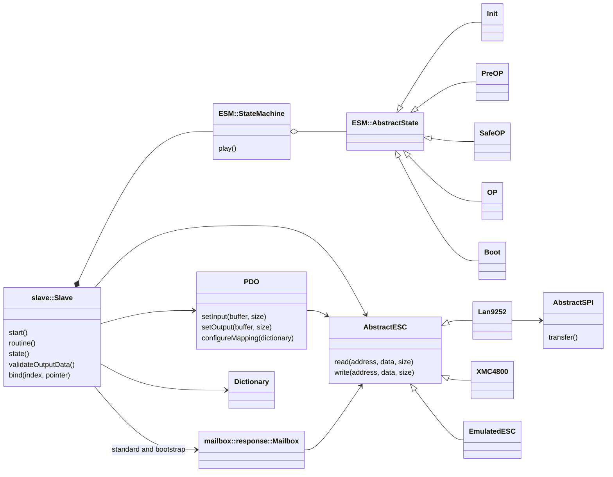
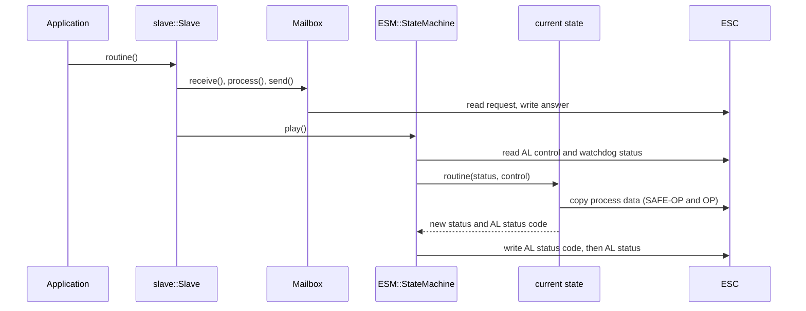
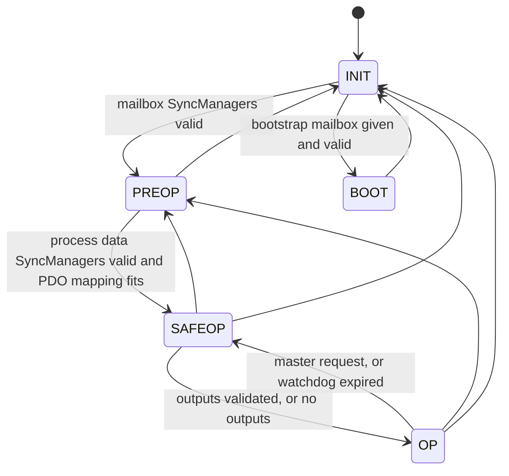

# The slave stack

> What does the application provide on an EtherCAT slave?
>
> You will learn:
>
> - how the master's `Slave` and the slave stack's `Slave` differ
> - how the application calls the stack
> - how the state machine checks requests to enter OP
> - how the application accesses mapped PDOs
> - how to support a new ESC or board

The ESC processes frames as described in [Chapter 0.3](inside-a-slave.md). The
microcontroller software implements the ESM from [Chapter 0.4](state-machine.md)
and accesses the ESC through the PDI.

## Two classes named Slave

- On the master, `kickcat::Slave` stores one slave's station address, EEPROM
  contents, request mailbox, and process image offsets.
- On the device, `kickcat::slave::Slave` handles the mailbox, runs the state
  machine, and copies process data between the ESC and application.

See [Chapter 3](master.md) for the master-side record.

## The problem: a small device on a strict master

The slave stack has three design constraints.

- **Memory and OS.** A microcontroller often has only a few hundred kilobytes of
  RAM. The stack runs on NuttX, Linux, and KickOS (experimental).
- **State requests.** The master requests a state. The slave checks the
  configuration and accepts or refuses the request. The master can read the
  reason for a refusal.
- **ESC access.** A LAN9252 uses an SPI transaction for each register access.
  The XMC4800 has an internal ESC with memory-mapped registers.

The stack must fit in the available memory, report EtherCAT errors to the master,
and support both types of register access through one interface.

## What the application gives, what the stack does

The application creates the objects and chooses where to allocate its buffers. The
stack keeps pointers to these objects (see [Chapter 1](principles.md)).

`slave::Slave` owns its state machine. The application supplies the ESC, the PDO
handler, the mailboxes, and the dictionary.

The Freedom K64F firmware builds the stack in this order:

1. A `Lan9252` ESC on an `AbstractSPI`, then `init()`.
2. A `PDO` on the ESC, and a `slave::Slave` on the ESC and the PDO.
3. A `mailbox::response::Mailbox` on the ESC, with CoE
   enabled on the object dictionary returned by `CoE::createOD()`.
4. `setMailbox` and `setDictionary` on the slave, then `setInput` and
   `setOutput` on the PDO with two application buffers.
5. `start()`, then the main loop.

The `simulated_bus` example uses the same slave stack with an `EmulatedESC`.

## The application loop

The application calls `routine()` often enough to meet the master's cycle time
and does its own work between calls. The stack has no timer or thread. Each
`routine()` call handles the mailbox and runs the state machine, which reads the
AL registers. In SAFE-OP and OP, it also copies process data.

In BOOT, `routine()` serves the bootstrap mailbox.

In SAFE-OP, `bind(index, pointer)` associates a typed pointer with a mapped
object. For example, `bind(0x7000, led_r)` binds a pointer to the red LED value on
the Freedom K64F board. The application can then read the output byte written in
the last cycle.

A slave with outputs can enter OP only after the application
calls `validateOutputData()`. The application decides what values are valid for its
device. The Freedom K64F firmware binds its pointers and validates the first outputs
it receives in each master session. A slave without outputs can skip this step.

## The state machine

### One object per state

`ESM::StateMachine` holds one object for each state, `Init`, `PreOP`, `SafeOP`,
`OP`, and `Boot`. Each call to `play()` reads the master's request from the
AL control register. The current state returns the new status
and AL status code. On a state change, the machine calls `onEntry` on the new state.
When the status changes, it writes the code before the status so the master reads
the matching code.

Each state's `onEntry` enables or disables the corresponding hardware. INIT is the
initialization state and PRE-OP is the pre-operational state.

| State | Mailbox | Inputs | Outputs |
|---|---|---|---|
| INIT | off | off | off |
| PRE-OP | on | off | off |
| SAFE-OP | on | on | on |
| OP | on | on | on |
| BOOT | bootstrap mailbox on | off | off |

When the slave falls back from OP to SAFE-OP on an error, it turns the outputs
off and keeps the inputs on.

### Checks before each step

Before a transition, the slave checks the requirements for the requested state. On
failure, it stays in its current state or returns to a lower one. It sets the error
flag and an AL status code. The master must acknowledge the error before making
another request.

Common reasons for refusal are listed below.

| Request | Refused when | AL status code |
|---|---|---|
| INIT to PRE-OP | the mailbox SyncManagers are wrong | 0x0016 |
| INIT to BOOT | no bootstrap mailbox was given | 0x0013 |
| INIT to BOOT | the bootstrap mailbox SyncManagers are wrong | 0x0015 |
| INIT to SAFE-OP or OP, PRE-OP to OP | a state is skipped | 0x0011 |
| PRE-OP to SAFE-OP | a process data SyncManager is wrong, or the PDO mapping does not fit | 0x001D (outputs), 0x001E (inputs) |
| OP | the process data watchdog expired | 0x001B, back to SAFE-OP |

The master reads the AL status code to find the cause of a refusal.

## Process data

`PDO` moves bytes between the ESC and the application buffers. It is set up
in two steps.

**When the slave leaves PRE-OP**, `configure()` finds the input and output
SyncManagers configured by the master. `configureMapping()` reads the assignment
objects (0x1C12, 0x1C13) and mapping objects (0x16xx, 0x1Axx) from the dictionary.
It points each mapped entry at the corresponding bytes in the application buffer.
For example, 0x6000 (accel_x) refers directly to the input buffer. Without a
dictionary, the stack copies the SyncManager bytes directly to the buffers.

**In SAFE-OP and OP**, each `routine()` writes the input buffer to the input
SyncManager and reads the output SyncManager into the output buffer.

The application, SDO server, and process data use the same bytes. In PRE-OP, a
master can change the mapping over SDO to select the data the slave sends. The
application buffers must fit the largest mapping the master may request. The
Freedom K64F firmware reserves 16 bytes in each direction.

KickCAT supports one input and one output process data SyncManager per slave
(see [FEATURES](../FEATURES.md)).

## The object dictionary

The application owns the `CoE::Dictionary`, a list of objects and their entries. The
mailbox uses it to serve SDOs. The slave uses it to map process data.

On the host, `od_generator` reads the ESI file in XML and generates
`od_populator.cc`, which defines `CoE::createOD()`. The firmware therefore needs
no XML parser at boot. The generator calls `CoE::validateDictionary` and rejects
entries the SDO server cannot handle safely. The SDO server relies on this check
and does not repeat it during the cycle. See [Chapter 1](principles.md) and
[Chapter 9](from-xml-to-bytes.md).

## Porting to a new ESC or board

The slave stack accesses the controller through `AbstractESC`. The driver to
implement depends on the board and ESC.

**A new board with a LAN9252.** Implement `AbstractSPI` for your OS and SPI
controller: `open`, `close`, `transfer`, chip select, baud rate and mode.
KickCAT has implementations for NuttX, Linux on a Raspberry Pi, and KickOS.
`Lan9252` uses that interface to access the ESC.

**A new ESC.** Implement `AbstractESC`: `read` and `write` of ESC registers and
memory, and `init` if the chip needs a start sequence. The SyncManager helpers in
`AbstractESC` use those two calls. `XMC4800` is the shortest example: its ESC is
memory mapped, so `read` and `write` copy memory.

**An ESC without an EEPROM chip.** Some ESCs, such as the one in the XMC4800,
let the microcontroller emulate the EEPROM. Implement `AbstractEmulatedEEPROM`,
which stores the image in flash and answers the ESC's EEPROM requests.

Each port also needs the following components.

- an EEPROM image, built from the ESI file and written with the `eeprom` tool
  (see [TOOLS](../TOOLS.md)),
- an object dictionary, generated by `od_generator`,
- the OS layer of KickCAT for the target (see [Chapter 10](os-and-porting.md)).

## Summary

| Question | Answer |
|---|---|
| Who calls the stack? | The application, through `routine()`, in its own loop. |
| Who owns the buffers and the dictionary? | The application. The stack holds pointers. |
| How does the slave refuse a request? | It stays or moves down, and sets an AL status code. |
| When may the slave enter OP? | When the application has validated the outputs, or the slave has no outputs. |
| Where is the mapping read from? | The object dictionary, when the slave leaves PRE-OP. |
| What must a port implement? | `AbstractSPI` for a LAN9252, or `AbstractESC` for a new ESC. |

## In the code

- `lib/slave/include/kickcat/slave/Slave.h`: the slave runtime.
- `lib/slave/include/kickcat/ESM.h`, `ESMStates.h`: the state machine and its states.
- `lib/slave/include/kickcat/PDO.h`: process data and mapping.
- `lib/slave/include/kickcat/AbstractESC.h`, `AbstractSPI.h`,
  `AbstractEmulatedEEPROM.h`: the hardware boundaries.
- `lib/slave/include/kickcat/ESC/`: `Lan9252`, `XMC4800`, `EmulatedESC`.
- `lib/slave/driver/`: SPI drivers for NuttX, KickOS and the Raspberry Pi.
- Example: `examples/slave/lan9252/freedom-k64f/nuttx/freedom_slave.cc`, the full
  Freedom K64F firmware loop.

## Where to go next

- The ESC and its registers: [Chapter 0.3](inside-a-slave.md).
- The state machine as the protocol defines it: [Chapter 0.4](state-machine.md).
- How the mailbox serves SDOs and files: [Chapter 5](mailbox-implementation.md).
- How the emulator runs this stack: [Chapter 8](simulation.md).
- How the dictionary and the EEPROM image are built: [Chapter 9](from-xml-to-bytes.md).
