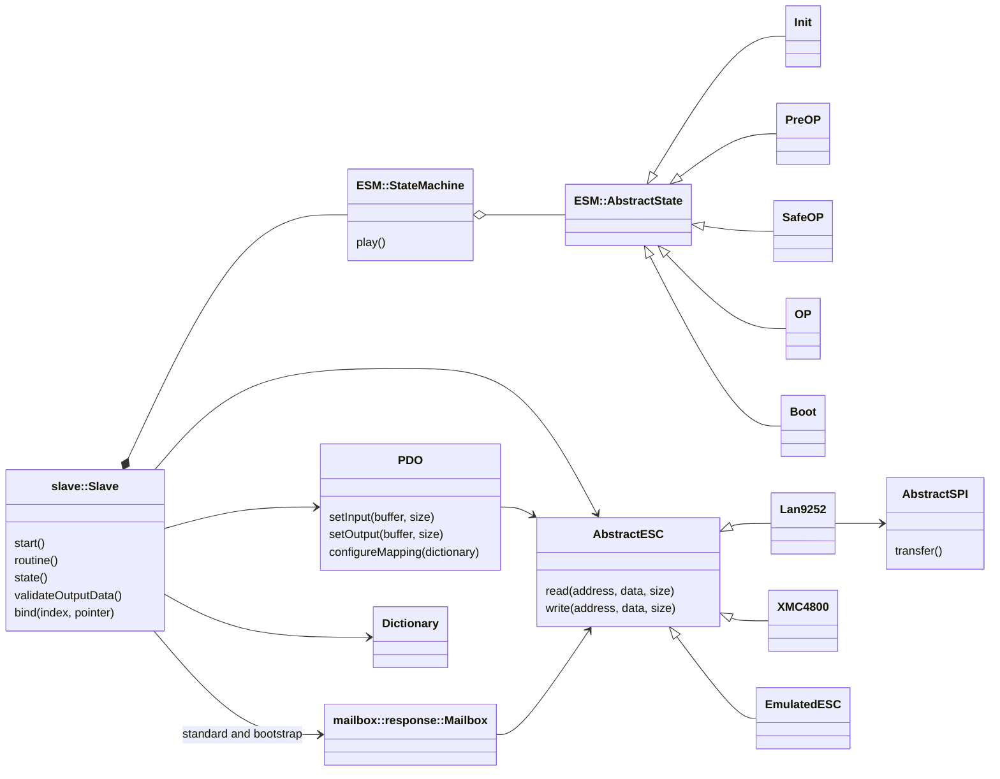
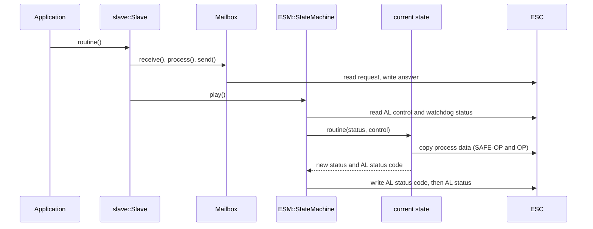
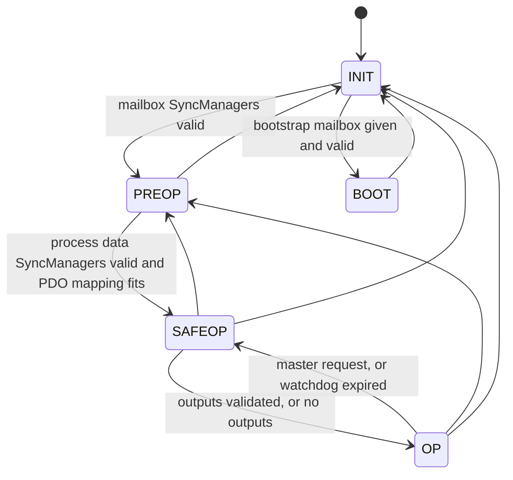

# The slave stack

> What runs on the microcontroller of a KickCAT slave, and what must the application give it?
>
> You will learn:
>
> - the difference between the master's `Slave` and the slave stack's `Slave`
> - how the slave application loop drives the stack
> - how the state machine decides to accept or refuse a state request
> - how process data reaches the application through the object dictionary
> - what to write to port the stack to a new ESC or a new board

[Chapter 0.3](inside-a-slave.md) described the EtherCAT Slave Controller (ESC),
the chip that does the real-time work on the wire. [Chapter 0.4](state-machine.md)
described the EtherCAT state machine (ESM). This chapter is about the software
on the other side of the ESC: the code that runs on the slave's
microcontroller and talks to the ESC through its Process Data Interface (PDI).

## Two classes named Slave

KickCAT has two classes with the same short name, and they do different jobs.

- `kickcat::Slave` is on the **master**. It is a record of one remote slave as
  the master sees it: its station address, the EEPROM content it read, its
  mailbox of requests, and where its inputs and outputs sit in the process
  image. It runs nothing.
- `kickcat::slave::Slave` is on the **slave**. It runs the device: it serves
  the mailbox, plays the state machine, and copies process data between the ESC
  and the application.

This chapter is about the second one. [Chapter 3](master.md) covers the first.

## The problem: a small device on a strict master

The slave side has constraints that the master does not have:

- **It runs on a microcontroller**, often with a few hundred kilobytes of RAM,
  and on several operating systems: NuttX, Linux and KickOS (experimental).
- **It never decides on its own.** The master requests a state. The slave
  checks that the request makes sense, accepts it or refuses it with a reason,
  and the master reads that reason.
- **It talks to the ESC through a narrow interface.** On a LAN9252, every
  register access is a transaction on a Serial Peripheral Interface (SPI) bus.
  On an XMC4800, the ESC is inside the microcontroller and its registers are in
  the memory map.

So the stack must be small, it must report problems the EtherCAT way, and it
must reach the ESC through one interface that hides how the bytes travel.

## What the application gives, what the stack does

The application builds the objects and owns their memory. The stack only holds
pointers to them. This is the "caller owns the memory" principle of
[Chapter 1](principles.md), and on a microcontroller it means that the
application decides where every buffer lives.

The diagram shows that `slave::Slave` owns only its state machine and borrows everything else: the ESC, the PDO, the mailboxes and the dictionary.

The Freedom K64F firmware builds the stack in this order:

1. A `Lan9252` ESC on an `AbstractSPI`, then `init()`.
2. A `PDO` on the ESC, and a `slave::Slave` on the ESC and the PDO.
3. A `mailbox::response::Mailbox` on the ESC, with CoE enabled on the object
   dictionary returned by `CoE::createOD()`.
4. `setMailbox` and `setDictionary` on the slave, then `setInput` and
   `setOutput` on the PDO with two application buffers.
5. `start()`, then the main loop.

The `simulated_bus` example builds the same objects on an `EmulatedESC`. That
is the point of the ESC interface: the emulator runs this exact stack.

## The application loop

The stack starts no thread and has no timer. The application calls
`routine()` often enough for the master's cycle, and does its own work between
two calls. One call to `routine()` does two things:

In BOOT, `routine()` serves the bootstrap mailbox instead of the standard one.

The application reads and writes its process data through pointers. After the
slave enters SAFE-OP, `bind(index, pointer)` points a typed pointer at a
mapped object, for example `bind(0x7000, led_r)` for the red LED of the
Freedom K64F board. From then on, the pointer reads the output byte the master
wrote in the last cycle.

Before the slave may enter OP, the application must call
`validateOutputData()`. It tells the stack that the outputs from the master
make sense for this device. This is an application decision: the stack cannot
know what a valid output looks like. The Freedom K64F firmware binds its
pointers and validates once per master session, when it first sees outputs
from the master. A slave with no outputs does not need to validate.

## The state machine

### One object per state

`ESM::StateMachine` holds one object per state: `Init`, `PreOP`, `SafeOP`,
`OP` and `Boot`. Each `play()` reads the AL control register, where the
master writes its request, and asks the current state what to do. The state
returns the new status and an AL status code. When the state changes, the
machine calls `onEntry` of the new state. When the status changes, it writes
the AL status code first, then the AL status, so that the master never reads a
new state with an old code.

The `onEntry` of each state turns the hardware on or off:

| State | Mailbox | Inputs | Outputs |
|---|---|---|---|
| INIT | off | off | off |
| PRE-OP | on | off | off |
| SAFE-OP | on | on | on |
| OP | on | on | on |
| BOOT | bootstrap mailbox on | off | off |

When the slave falls back from OP to SAFE-OP on an error, it turns the outputs
off and keeps the inputs on.

### Checks before each step

Each transition checks what the next state needs. A refused request keeps the
slave where it is, or moves it down, and sets the error flag with an AL status
code. The master must acknowledge the error before the slave accepts a new
request.

The diagram shows the accepted transitions and the condition each one checks. The main refusals are:

| Request | Refused when | AL status code |
|---|---|---|
| INIT to PRE-OP | the mailbox SyncManagers are wrong | 0x0016 |
| INIT to BOOT | no bootstrap mailbox was given | 0x0013 |
| INIT to BOOT | the bootstrap mailbox SyncManagers are wrong | 0x0015 |
| INIT to SAFE-OP or OP, PRE-OP to OP | a state is skipped | 0x0011 |
| PRE-OP to SAFE-OP | a process data SyncManager is wrong, or the PDO mapping does not fit | 0x001D (outputs), 0x001E (inputs) |
| OP | the process data watchdog expired | 0x001B, back to SAFE-OP |

These codes are how the slave reports an error. There is no exception and no
log the master can read: the AL status code is the contract with the master.

## Process data

`PDO` moves bytes between the ESC and the application buffers. It is set up
in two steps.

**When the slave leaves PRE-OP**, `configure()` finds the two process data
SyncManagers that the master programmed in the ESC, one for inputs and one for
outputs. Then `configureMapping()` reads the object dictionary: the SyncManager
assignment objects (0x1C12, 0x1C13) and the PDO mapping objects (0x16xx,
0x1Axx). For each mapped entry, it points the dictionary entry at its place in
the application buffer. After this step, an entry such as 0x6000 (accel_x) has
no memory of its own: it is a view into the input buffer. If the application
gave no dictionary, there is no mapping to read, and the stack copies the
SyncManager bytes to the buffers as they are.

**In SAFE-OP and OP**, each `routine()` writes the input buffer to the input
SyncManager and reads the output SyncManager into the output buffer.

This design has two results. First, there is one copy of each value: the
application, the SDO server and the process data all see the same bytes.
Second, the mapping is read from the dictionary, so a master that changes the
mapping over SDO in PRE-OP changes what the slave sends, with no code change.
The application buffers must be large enough for the largest mapping the
master may request. The Freedom K64F firmware reserves 16 bytes in each
direction.

KickCAT supports one input and one output process data SyncManager per slave
(see [FEATURES](../FEATURES.md)).

## The object dictionary

The dictionary is a `CoE::Dictionary`: a list of objects, each with its
entries. The application owns it and gives it to both the mailbox, which
serves SDOs from it, and the slave, which maps process data from it.

A firmware does not parse XML at boot. `od_generator` reads the device's ESI
file on the host and writes `od_populator.cc`, which defines
`CoE::createOD()`. Before it writes the file, it checks the dictionary with
`CoE::validateDictionary` and refuses to generate code for a dictionary that
the SDO server could not serve safely. The firmware then trusts the
dictionary: the SDO server has no guard against a malformed entry. This is the
"validate once, then trust" principle of [Chapter 1](principles.md), and it
keeps checks out of the slave's cyclic path. [Chapter 9](from-xml-to-bytes.md)
follows this path in detail.

## Porting to a new ESC or board

The stack touches the hardware only through `AbstractESC`. What you write
depends on what is new.

**A new board with a LAN9252.** Implement `AbstractSPI` for your OS and SPI
controller: `open`, `close`, `transfer`, chip select, baud rate and mode.
KickCAT has implementations for NuttX, Linux on a Raspberry Pi, and KickOS.
`Lan9252` does the rest.

**A new ESC.** Implement `AbstractESC`: `read` and `write` of ESC registers and
memory, and `init` if the chip needs a start sequence. The SyncManager helpers
of `AbstractESC` work on top of those two calls. `XMC4800` is the shortest
example: its ESC is memory mapped, so `read` and `write` copy memory.

**An ESC without an EEPROM chip.** Some ESCs, such as the one in the XMC4800,
let the microcontroller emulate the EEPROM. Implement `AbstractEmulatedEEPROM`,
which stores the image in flash and answers the ESC's EEPROM requests.

**For every port**, the device also needs:

- an EEPROM image, built from the ESI file and written with the `eeprom` tool
  (see [TOOLS](../TOOLS.md)),
- an object dictionary, generated by `od_generator`,
- the OS layer of KickCAT for the target (see [Chapter 10](os-and-porting.md)).

## Summary

| Question | Answer |
|---|---|
| Who calls the stack? | The application, through `routine()`, in its own loop. |
| Who owns the buffers and the dictionary? | The application. The stack holds pointers. |
| How does the slave refuse a request? | It stays or moves down, and sets an AL status code. |
| When may the slave enter OP? | When the application has validated the outputs, or the slave has no outputs. |
| Where is the mapping read from? | The object dictionary, when the slave leaves PRE-OP. |
| What must a port implement? | `AbstractSPI` for a LAN9252, or `AbstractESC` for a new ESC. |

## In the code

- `lib/slave/include/kickcat/slave/Slave.h`: the slave runtime.
- `lib/slave/include/kickcat/ESM.h`, `ESMStates.h`: the state machine and its states.
- `lib/slave/include/kickcat/PDO.h`: process data and mapping.
- `lib/slave/include/kickcat/AbstractESC.h`, `AbstractSPI.h`, `AbstractEmulatedEEPROM.h`: the hardware boundaries.
- `lib/slave/include/kickcat/ESC/`: `Lan9252`, `XMC4800`, `EmulatedESC`.
- `lib/slave/driver/`: SPI drivers for NuttX, KickOS and the Raspberry Pi.
- Example: `examples/slave/lan9252/freedom-k64f/nuttx/freedom_slave.cc`, the full Freedom K64F firmware loop.

## Where to go next

- The ESC and its registers: [Chapter 0.3](inside-a-slave.md).
- The state machine as the protocol defines it: [Chapter 0.4](state-machine.md).
- How the mailbox serves SDOs and files: [Chapter 5](mailbox-implementation.md).
- How the emulator runs this stack: [Chapter 8](simulation.md).
- How the dictionary and the EEPROM image are built: [Chapter 9](from-xml-to-bytes.md).
