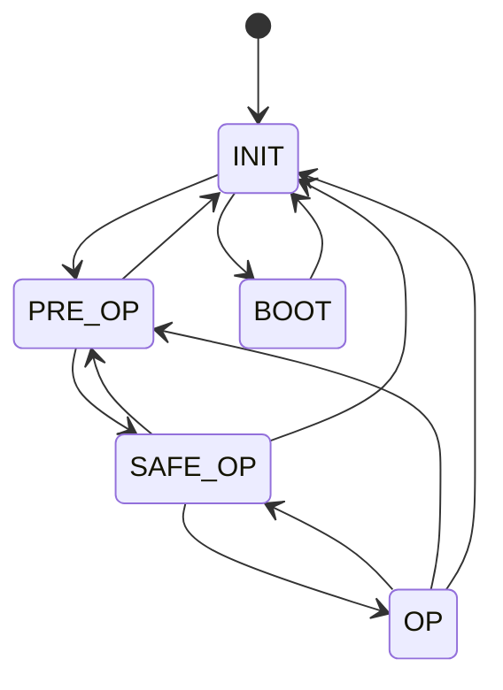
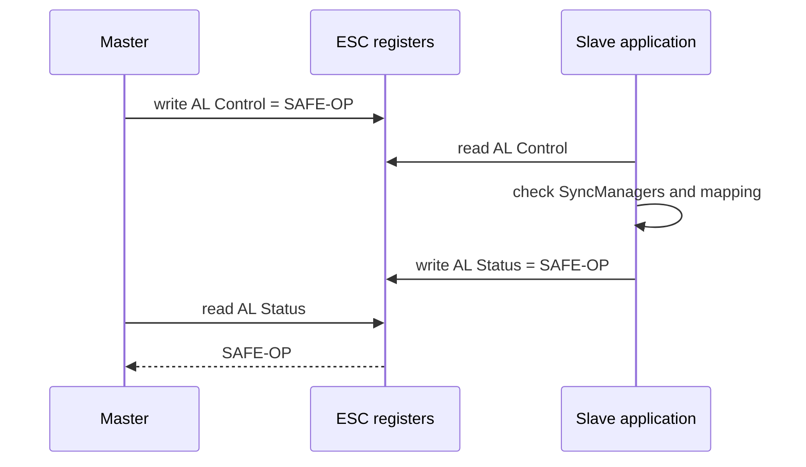

# The EtherCAT state machine

> In which order does a slave become ready, who decides when it is ready, and what
> happens when something goes wrong?
>
> You will learn:
>
> - the five states of a slave: INIT, PRE-OP, SAFE-OP, OP and BOOT
> - what the master configures in each state, and what each state allows
> - how the master requests a state and how the slave answers
> - how a slave reports an error, and how it falls back on its own

## The problem: start a machine safely

A slave that drives a motor must not move it with outputs that nobody has checked.
Before the first cycle, the master must give each slave an address, set up its
mailbox, choose which data it exchanges, and program its SyncManagers and FMMUs.
Each step depends on the previous one. If the slave started to use its outputs
before the configuration was complete, a half-configured machine could move.

EtherCAT solves this with a **state machine**: every slave is always in one of a few
states, and each state allows a little more than the one before it. A slave moves up
only when the master asks and the slave agrees that its configuration is valid.

## The five states

| State | Mailbox | Inputs | Outputs | What the master does here |
|---|---|---|---|---|
| **INIT** | No | No | No | Sets the station address, reads the EEPROM, configures the mailbox SyncManagers. |
| **PRE-OP** (pre-operational) | Yes | No | No | Configures the process data: the mapping, the process data SyncManagers and the FMMUs. |
| **SAFE-OP** (safe-operational) | Yes | Yes | No, held in a safe state | Starts the cycle, so that valid outputs reach the slave. |
| **OP** (operational) | Yes | Yes | Yes | Runs the machine. |
| **BOOT** (bootstrap) | Bootstrap mailbox only | No | No | Updates the firmware, see [Chapter 0.6](mailboxes.md). |

The diagram below shows the allowed transitions. Moving up goes one state at a time.
Moving down can skip states.

A request that skips a state on the way up, such as INIT to SAFE-OP, is refused. BOOT
can only be entered from INIT and only left toward INIT.

**SAFE-OP is the key state.** In SAFE-OP, the slave already sends real inputs, so the
master can read the machine and compute its first outputs. The slave also receives
those outputs, but it does not apply them yet: its actuators stay in a safe state. Only
when the master has sent valid outputs does it request OP, and only then does the
slave apply them.

## The running example

For the Freedom K64F board, start-up goes like this:

1. **INIT.** The master counts the slaves and finds one. It gives the board the station
   address 1001, reads the EEPROM, finds product code 0x00DEFEDE and a mailbox, and
   programs SyncManagers 0 and 1 at 0x1000 and 0x1400.
2. **PRE-OP.** The mailbox works. The master learns that the board has 3 output bytes
   and 12 input bytes, programs SyncManagers 2 and 3, and programs two FMMUs.
3. **SAFE-OP.** Each cycle now brings back the 12 sensor bytes. The master writes the 3
   colour bytes, but the light does not change yet.
4. **OP.** The light follows the colour bytes that the master writes in each cycle.

## Request and answer

Three ESC registers carry the conversation:

- **AL Control** (Application Layer control, at 0x0120): the master writes the state it
  wants.
- **AL Status** (at 0x0130): the slave writes the state it is in.
- **AL Status Code** (at 0x0134): the slave writes why it refused a request or left a
  state.

The master requests, but the slave decides. The application on the slave sees the
request, checks its configuration, and then either moves to the new state or stays
where it is. The master knows the result only by reading AL Status, so it polls that
register until the state changes or a timeout expires.

The diagram below shows one request that succeeds.

## Errors

When the slave refuses a request, or must leave a state on its own, it does three
things:

- it stays in its current state, or falls to a lower one
- it sets the **error indication** bit in AL Status
- it writes a code in AL Status Code, for instance 0x0011 for an invalid state change,
  or 0x001D for an invalid output configuration

The master reads the code to report the cause. To clear the error, the master writes
AL Control again with the **error acknowledge** bit set. The slave then clears the
error indication bit.

The most common fall is caused by the process data watchdog of [Chapter
0.3](inside-a-slave.md). When the master stops sending outputs while the slave is in
OP, the watchdog expires. The slave goes back to SAFE-OP with the code 0x001B (sync
manager watchdog), and its outputs return to their safe state. A lost cable or a
crashed master can therefore not leave a motor running on old commands.

## Summary

| Question | Answer |
|---|---|
| In which state does the mailbox start to work? | PRE-OP. |
| In which state does the master first receive inputs? | SAFE-OP. |
| In which state does the slave apply outputs? | OP only. |
| Who decides that a slave changes state? | The slave, after the master requests it. |
| Where does the slave say why it refused? | In AL Status Code, with the error indication bit in AL Status. |
| What happens when the master stops sending outputs in OP? | The watchdog expires and the slave falls back to SAFE-OP. |

## In KickCAT

The master requests states and waits for them, and the slave stack implements one
class per state. [Chapter 3](master.md) shows the master side, and [Chapter 6](slave.md)
the slave side.

## Where to go next

- What the master configures between PRE-OP and SAFE-OP: Chapter 0.5, [Process
  data](process-data.md).
- What the mailbox carries once PRE-OP is reached: Chapter 0.6, [Mailboxes: CoE and
  FoE](mailboxes.md).
