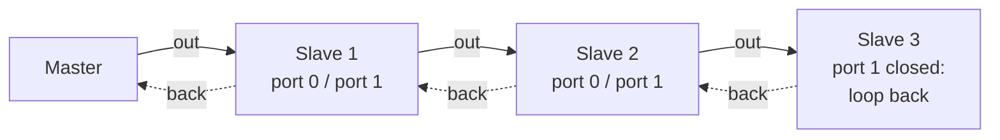
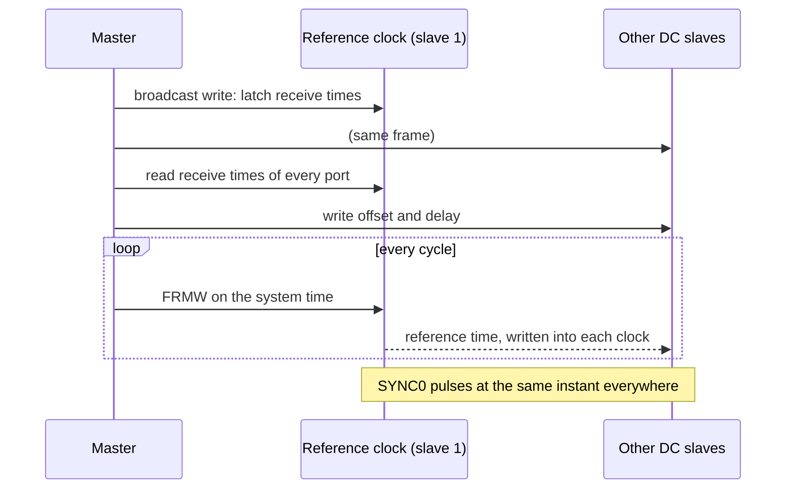

# Topology, redundancy and clocks

> How does a frame find its way through the slaves, what happens when a cable
> breaks, and how do slaves agree on the time?
>
> You will learn:
>
> - what the ports of a slave are, and in which order a frame visits them
> - how a line and a tree of slaves are wired
> - how a ring with cable redundancy survives a broken cable
> - how distributed clocks give every slave the same time

## Ports: how a frame travels

A slave controller has up to four **ports**, numbered 0 to 3. Each port is one
Ethernet connection. Port 0 faces the master. The other ports lead to the next
slaves.

Ethernet is **full duplex**: a cable carries data in both directions at once, on
separate wires. EtherCAT uses this. A frame goes out on one direction of each
cable and comes back on the other direction of the same cable.

Inside the slave controller, the frame entering port 0 goes through the
**EtherCAT processing unit**, the part that reads and writes the datagrams. It
then leaves through the next port. When a port has no link, it is **closed**: the
slave controller does not send the frame on it, and loops it back inside itself
to the next port at once. The order is fixed by the hardware. With four ports it
is:

**0 -> processing unit -> 3 -> 1 -> 2 -> 0**

A frame that comes back to a slave on port 1, 2 or 3 is only forwarded. It is not
processed a second time.

## Line and tree

In a **line**, each slave uses port 0 toward the master and port 1 toward the next
slave. The last slave has nothing on port 1, so the port is closed and the frame
turns back there. The frame visits every slave on the way out, and the way back
is pure forwarding.

The frame goes out through slaves 1, 2 and 3, turns back at the closed port of
slave 3, and returns to the master through the same cables.

A **tree** uses slaves with three or four ports, called **junctions**. Each extra
port starts a branch. The frame visits each branch fully, in the port order
above, before it moves on to the next one. The topology changes where a slave is
in the frame order, so the master reads the link status of every port at startup
to learn the real shape of the network.

## Cable redundancy: a ring

A line has a weak point: if one cable breaks, every slave after it is lost. With
**cable redundancy**, the master has two network ports, and the last slave's port
1 is wired back to the master's second port. The slaves form a **ring**.

Each cycle, the master sends the frame on both of its ports:

- When the ring is whole, the frame from the first port visits every slave and
  arrives at the second port. The copy from the second port is only forwarded
  through the slaves, back to the first port.
- When a cable breaks, the slaves on each side of the break see that their port
  lost its link, and close it. The ring splits into two lines. The frame from the
  first port is processed by the slaves before the break, and turns back there.
  The copy from the second port is processed by the slaves after the break, and
  turns back at the other side of the break.

Every slave is still reached, by one frame or the other. The master merges the two
returned frames into one result. The machine keeps running, and the master can
report where the break is.

## Distributed clocks: why time matters

Some machines need actions at the same instant on several slaves: two motor axes
that must move together, or inputs that must be sampled at the same moment. The
frame cannot do that, because it reaches each slave at a different time. On a
long line, the last slave sees the frame many microseconds after the first one.

**Distributed clocks (DC)** solve this. Each slave controller that supports DC
has its own 64-bit clock that counts nanoseconds. The goal is that all these
clocks show the same **system time**, counted from 1 January 2000. One slave
holds the **reference clock**, usually the first DC slave after the master. Every
other clock is set to follow it.

Three differences must be removed:

1. **Propagation delay.** A frame takes time to travel to each slave. The master
   sends one broadcast write to a special register. Each slave controller
   **latches**, that is records, the local time at which that frame passed each
   of its ports, on the way out and on the way back. From these times, the master
   computes the delay between the reference clock and each slave.
2. **Offset.** Each clock started at its own power-on, so each one shows a
   different time. The master computes the difference to the reference clock and
   writes it into each slave as an offset.
3. **Drift.** No two quartz crystals run at exactly the same speed. To correct
   that, the master sends a special datagram every cycle. In an **ARMW** (Auto
   increment Read Multiple Write) or **FRMW** (configured address Read Multiple
   Write) datagram, the addressed slave, here the reference clock, puts its time into
   the datagram, and every slave after it reads that time as a write. A small
   control loop in each slave controller then speeds up or slows down its clock a
   little.

When the clocks agree, each slave controller can produce **SYNC0** pulses: a
signal that starts at a chosen system time and repeats at a chosen cycle time.
The slave's application acts on each pulse. Because all the clocks agree, all the
slaves act at the same instant, within much less than a microsecond on typical
hardware.

The master first measures the delays and sets the offsets once, then sends the
reference time to the other clocks every cycle.

One question remains: the master's own cycle. Its computer has another clock. The
master either writes its own time to the reference clock, or makes its cycle
follow the reference clock. Both are found in practice.

## Summary

| Question | Answer |
|---|---|
| Which port faces the master? | Port 0. |
| What does a closed port do? | It loops the frame back to the next port in the order. |
| In which order are four ports visited? | 0, processing unit, 3, 1, 2, back to 0. |
| How does a ring survive a broken cable? | The master sends the frame on both ends, and each half of the ring answers one copy. |
| What do distributed clocks remove? | Propagation delay, offset and drift. |
| What makes slaves act at the same instant? | SYNC0 pulses at the same system time. |

## In KickCAT

KickCAT supports cable redundancy on the master. Its master DC support is
experimental: the master lets the reference clock run on its own, and keeps its
cycle in step with it. [Chapter 4](transport.md) covers redundancy, and
[Chapter 7](distributed-clocks.md) covers the clocks. The emulator models ports,
topologies, broken cables and DC clocks, see [Chapter 8](simulation.md).

## Where to go next

- How frames and redundancy are handled in the master:
  [Chapter 4](transport.md).
- How the master sets up DC and follows the reference clock:
  [Chapter 7](distributed-clocks.md).
- How the emulator wires a network of software slaves:
  [Chapter 8](simulation.md).
