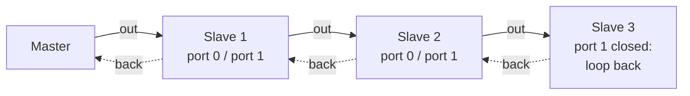
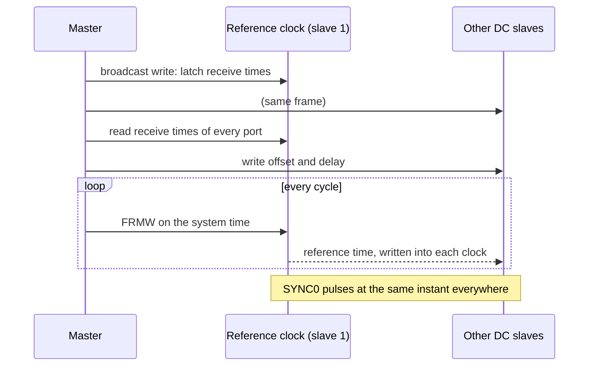

# Topology, redundancy and clocks

> How does EtherCAT handle frame
> routing, broken cables, and clock synchronization?
>
> You will learn:
>
> - in what order a frame passes through the slave ports
> - how slaves connect in a line or a tree
> - how a ring maintains communication after a cable break
> - how distributed clocks (DC) keep a common time

## Ports: how a frame travels

A slave controller has up to four **ports**, numbered 0 to 3. Each port is one
Ethernet connection. Port 0 faces the master. The other ports lead to the next
slaves.

Ethernet is **full duplex**. Each cable carries data in both directions at once on
separate wires. The EtherCAT frame returns to the master through the same cables.

A frame entering port 0 passes through the **EtherCAT processing unit**, which reads
and writes datagrams. The controller then forwards the frame to the next port. A
port without a link is **closed**. The controller skips it and forwards the frame
internally to the next port. With four ports, the hardware uses this order.

**0 -> processing unit -> 3 -> 1 -> 2 -> 0**

A frame that comes back to a slave on port 1, 2 or 3 is only forwarded. It is not
processed a second time.

## Line and tree

In a **line**, port 0 faces the master and port 1 connects to the next slave. On the
last slave, port 1 is closed. The frame returns through the line. Each slave
processes it on the outward path and only forwards it on the return path.

A **tree** uses slaves with three or four ports, called **junctions**. Each extra
port starts a branch. The frame passes through each branch in port order before
entering the next branch. The master reads each port's link status at startup to
determine the network layout and slave order.

## Cable redundancy: a ring

In a line, a broken cable disconnects every slave beyond the break. For **cable
redundancy**, the master uses two network ports. A cable connects port 1 of the last
slave to the master's second port to form a **ring**.

Each cycle, the master sends the frame on both of its ports:

- With an intact ring, all slaves process the frame from the first port. It arrives
  at the second port. The slaves forward the other copy to the first port without
  processing it.
- After a cable break, the slave port on each side of the break closes. Each master
  port now serves one line. Each frame passes through the slaves on its line and
  returns to the port that sent it.

The two frames together reach all slaves. The master combines the results and can
report the location of the break while the machine runs.

## Distributed clocks: why time matters

Two motor axes may need to move together, or sensors may need to sample inputs at
the same time. The frame reaches each slave at a different time. On a long line, it
can reach the last slave many microseconds after the first.

Each slave controller that supports **DC** has its own clock that counts
nanoseconds, 32 or 64 bits wide. The clocks share a **system time** measured from
January 1, 2000. One slave supplies the **reference clock**, usually the first DC
slave after the master. The other clocks follow it.

Clock setup and synchronization account for three timing differences.

1. **Propagation delay.** The master broadcasts a register write. Each controller
   records the local time when the frame passes each port on its outward and return
   paths. The master uses these times to calculate the delay from the reference
   clock to each slave.
2. **Offset.** The clocks start at different times. The master calculates each
   clock's difference from the reference and writes the offset to the slave.
3. **Drift.** Quartz crystals run at slightly different frequencies. Each cycle, the
   master sends an auto-increment read multiple write (ARMW) or configured address
   read multiple write (FRMW) datagram. The reference clock writes its time into the
   datagram. Each following slave receives that value and adjusts its clock rate.

Once synchronized, each slave controller can generate **SYNC0** pulses. The pulses
start at a configured system time and repeat at a configured interval. An
application can act on each pulse. On typical hardware, the timing difference
between slaves is much less than a microsecond.

The master measures delays and sets offsets at startup. It sends the reference time
every cycle.

The master's computer has its own clock. The master can write its time to the
reference clock or adjust its cycle to follow the reference clock.

## Summary

| Question | Answer |
|---|---|
| Which port faces the master? | Port 0. |
| What does a closed port do? | It loops the frame back to the next port in the order. |
| In which order are four ports visited? | 0, processing unit, 3, 1, 2, back to 0. |
| How does a ring survive a broken cable? | The master sends the frame on both ends, and each half of the ring answers one copy. |
| What do distributed clocks remove? | Propagation delay, offset and drift. |
| What makes slaves act at the same instant? | SYNC0 pulses at the same system time. |

## In KickCAT

KickCAT supports cable redundancy. Its experimental master DC support adjusts the
master's cycle to follow the reference clock. See [Chapter 4](transport.md) for
redundancy and [Chapter 7](distributed-clocks.md) for clock setup. The emulator
models ports, network layouts, broken cables, and DC. See [Chapter
8](simulation.md).

## Where to go next

- How frames and redundancy are handled in the master:
  [Chapter 4](transport.md).
- How the master sets up DC and follows the reference clock:
  [Chapter 7](distributed-clocks.md).
- How the emulator wires a network of software slaves:
  [Chapter 8](simulation.md).
