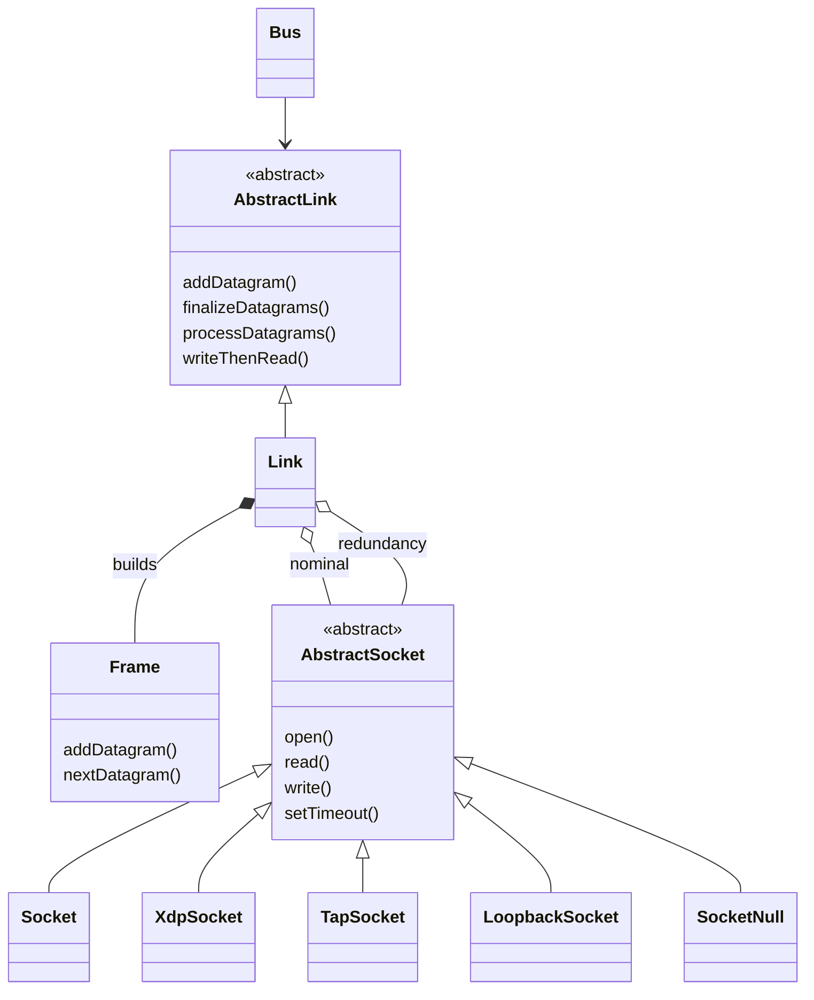
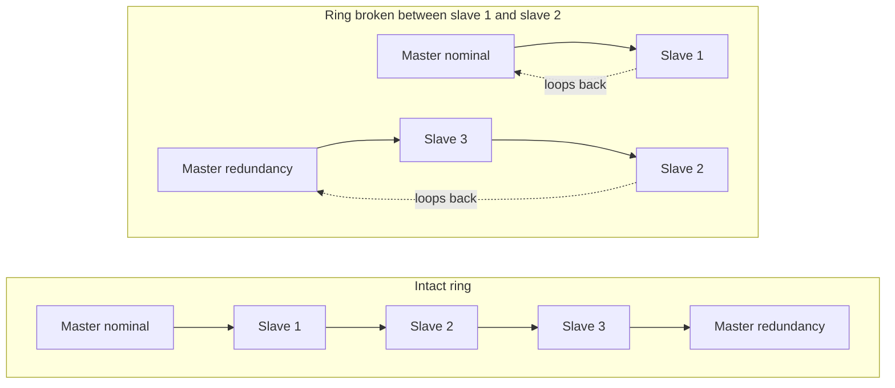

# Transport: links, frames and sockets

> How does a datagram leave the master and come back, and how does the master
> keep working when a cable breaks?
>
> You will learn:
>
> - the three layers between `Bus` and the network card
> - the life of a datagram, from `addDatagram()` to its callback
> - how lost, late and wrong answers are reported
> - how cable redundancy merges two copies of the same frame
> - how to pick a socket: a network card, AF_XDP, shared memory or in-process

## The problem: many small requests, one wire, no waiting

[Chapter 0.2](frames-and-datagrams.md) showed that a frame carries several
datagrams, and that each datagram comes back with its data and a working
counter. A master cycle produces many small requests: a logical read, a logical
write, a mailbox check, an error counter refresh. Each one has its own meaning
and its own way to fail.

The transport has three jobs:

1. Pack the requests into as few frames as possible.
2. Send the frames, read them back, and give each answer to the code that asked
   for it, even when frames come back in another order or not at all.
3. Hide the kind of network: a real card, a fast kernel bypass, a simulator in
   another process, or a simulator in the same process.

One could give each request its own frame and wait for it. That is simple, but
each round trip costs tens of microseconds, and a cycle would spend most of its
time waiting. KickCAT queues the requests, sends them together, and dispatches
the answers through callbacks. Blocking calls are built on top of this, never
the other way round (see [Chapter 1](principles.md)).

## Three layers



The diagram shows the stack of layers: `Bus` speaks to a link, the link builds
frames and owns two sockets, and each socket hides one kind of network.

- **`AbstractLink`** is the interface `Bus` uses. It deals in datagrams and
  callbacks. `Link` is its implementation. Unit tests replace it with a mock to
  test `Bus` alone.
- **`Frame`** is one Ethernet frame with an EtherCAT header. It knows how to
  append a datagram, how much space is left, and how to walk the datagrams of
  an answer. It does no input or output.
- **`AbstractSocket`** sends and receives raw frames. It knows nothing about
  datagrams. This is one of the hardware boundaries of KickCAT: anything that can
  carry an Ethernet frame can carry the bus.

## The life of a datagram

```mermaid
sequenceDiagram
    participant Bus
    participant Link
    participant Frame
    participant Socket
    Bus->>Link: addDatagram(cmd, address, data, process, error)
    Link->>Frame: append datagram with index N
    Note over Link,Frame: frame full: send it now
    Bus->>Link: finalizeDatagrams()
    Link->>Socket: write last frame
    Bus->>Link: processDatagrams()
    loop once per frame sent
        Socket-->>Link: read frame (until timeout)
        Link->>Bus: process(header, data, wkc) for index N
    end
    Link->>Bus: error(state) for each datagram not OK
```

The sequence shows that sending and reading are separate steps, and that each
datagram finds its callback through its index.

**Queue.** `addDatagram()` takes a command, an address, an optional payload and
two callbacks:

- The **process callback** receives the answer: the header, the data and the
  working counter. It returns a state: `OK`, or an error such as `INVALID_WKC`.
  It must not throw.
- The **error callback** is called after the whole exchange if the datagram did
  not end `OK`. It receives the state and may throw.

The link writes the datagram in the current frame and gives it an index, a
number from 0 to 255 that the slaves send back unchanged. If the frame has no
room left, the link sends it first and starts a new one. Up to 255 datagrams can
be in flight at once. `addDatagram()` throws beyond that.

**Send.** A frame leaves as soon as it is full. `finalizeDatagrams()` sends the
last, partly filled frame. Sending early lets the first frames travel while the
application is still queuing the next ones.

**Dispatch.** `processDatagrams()` sends what is left, then reads one answer for
each frame sent. For each datagram in an answer, it finds the callback by index
and calls the process callback. The order of the answers does not matter.

**Report.** Then every datagram of the window that did not end `OK` gets its
error callback, with one of these states:

| State | Meaning |
|---|---|
| `LOST` | No answer came back before the timeout. |
| `SEND_ERROR` | The frame could not be written on any socket. |
| `INVALID_WKC` | The answer came back with a wrong working counter. |
| `NO_HANDLER` | A mailbox answer arrived that no message was waiting for. |

If an error callback throws, the link still finishes the cycle and clears its
window, then rethrows. So one failed datagram never leaves the link in a
half-processed state.

## Late frames and timeouts

The link waits for each answer up to its **timeout** (`setTimeout()`, 2 ms by
default). A real-time loop sets it below the cycle period. Bring-up often needs
more, because a slave may answer slowly while it handles a mailbox.

A frame can arrive after its timeout, during the next cycle. Its indexes are then
outside the window of datagrams in flight. The link recognizes such a **stale**
frame, drops it, and reads again, because the frame it expects may be queued
behind it. The datagrams of the old frame were already reported `LOST`, so they
are not dispatched twice.

## Synchronous use: writeThenRead

`writeThenRead()` sends one frame and waits for it. There are no callbacks and no
merge. The bus uses it where each answer must stay attached to its own copy,
such as when it gives station addresses with auto-increment addressing during
`init()`. Tools can use it for a quick register access. `readRegister()` and
`writeRegister()` wrap the common case of one register of one slave.

## Cable redundancy

EtherCAT can close the line into a ring: the last slave is wired back to a
second network card of the master (see [Chapter 0.7](topology-and-clocks.md)). A
`Link` always has two sockets, **nominal** and **redundancy**. Without
redundancy, the second one is a `SocketNull`, which accepts every write and never
receives anything.

With redundancy, the link sends every frame on both cards. What comes back
depends on the state of the ring:

- **Intact ring.** The copy sent on the nominal card crosses every slave in the
  processing direction and arrives on the redundancy card with the full working
  counter. The other copy travels the ring backwards. Slaves forward it without
  processing it, so it comes back with a working counter of zero.
- **Broken ring.** Each copy goes out, reaches the break, turns back at the last
  slave before it, and returns on the card it left from. Each copy has been
  processed by one segment of the bus only, so each carries part of the answer.



The flowchart shows that a broken ring becomes two lines, each served from one
end.

The link reads both cards and pairs the two copies of each datagram by index.
It adds their working counters, so a datagram that reached every slave on
either side has the full count. Then it rebuilds the data:

- For a **read**, the master sends zeros, so each slave's answer sits on top of
  zeros. The link combines the two copies with a bitwise OR.
- For a **logical read-write** (LRW), inputs and outputs share addresses, so an
  OR would mix them. The bus gives the link a description of each mapped frame
  (`LogicalFrameDescription`, set with `setLogicalMapping()`): for each slave,
  in bus order, its expected working counter and the place of its inputs. The
  link uses the working counter of each copy to find where the ring is broken,
  then takes each slave's inputs from the copy that crossed it.
- For a **write**, both copies echo the same payload, and the link keeps one.

The application sees one answer with the full working counter. It does not have
to know that the ring is broken. `checkRedundancyNeeded()` sends a probe at
start-up and calls the callback given to the `Link` constructor if the ring is
already open. The error counters of the slaves, and their port status, tell where
the break is (see [Chapter 3](master.md)).

## Events from the slaves

Each datagram that comes back also carries an event field: each slave sets bits
in it for the events enabled in its event mask register. `Bus::enableIRQ()`
enables one event, such as a change of the data link status, and attaches a
callback to it. The link collects the event bits of every answer, and calls the
callback once on each rising edge: when the bit goes from clear to set. The
callback runs inside `processDatagrams()`, in the application's thread, like every
other callback.

## Choosing a socket

The helper `createSockets()` turns two interface names into two sockets, so an
example can take its interfaces from the command line. The name selects the
kind:

| Name | Socket | Use |
|---|---|---|
| `eth0` | `Socket` | A network card, through the platform's raw socket. |
| `xdp:eth0` | `XdpSocket` | A network card through AF_XDP on Linux, which bypasses most of the kernel network stack. Needs a build with AF_XDP enabled. |
| `tap:server`, `tap:client` | `TapSocket` | A shared memory channel to another process on the same host, such as the network simulator. An optional `:name` suffix gives independent channels. |
| `?` | (asks) | Lists the interfaces and asks the user to choose. |
| empty | `SocketNull` | No interface: the usual choice for the redundancy side. |

`Socket` has one implementation per platform: Linux, Windows (through Npcap),
PikeOS and NuttX. The build picks the one for the target.

`LoopbackSocket` is not reached by name. It connects the master to emulated
slaves in the same process: each frame written is passed through the emulated
network, the slaves are advanced once, and the answer is ready for the next
read. It is how `simulated_bus` runs a whole bus in one thread (see
[Chapter 8](simulation.md)).

A new transport only has to implement `AbstractSocket`: open, close, set a
timeout, read one frame, write one frame. Nothing above the socket changes.

## Summary

| Question | Answer |
|---|---|
| What does `Bus` talk to? | An `AbstractLink`, in datagrams and callbacks. |
| When does a frame leave? | When it is full, or on `finalizeDatagrams()` or `processDatagrams()`. |
| How is an answer matched to its request? | By the datagram index, from 0 to 255. |
| What happens to a lost datagram? | Its error callback gets `LOST` after the timeout. |
| What happens to a late frame? | It is recognized as stale and dropped. |
| How does redundancy work? | Every frame goes out on both cards, and the two copies are merged. |
| How do I add a transport? | Implement `AbstractSocket`. |

## In the code

- `lib/master/include/kickcat/AbstractLink.h`: the link interface and
  `LogicalFrameDescription`.
- `lib/master/include/kickcat/Link.h` and `lib/master/src/Link.cc`: queuing,
  dispatch, stale frames and the redundancy merge.
- `lib/include/kickcat/Frame.h`: building and walking a frame.
- `lib/include/kickcat/AbstractSocket.h`: the socket interface.
- `lib/include/kickcat/OS/Linux/Socket.h`, `lib/include/kickcat/OS/Linux/XdpSocket.h`,
  `lib/include/kickcat/TapSocket.h`, `lib/include/kickcat/LoopbackSocket.h`,
  `lib/include/kickcat/SocketNull.h`: the socket implementations.
- `lib/master/include/kickcat/helpers.h`: `createSockets()` and interface
  selection.
- Read `examples/master/freedom-k64f/freedom_k64f_static_map_example.cc` for a
  link with redundancy and an event callback.

## Where to go next

- What the bus puts in the datagrams: [Chapter 3](master.md).
- The emulated network behind `LoopbackSocket` and `TapSocket`:
  [Chapter 8](simulation.md).
- How to tune Linux and the network card for low latency:
  [the performance guide](../PERFORMANCE.md).
- Ports, rings and loop-back on the protocol side:
  [Chapter 0.7](topology-and-clocks.md).
