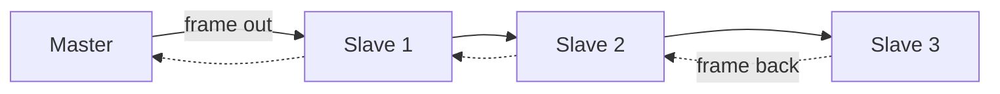

# What is EtherCAT?

> How does Ethernet for Control Automation Technology (EtherCAT) exchange machine data?
>
> You will learn:
>
> - what a fieldbus does
> - what a master, a slave, and a cycle are
> - how one frame serves many devices
> - which board the examples use

## The problem: one controller, many devices, every millisecond

In a robot arm or packaging line, a central computer reads devices such as position
encoders, temperature sensors, and push buttons. It calculates commands and sends
them to actuators such as motor drives, valves, and lights. It repeats these steps
at a fixed rate.

The controller has two timing requirements.

- **Speed.** A motor drive may need a new position at least once per millisecond.
- **Determinism.** Data must arrive at a predictable point in each cycle. A high
  average speed alone does not guarantee this.

A **fieldbus** connects the controller to the devices. EtherCAT is a fieldbus that
uses standard Ethernet cables and frames.

## Master, slaves and the cycle

- The **master** is the central computer. Only the master starts a frame exchange.
  It is usually a personal computer or an embedded computer with a standard Ethernet
  port.
- A **slave** is a device that responds to the master's frames.

The master repeats the same exchange at a fixed rate. One repetition is a **cycle**,
and its duration is the **cycle time**. Machines often run cycle times between 100
microseconds and a few milliseconds. In each cycle, the master sends its outputs
(commands for the actuators) and collects its inputs (measurements from the
sensors).

Inputs and outputs are named from the master's point of view. An output goes from
the master to a slave. An input goes from a slave to the master.

## How one frame serves every device

Sending a separate request to each of 50 devices would take 50 frames and 50 replies
per cycle. Each adds delay. A switch could add a delay that varies between frames.

EtherCAT slaves usually connect in a line. The master sends one frame through the
slaves in order. As the frame passes, a chip in each slave reads the data addressed
to it and writes its data into the frame. The chip forwards the frame without
storing it first. Each slave adds a small, fixed delay of much less than a
microsecond. This is called **processing on the fly**.

The last slave returns the frame through the same cables. The master receives the
inputs from all the slaves.

- **Frame size.** One frame can carry up to 1500 bytes of data for many devices.
  This reduces the time spent on headers and gaps between frames.
- **Timing.** Each slave adds the same delay each cycle. No switch queues the
  frames, so the round-trip time is almost constant.
- **Hardware.** The master uses a standard Ethernet port. Only the slaves need
  special hardware.

Each slave uses an **EtherCAT Slave Controller (ESC)** to process frames. See
[Chapter 0.3](inside-a-slave.md).

## The example this guide follows

The **Freedom K64F board** has an NXP K64F microcontroller connected to a LAN9252
ESC. The examples use these parts of the board.

- A light uses **3 output bytes**, one each for red, green, and blue.
- An accelerometer and a magnetometer provide **12 input bytes**. Each sensor
  returns three signed 16-bit values for the x, y, and z axes.
- A mailbox carries messages outside the cyclic exchange. See [Chapter 0.6](mailboxes.md).

Each cycle, the master writes the 3 color bytes and reads the 12 sensor bytes. The
next chapters explain the frame layout, where the board stores the data, and when it
accepts outputs.

You can run the example with an emulated board. See [Chapter 2](../architecture.md).

## Summary

| Question | Answer |
|---|---|
| What does a fieldbus carry? | Inputs and outputs between a central computer and many devices, at a fixed rate. |
| Who sends frames? | Only the master. Slaves answer. |
| What is a cycle? | One exchange of all outputs and inputs, repeated at a fixed cycle time. |
| How does one frame serve many slaves? | Each slave reads and writes its part while the frame passes through it. |
| Where is the special hardware? | In each slave, the ESC. The master uses standard Ethernet. |

## In KickCAT

The KickCAT master runs on a host operating system. The slave stack runs on a
microcontroller connected to an ESC. See [Chapter 1](principles.md).

## Where to go next

- What is inside the frame, and how a slave finds its part: Chapter 0.2,
  [Frames and datagrams](frames-and-datagrams.md).
- What the ESC does with the frame: Chapter 0.3, [Inside a slave](inside-a-slave.md).
