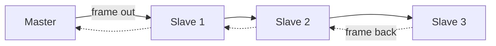

# What is EtherCAT?

> What problem does EtherCAT solve, and why does it solve it so fast?
>
> You will learn:
>
> - what a fieldbus does in a machine
> - what a master, a slave and a cycle are
> - how one frame serves every device on the network
> - the example board that the rest of Part 0 follows

## The problem: one controller, many devices, every millisecond

A machine such as a robot arm or a packaging line has one central computer and many
small devices around it. Some devices measure: a position encoder, a temperature
sensor, a push button. Others act: a motor drive, a valve, a light. The central
computer reads every sensor, computes what to do, and writes a command to every
actuator. Then it does the same again, and again, at a fixed rate.

Two things matter in that loop:

- **Speed.** A motor drive may need a new position every millisecond, or faster.
- **Determinism.** The data must arrive at the same moment in every loop. A command
  that is late by a random amount is almost as bad as a wrong command. Determinism
  means that the timing is predictable, not only that it is fast on average.

A **fieldbus** is the network that carries this data between the central computer
and the devices. EtherCAT (Ethernet for Control Automation Technology) is one
fieldbus. It uses standard Ethernet cables and Ethernet frames, but it uses them in
an unusual way.

## Master, slaves and the cycle

EtherCAT gives the two sides fixed roles.

- The **master** is the central computer. It is the only device that sends frames.
  It is usually an ordinary PC or an embedded computer with a standard Ethernet
  port.
- A **slave** is a device on the network. A slave never starts a transfer. It only
  answers the frames that the master sends.

The master repeats the same exchange at a fixed rate. One repetition is a **cycle**,
and its duration is the **cycle time**. Machines often run cycle times between 100
microseconds and a few milliseconds. In each cycle, the master sends its outputs
(commands for the actuators) and collects its inputs (measurements from the
sensors).

The words "input" and "output" are always seen from the master. An output goes from
the master to a slave. An input goes from a slave to the master.

## How one frame serves every device

A naive design would send one Ethernet frame to each device and wait for each
answer. With fifty devices, that is fifty frames and fifty replies per cycle, and
each one adds its own delay. A switch between the devices would add more delay, and
that delay would vary.

EtherCAT does something else. The slaves are connected one after the other, usually
in a line. The master sends **one frame**, and that frame passes through every
slave in turn. Each slave has a dedicated chip that reads the data meant for it and
writes its own data into the frame **while the frame passes**. The chip does not
store the frame and forward it later. It delays the frame by a small, fixed amount,
much less than a microsecond per slave. This is called **processing on the fly**.

The last slave in the line has nothing connected after it. It sends the frame back,
and the frame returns to the master through the same cables. When it arrives, it
holds the inputs of every slave.

The diagram below shows one frame going out through three slaves and coming back.

This design has three consequences:

- **It is fast.** One frame of up to 1500 bytes of data serves many devices. The
  network spends its time carrying data, not headers and gaps between frames.
- **It is deterministic.** Each slave adds the same delay in every cycle, and there
  is no switch that queues frames. The time a frame takes to go around is almost
  constant.
- **It is cheap on the master side.** The master needs no special hardware. A
  standard Ethernet port sends and receives the frame. The special hardware is in the
  slaves.

The chip in each slave is the **EtherCAT Slave Controller (ESC)**. [Chapter
0.3](inside-a-slave.md) looks inside it.

## The example this guide follows

Part 0 follows one small slave from start to end: the **Freedom K64F board**. It is
a development board with an NXP K64F microcontroller, connected to a LAN9252 ESC.
The board has:

- an RGB light, with one byte each for red, green and blue: **3 bytes of outputs**
- an accelerometer and a magnetometer, each giving x, y and z as 16-bit signed
  integers: **12 bytes of inputs**
- a mailbox, a channel for messages that are not part of the cycle, which [Chapter
  0.6](mailboxes.md) describes

In every cycle, the master wants to do two things with this board: write the 3
colour bytes, and read the 12 sensor bytes. The next chapters show how EtherCAT
places those 15 bytes in a frame, where the board stores them, and what must
happen before the board accepts them.

You do not need the board to follow the guide. KickCAT can emulate it in software,
and [Chapter 2](../architecture.md) runs that emulation.

## Summary

| Question | Answer |
|---|---|
| What does a fieldbus carry? | Inputs and outputs between a central computer and many devices, at a fixed rate. |
| Who sends frames? | Only the master. Slaves answer. |
| What is a cycle? | One exchange of all outputs and inputs, repeated at a fixed cycle time. |
| How does one frame serve many slaves? | Each slave reads and writes its part while the frame passes through it. |
| Where is the special hardware? | In each slave, the ESC. The master uses standard Ethernet. |

## In KickCAT

KickCAT provides both sides: a master that runs on a host operating system, and a
slave stack that runs on a microcontroller next to an ESC. [Chapter
1](principles.md) describes both.

## Where to go next

- What is inside the frame, and how a slave finds its part: Chapter 0.2,
  [Frames and datagrams](frames-and-datagrams.md).
- What the ESC does with the frame: Chapter 0.3, [Inside a slave](inside-a-slave.md).
