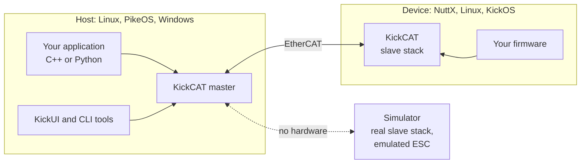
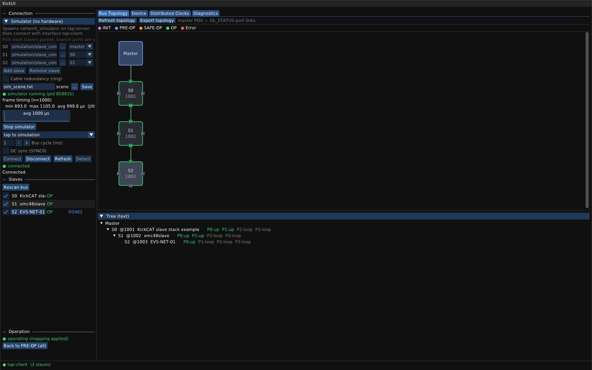

<p align="center">
  
  
</p>

<p align="center">
  <strong>A lightweight, efficient EtherCAT master/slave stack for embedded and real-time systems</strong>
</p>

KickCAT is an EtherCAT stack that you can embed in your own software. One codebase provides
both the **master** and the **slave**, plus an **emulator** for developing and testing a bus
without hardware.



## Choose your path

<div class="grid cards" markdown>

-   :lucide-cpu: **Drive slaves from your application**

    ---

    Bring a bus to OP and exchange process data from C++ or Python.

    [Installation](get-started/installation.md) · [Your first bus](get-started/first-bus.md) ·
    [The master](developer-guide/architecture/master.md)

-   :lucide-circuit-board: **Build a slave device**

    ---

    Run the slave stack on your board, with its EEPROM image and object dictionary.

    [Hardware](user-guide/hardware.md) · [The slave stack](developer-guide/architecture/slave.md) ·
    [From XML to bytes](developer-guide/architecture/device-descriptions.md)

-   :lucide-flask-conical: **Test without hardware**

    ---

    Emulate slaves and cables within your process or in a separate simulator.

    [Simulation](user-guide/simulation.md) ·
    [Simulation internals](developer-guide/architecture/emulation.md)

-   :lucide-monitor: **Inspect and operate a bus**

    ---

    { loading=lazy }

    KickUI, the EEPROM editor and the CLI tools: [Tools](user-guide/tools.md)

-   :lucide-book-open: **New to EtherCAT?**

    ---

    These pages explain KickCAT. Keep the ETG poster at hand for the protocol.

    [EtherCAT primer](get-started/ethercat-primer.md) · [Poster][etg-poster] ·
    [Glossary](reference/glossary.md)

-   :lucide-git-pull-request: **Contribute**

    ---

    See how the code is organized, then test and document your changes.

    [Principles](developer-guide/architecture/principles.md) ·
    [A map of the code](developer-guide/architecture/code-map.md) ·
    [Contributing](developer-guide/contributing/index.md)

</div>

## Quick start

Build, then run a master against an emulated slave in one process. No hardware is needed.

```bash
source .venv/bin/activate   # provides Conan, see Building
./scripts/setup_build.sh build
make -C build -j
./build/examples/master/simulated_bus/simulated_bus \
    -f examples/slave/lan9252/freedom-k64f/nuttx/freedom-k64f.xml -t Board
```

```text
Device: Board  (product 0x00defede, revision 0x5a01)
Detected 1 slave(s)
SAFE_OP reached
OPERATIONAL reached
Process data: 12 input byte(s), 3 output byte(s)
```

To set up `.venv`, see [Installation](get-started/installation.md). For a step-by-step walkthrough of
what this program does, see [Your first bus](get-started/first-bus.md).

## At a glance

| | Master | Slave |
|---|---|---|
| Runs on | Linux (RT-PREEMPT recommended), PikeOS 5.1, Windows (tools and tests) | NuttX, Linux, KickOS (experimental) |
| State machine and process data | Supported | Supported |
| CoE | SDO, SDO Information, emergencies | Object dictionary, SDO, SDO Information |
| FoE | Experimental, including firmware update in BOOT | Experimental |
| Distributed clocks | Experimental | Planned |
| Hardware | Any NIC; optional AF_XDP on Linux; cable redundancy | LAN9252 (SPI) and XMC4800 ESCs |
| Also | Mailbox gateway (ETG.8200), Python bindings | CTT-validated on the WDC_FOOT board |

The full list is in [Features](user-guide/features.md).

## Project

[Source](https://github.com/leducp/KickCAT) ·
[Issues](https://github.com/leducp/KickCAT/issues) ·
[Discussions](https://github.com/leducp/KickCAT/discussions) ·
[Releases](https://github.com/leducp/KickCAT/releases) ·
[PyPI](https://pypi.org/project/kickcat/) ·
[Conan](https://github.com/conan-io/conan-center-index/tree/master/recipes/kickcat) ·
License: [CeCILL-C](https://github.com/leducp/KickCAT/blob/master/LICENSE)
